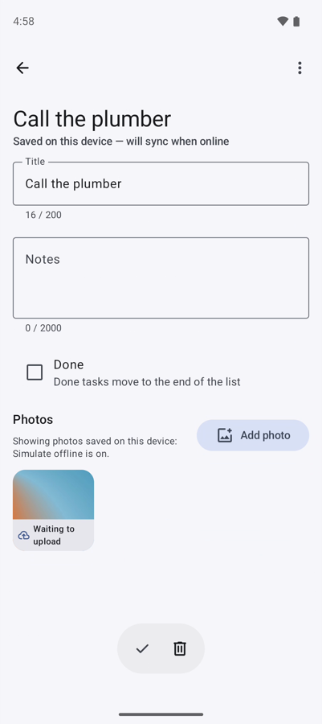
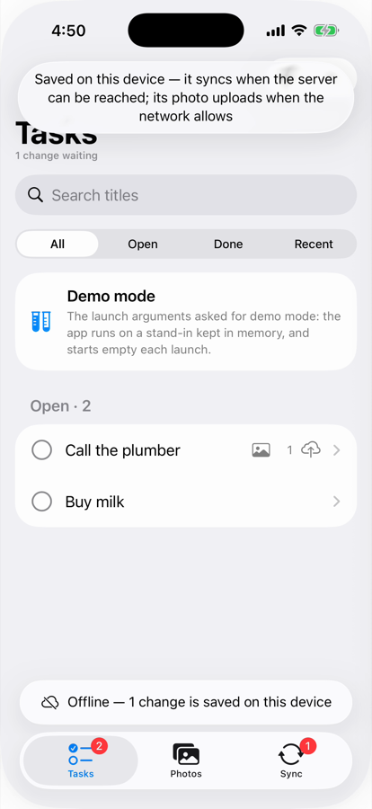

[](https://github.com/nesfeder/supabase-offline-kt/actions/workflows/ci.yml)

# supabase-offline-kt

A plugin for [supabase-kt](https://github.com/supabase-community/supabase-kt) that makes PostgREST
and Storage offline-first in Kotlin Multiplatform apps on Android and iOS. Reads are answered from
a cache on the device when the server cannot be reached, writes made offline wait in a queue on the
device and are sent, in the order they were made, when the network comes back, and Storage
downloads are kept on disk. You keep supabase-kt's own calls, filters and request DSL.

## See it

The same tasks app on both platforms, in one minute each: a task added online, the network switched
off, a task with a photo added offline and shown at once with its waiting mark, the queue listed on
the Sync tab, and everything sent when the network returns.

<table>
  <tr>
    <th>Android</th>
    <th>iOS</th>
  </tr>
  <tr>
    <td></td>
    <td></td>
  </tr>
</table>

### Android

<!-- The recording: open this file in GitHub's editor and drop android.mp4 on the line below. -->
_Recording coming._

### iOS

<!-- The recording: open this file in GitHub's editor and drop ios.mp4 on the line below. -->
_Recording coming._

## Quick start

### Add the dependency

The library brings supabase-kt's Postgrest, Storage and Auth with it, at the supabase-kt minor it
is built and tested against: 3.6. supabase-kt sends its requests through Ktor, so give each target
a Ktor engine of the version supabase-kt uses.

```kotlin
// build.gradle.kts of your shared module
kotlin {
    sourceSets {
        commonMain.dependencies {
            implementation("io.github.nesfeder.supabase-offline:supabase-offline-kt:0.1.0")
        }
        androidMain.dependencies { implementation("io.ktor:ktor-client-okhttp:3.4.3") }
        iosMain.dependencies { implementation("io.ktor:ktor-client-darwin:3.4.3") }
        commonTest.dependencies {
            implementation("io.github.nesfeder.supabase-offline:supabase-offline-kt-testing:0.1.0")
        }
    }
}
```

In an Android-only app, the same coordinates go in `dependencies { }`, with the OkHttp engine. Use
the testing artifact at exactly the library's version, from one version-catalog entry. Its published
metadata pins the library to its own version: an older testing artifact fails dependency
resolution, and a newer one raises the library in your test classpath to its version without a
word, so your tests would run on a library your app does not ship.

### Install the plugin

```kotlin
import io.github.jan.supabase.createSupabaseClient
import io.github.jan.supabase.postgrest.Postgrest
import io.github.jan.supabase.storage.Storage
import io.github.nesfeder.supabase.offline.Offline
import io.github.nesfeder.supabase.offline.offline

val supabase = createSupabaseClient(
    supabaseUrl = "https://your-project.supabase.co",
    supabaseKey = "your-publishable-key",
) {
    install(Postgrest)
    install(Storage) // if you use Storage
    install(Offline) // last; settings go here: install(Offline) { cacheSizeBytes = … }
}
```

`supabase.offline` is the plugin, reached as `supabase.postgrest` is; it needs the
`io.github.nesfeder.supabase.offline.offline` import.

### Read

```kotlin
import io.github.jan.supabase.postgrest.query.Order
import kotlinx.serialization.Serializable

@Serializable
data class Task(val id: String, val title: String, val done: Boolean = false)

val tasks = supabase.offline.from("tasks")
    .select { order("title", Order.ASCENDING) }
    .decodeList<Task>()
```

Online, this is the server's answer, and the device keeps it. Offline, the same request is answered
from what the device kept. A request never answered online has nothing kept: the first time,
offline, it fails as supabase-kt would. Each request is kept on its own, so read a single task from
the list you already read rather than with a request of its own. `selectAsFlow { … }` reads the
same rows as a `Flow` that follows every change.

### Write

```kotlin
import io.github.nesfeder.supabase.offline.MutationOutcome
import kotlin.uuid.Uuid

val task = Task(id = Uuid.random().toString(), title = "Buy milk")

when (val outcome = supabase.offline.from("tasks").insert(task)) {
    is MutationOutcome.Applied -> outcome.result // the server has it
    is MutationOutcome.Queued -> outcome.pendingMutation // saved on the device, sent later
}
```

Make the row's id on the device. A write that was sent but whose answer never arrived stays queued
and is sent again; with its id it is recognized as the row already there instead of being inserted
twice. Reads show a queued write at once, and the library sends the queue by itself when the
network comes back.

### Swift

An iOS app in Swift uses the Swift package: the same library as a native Swift API, beside
supabase-swift, which keeps Auth. In Xcode, add `https://github.com/nesfeder/supabase-offline-swift`
with **File > Add Package Dependencies…** (in a manifest, `.upToNextMinor(from: "0.1.0")`), the
`SupabaseOffline` library to your app's target and `SupabaseOfflineTesting` to its tests. It needs
iOS 16 and Xcode 26 or later, and runs on arm64 simulators only: a simulator build that includes
x86_64 fails to link, so build for a specific simulator, or with `ARCHS=arm64`.

Create one client; its access-token closure hands it the signed-in user's token from
supabase-swift's Auth:

<!-- swift-listing: GettingStartedListings.swift:client -->
```swift
let offline = SupabaseOfflineClient(
    supabaseURL: URL(string: "https://your-project.supabase.co")!,
    supabaseKey: "your-publishable-key",
    config: .init(accessToken: { try? await supabase.auth.session.accessToken })
)
```

Read, and write with an id made on the device:

<!-- swift-listing: GettingStartedListings.swift:row -->
```swift
nonisolated struct Todo: Codable, Sendable, Identifiable {
    var id: UUID
    var title: String
    var done: Bool
}
```

<!-- swift-listing: GettingStartedListings.swift:first-read -->
```swift
let todos: [Todo] = try await offline.from("todos")
    .select()
    .eq("done", value: false)
    .order("title")
    .execute()
    .value
```

<!-- swift-listing: GettingStartedListings.swift:queued-write -->
```swift
let todo = Todo(id: UUID(), title: "Buy milk", done: false)
let outcome = try await offline.from("todos").insert(todo).execute()
// .applied: the server has the row. .queued(let pending): the row waits on the device,
// reads show it already, and the client sends it when the network is back.
```

When the user signs out, turn the client's network off, sign out (so the closure returns `nil`),
clear local data even if the sign-out throws, and turn the network back on once the next user is
signed in: the [guide for Swift apps](./docs/getting-started/swift.md) shows the order and why, and
what else the package does.

## Documentation

The [documentation site](https://nesfeder.github.io/supabase-offline-kt/), also under
[`docs/`](./docs/index.md): [the architecture](./docs/project/architecture.md), with the whole
public API and what the library promises;
[compatibility and versioning](./docs/project/compatibility.md); and
[the sample apps](./docs/samples/index.md).

## Contributing

See [CONTRIBUTING.md](./CONTRIBUTING.md).

## License

MIT; see [LICENSE](./LICENSE).
