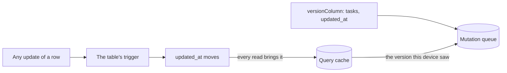
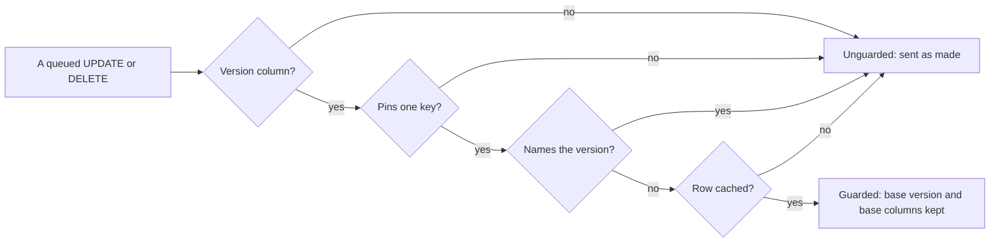
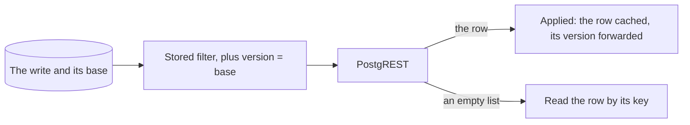
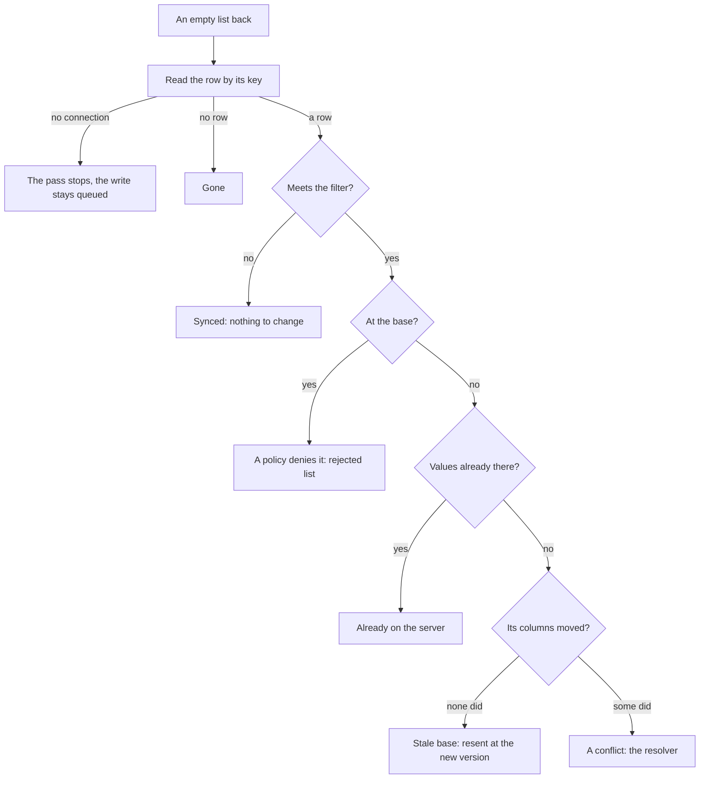
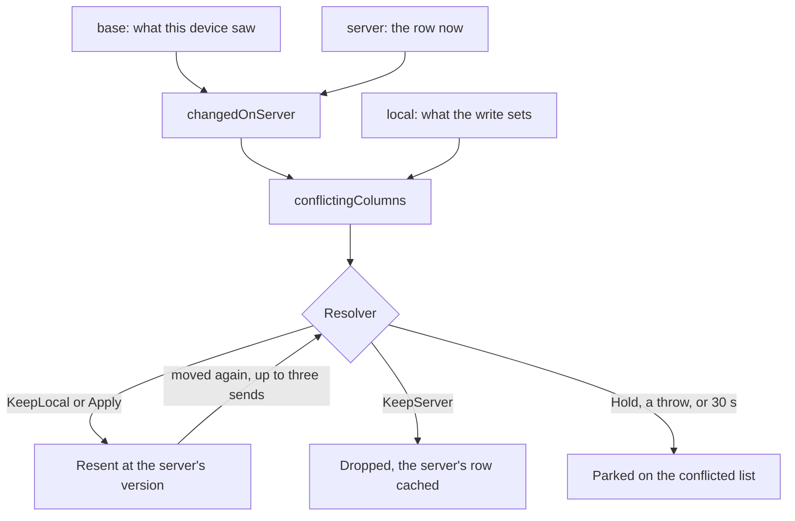
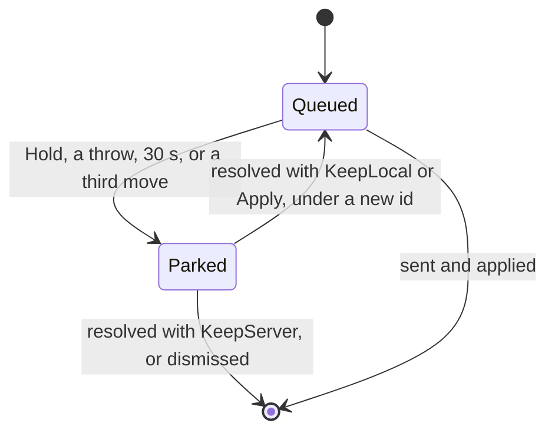
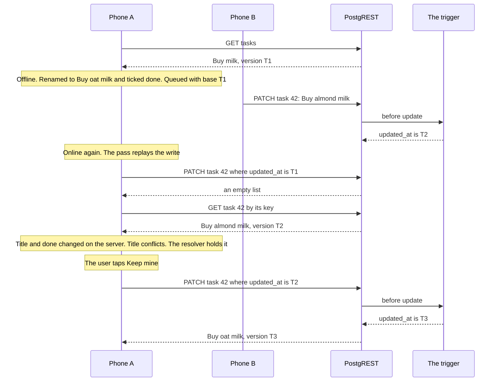
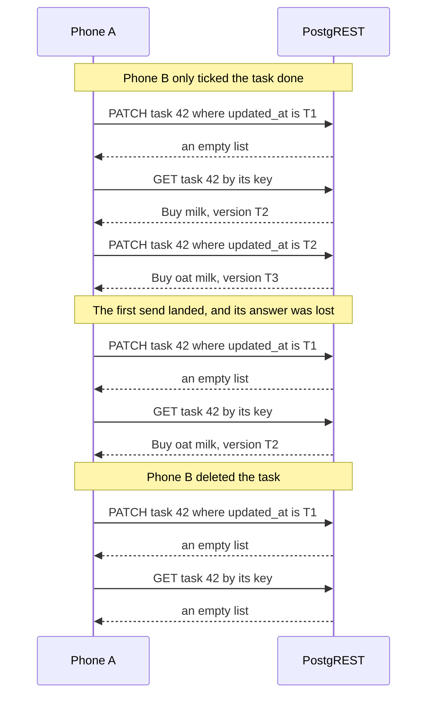

# Conflicts and merging

A write made offline is sent later, and by then another device may have changed the same row.
Name a table's version column, and the library sends a queued update or delete of one of its rows
only while the server's row still has the version this device saw. When it does not, the library
reads the row again, sees which columns moved on each side, and lets your resolver settle the
conflict, or holds the write for the user. A table without a version column keeps the rule it had:
the last write wins.

This page follows one write through each step, from the moment it is queued to the moment the
server takes it, then plays one conflict through from two phones.

## Opting in

The configuration names the column, the server's trigger moves it, and every read carries it into
the cache, where the queue finds it:



From the samples: [SampleSupabaseClient.kt](https://github.com/nesfeder/supabase-offline-kt/blob/main/samples/android/src/main/kotlin/io/github/nesfeder/offlinetasks/platform/SampleSupabaseClient.kt) · [ClientSettings.swift](https://github.com/nesfeder/supabase-offline-kt/blob/main/samples/ios/OfflineTasks/App/ClientSettings.swift)

=== "Android"

    ```kotlin
    --8<-- "platform/SampleSupabaseClient.kt:version-column"
    ```

=== "iOS"

    ```swift
    --8<-- "App/ClientSettings.swift:version-column"
    ```

On the server, either kind of column works, as long as every update changes it:

=== "A timestamp"

    ```sql
    create extension if not exists moddatetime with schema extensions;
    alter table public.tasks
      add column if not exists updated_at timestamptz not null default now();
    create or replace trigger tasks_set_updated_at
      before update on public.tasks
      for each row execute function extensions.moddatetime(updated_at);
    ```

=== "An integer"

    ```sql
    alter table public.tasks
      add column if not exists version bigint not null default 1;
    create or replace function public.tasks_bump_version()
    returns trigger
    language plpgsql
    set search_path = ''
    as $$
    begin
      new.version := old.version + 1;
      return new;
    end;
    $$;
    create or replace trigger tasks_bump_version
      before update on public.tasks
      for each row execute function public.tasks_bump_version();
    ```

The column is the server's. The library never writes it and compares it for equality only, as
text: it sends back exactly the string the server sent, whatever its offset or precision. A
trigger is what makes it a version, since a value the app sends in an update is overwritten.
Without one, a row that moved cannot be told from one that did not, and every replay goes through
as before. `versionColumn(table, column)` and the `versionColumns` map are keyed as `primaryKeys`
is (`tasks`, or `schema.table` in another schema); a blank column, or one of the table's key
columns, fails `createSupabaseClient` with `IllegalArgumentException`. `moddatetime` stamps the
transaction's start time, so a row updated twice in one server-side transaction keeps one version: use the integer there
([Project setup](../getting-started/setup.md#a-server-side-version-column)). The samples' schema
already has the trigger on both tables ([Set up Supabase](../samples/supabase-setup.md#what-it-creates)).

## What the queue records

When an update or a delete is queued, the queue looks for the row it targets among the cached
lists and keeps the version it finds there, with the columns the write sets:



| Kept with the write | What it holds |
| --- | --- |
| The base version | The version column's value in the newest cached copy of the row, as text. `PendingMutation.baseVersion` shows it; `null` means the write is not guarded |
| The base columns | That copy's values of the columns the write sets, and its version; for a DELETE, the version alone |

A filter pins one row when it names every key column with `eq` (`filter { eq("id", 42) }` for a
table keyed on `id`); other conditions may sit beside the key. A write that updates every done
task, one whose row no cached list holds, and one queued before the app named the column are not
guarded, and replay as they always did. So are the writes this page never reaches: an insert, an
upsert, an `OnlineOnly` write, and a write the queue cannot hold
([Writes the queue cannot hold](mutations.md#writes-the-queue-cannot-hold)).

A queued write is first tried at once, when nothing of its user waits ahead of it, and that first
send is the request you built, unchanged. The base matters when the write waits: offline, behind
another write, or when that send may not have run.

**Your own writes never conflict with each other.** When a guarded write, or a write sent at once
that asked for its rows back, returns the row, every later queued write to that row takes the
returned version and columns as its base. A write sent at once without `select()` returns no row
to forward, so the next write meets an old base; it is resent at the new version without asking
anyone ([below](#the-five-outcomes)). A Realtime event or `applyServerRecord` never moves a base:
a base is what this device's user saw, and a change made elsewhere has to show as a conflict.

## What a replay sends

A guarded write carries its base as one more filter and asks for its row back:



The update of task 42, made when the device had version `2026-10-18T13:00:27.486123+00:00`:

```http
PATCH /rest/v1/tasks?id=eq.42&updated_at=eq.2026-10-18T13:00:27.486123%2B00:00&select=id,updated_at,title,done
Prefer: return=representation

{"title":"Buy oat milk","done":true}
```

It asks back for the key, the version and the columns it sets, never `*`, so a column the user
cannot read elsewhere in the row cannot turn it into a refusal; the row it returns must still pass
the table's SELECT policy, as for any write with `select()`. The version travels percent-encoded
(`+` as `%2B`, which a URL would otherwise read as a space), and the server reads back exactly the
string it sent. Its answer is one of two, both `200`:

- **The row**, with the trigger's new version: the write applied. The row is written into every
  cached list that holds it, so a read after the replay shows it once, at the server's version, and
  its version is forwarded to the writes queued behind it.
- **An empty list**: no row matched. The server has moved the row, deleted it, hidden it, or the
  filter missed; the answer does not say which, so the library reads the row by its key, from the
  network only:

```http
GET /rest/v1/tasks?select=id,updated_at,title,done&id=eq.42&limit=1
```

A guarded DELETE asks back for the key and the version only, and its returned row is not written
into the cache, which already hides the deleted row.

## The five outcomes

What the read by key finds decides what happens to the write:



| The read finds | An UPDATE | A DELETE |
| --- | --- | --- |
| No connection, or the session changed | The pass stops and the write stays queued, as on any connectivity failure | The same |
| No row: deleted, or hidden from the user by a policy | **Gone**: a conflict with `server = null`. The default, `KeepServer`, drops the write and counts it in `conflictsKeptServerCount`; nothing is recreated | **Already gone**: synced, counted in `alreadyOnServerCount` |
| A row the rest of the write's filter no longer reaches | Synced, as the unguarded replay's empty answer was | The same |
| The row at the base version, still meeting the filter | **A policy denies it**: the write moves to the rejected list, with no `serverError` and nothing resent | The same |
| Another version, already holding every value the write sets | **Already applied**: an earlier send landed and its answer was lost. Synced, counted in `alreadyOnServerCount`, the row cached and forwarded | — |
| Another version, none of the write's columns changed since the base | **A stale base**, typically your own earlier write: resent at the new version without the resolver, and not counted as a conflict | — |
| Another version, otherwise | **Moved**: a conflict, settled as the next section says | **Moved**: always a conflict, with `local = null` and both column sets empty, so an app can hold a delete of a row someone edited. The default, `KeepLocal`, deletes it |

The policy denial is declared only when every other condition of the write's filter holds on the
row as the overlay evaluates conditions (`eq`, `neq`, `in`, `is`). One it cannot judge (`like`,
`gt`, a JSON path) at the base version reads as the filter missing, the empty answer the unguarded
replay had; on a moved row the resend carries the whole filter, so the server judges it. No row and
a row hidden by a policy look the same from the device, which is why a gone row is never
recreated by default.

## The resolver

A moved row is compared column by column, as the device saw it, as the write sets it and as the
server has it:



- **`changedOnServer`** is the columns the write sets whose server value differs from the base:
  what changed elsewhere. **`conflictingColumns`** is those of them the write sets to another value
  than the server's: where the two changes disagree. A column both sides set to the same value is
  changed but not conflicting.
- The resolver is shown a `MutationConflict`: the write's `mutationId`, `table`, `operation`,
  `rowKey` (the key values as the filter pins them, as text), `base`, `local` (`null` for a DELETE),
  `server` (`null` when gone), and the two sets. `server` holds the key, the version, the columns
  the write sets and the columns its filter names, not the whole row.
- It answers a `ConflictResolution`:

| Resolution | What happens |
| --- | --- |
| `KeepLocal` | The write is sent again, preconditioned on the server's version now: an UPDATE sets its columns over the server's, and the others keep the server's values; a DELETE deletes. On a gone row it cannot apply, so the write is parked |
| `ConflictResolution.apply(columns)` | These columns are sent instead, preconditioned the same way: for a merge the app works out. Only for an UPDATE of a row still there; otherwise the write is parked. It needs at least one column |
| `KeepServer` | The write leaves the queue unsent, and the server's row, or its deletion, is laid into the cache |
| `Hold` | The write is parked on the conflicted list for later, and the pass goes on with the next write |

A resend that finds the row moved again is a new conflict, and the resolver is asked again; a
write is sent at most three times in one pass, and after the third send the write is parked
without asking. The resolver is called during the pass, outside every database transaction, on the
library's own dispatcher, never the one your `syncPendingMutations()` call runs on, while the pass
waits for it: answer promptly, and never wait for a sync from inside it. Anything it throws but a
cancellation, and 30 seconds without an answer, read as `Hold`, logged at `WARNING` with the table
and the failure's type only. In Swift the resolver is an `async throws` closure run in a task of
its own, off the caller's actor; one that runs past the 30 seconds keeps running, and its late
answer is dropped.

**Without a resolver**, every conflict is settled as `KeepLocal`, but for an UPDATE of a row that
is gone, which is settled as `KeepServer`. An UPDATE sends only the columns it sets, so the default
is the last write winning column by column: a title changed here and a done flag ticked elsewhere
both survive, and of two titles, this device's wins. The samples' resolver holds a title both sides
changed for the user to choose, and settles everything else as the default does:

From the samples: [SampleSupabaseClient.kt](https://github.com/nesfeder/supabase-offline-kt/blob/main/samples/android/src/main/kotlin/io/github/nesfeder/offlinetasks/platform/SampleSupabaseClient.kt) · [ClientSettings.swift](https://github.com/nesfeder/supabase-offline-kt/blob/main/samples/ios/OfflineTasks/App/ClientSettings.swift)

=== "Android"

    ```kotlin
    --8<-- "platform/SampleSupabaseClient.kt:conflict-resolver"
    ```

=== "iOS"

    ```swift
    --8<-- "App/ClientSettings.swift:conflict-resolver"
    ```

## The conflicted list

A parked write waits on the conflicted list until the app settles it:



`conflictedMutations()` is the current user's entries as a `Flow<List<ConflictedMutation>>`
(Swift: a `ConflictedMutationSequence`), oldest first, kept on the device across restarts. Each
entry holds the write's `id`, `table`, `operation`, `createdAt`, `rowKeys` and `body`; the `base`;
the `server` row and its `serverVersion` when the replay read it; `changedOnServer` and
`conflictingColumns`; a `message` saying why it was parked; and `conflictedAt`.

- `resolveConflictedMutation(id, KeepLocal)`, or with `ConflictResolution.apply(columns)`, queues the write again at the end of the user's queue, under a new id, preconditioned on the
  entry's `serverVersion`, and asks for a pass. If the row has moved again since, the replay finds
  a new conflict.
- `resolveConflictedMutation(id, KeepServer)` and `dismissConflictedMutation(id)` drop it.
- `Hold` is refused with `IllegalArgumentException`, as are `Apply` on anything but an UPDATE of a
  row that was there, and `KeepLocal` on a row that was gone or on an entry whose body was too
  large to keep.
- Only the current user's entries are listed and changed, as with the rejected list, and
  `clearLocalData()` empties it. A later queued write to the same row replays as usual and meets
  the same check.
- **Its bounds** are the rejected list's: the newest 100 entries of every user together, within
  512 K characters; a body over 16 K characters is not kept (`Apply` still works on that entry,
  `KeepLocal` does not), and texts are kept to 4 K characters. When it is full the oldest entries
  go, and their writes are lost.

The samples show each entry on the Sync tab under **Conflicting changes**, with both values of each
conflicting column, and **Keep mine** and **Keep theirs**:

From the samples: [LibraryMappings.kt](https://github.com/nesfeder/supabase-offline-kt/blob/main/samples/android/src/main/kotlin/io/github/nesfeder/offlinetasks/data/supabase/LibraryMappings.kt) · [OfflineTaskRepository.kt](https://github.com/nesfeder/supabase-offline-kt/blob/main/samples/android/src/main/kotlin/io/github/nesfeder/offlinetasks/data/supabase/OfflineTaskRepository.kt) · [QueueWording.swift](https://github.com/nesfeder/supabase-offline-kt/blob/main/samples/ios/OfflineTasks/Sync/QueueWording.swift) · [TaskRepository.swift](https://github.com/nesfeder/supabase-offline-kt/blob/main/samples/ios/OfflineTasks/Data/TaskRepository.swift)

=== "Android"

    ```kotlin
    --8<-- "data/supabase/LibraryMappings.kt:conflicted-list"

    --8<-- "data/supabase/OfflineTaskRepository.kt:resolve-conflict"
    ```

=== "iOS"

    ```swift
    --8<-- "Sync/QueueWording.swift:conflicted-list"

    --8<-- "Data/TaskRepository.swift:resolve-conflict"
    ```

## What a sync reports

| Where | Field | What it counts |
| --- | --- | --- |
| `SyncReport` | `conflictsResolvedCount` | Conflicts this call settled with `KeepLocal` or `Apply`, from the resolver or the default, and sent; counted in `syncedCount` too |
| `SyncReport` | `conflictsKeptServerCount` | Writes this call dropped for the server's row, with `KeepServer` |
| `SyncReport` | `conflicted` | The `ConflictedMutation`s this call parked, now on `conflictedMutations()` |
| `SyncReport` | `alreadyOnServerCount` | Of `syncedCount`, also the guarded writes whose earlier send had landed, and the DELETEs whose row was already gone |
| `SyncStatus` | `conflictedMutationCount` | The current user's entries on the conflicted list, read with the pending and rejected counts, so a write moving between the queue and either list is counted in exactly one |
| `PendingMutation` | `baseVersion` | The version a queued write replays against; `null` when it is not guarded |

A stale base resent without the resolver counts in `syncedCount` alone. The library's own passes
report nothing to the app, so read `conflictedMutations()` or the status count to show a parked
write that an automatic pass found.

## What stays last write wins

- **Upserts.** PostgREST has no precondition for an upsert, so a replayed one is sent as made: it
  overwrites the columns it sets, and recreates a row deleted elsewhere. Use an update for an edit
  of a row that exists.
- **Writes sent at once.** The request you built goes out as it is; only a replay is guarded.
- **Unguarded writes.** An update or delete whose filter pins no single row, names the version
  column, or targets a row no cached list holds; a write queued before the table had a version
  column; an `OnlineOnly` write; a write the queue cannot hold; an `rpc`.
- **Other tables.** A table without a version column replays as before.
- **A value several devices move.** A counter or a running total written as a number replays the
  number it set, and merging per column does not change that. Compute it on the server from the
  facts each device writes.

## A running example: two phones, one task

Two phones share a task. Phone A reads it, goes offline, and renames it while ticking it done;
Phone B renames it too. The app is the samples' own, with their resolver, and the three versions
are the ones the [testing page's staging test](../getting-started/testing.md#stage-a-conflict)
uses: `T1` is `2026-10-18T13:00:27.486123+00:00`, `T2` `2026-10-18T13:04:00.000001+00:00`, `T3`
`2026-10-18T13:05:00.000002+00:00`.



**1. Phone A reads the task.** The cached list holds it at `T1`. Offline, the user renames it to
"Buy oat milk" and ticks it done; the update is queued with its base:

```json
{"baseVersion": "2026-10-18T13:00:27.486123+00:00",
 "base": {"title": "Buy milk", "done": false, "updated_at": "2026-10-18T13:00:27.486123+00:00"}}
```

**2. Phone B renames it to "Buy almond milk"** and ticks it done too. The trigger moves
`updated_at` to `T2`.

**3. Phone A comes back online.** The pass sends the update preconditioned on `T1`, and the server
answers an empty list:

```http
PATCH /rest/v1/tasks?id=eq.42&updated_at=eq.2026-10-18T13:00:27.486123%2B00:00&select=id,updated_at,title,done
Prefer: return=representation

{"title":"Buy oat milk","done":true}

HTTP/1.1 200 OK

[]
```

**4. The read by key** finds the row at `T2`:

```http
GET /rest/v1/tasks?select=id,updated_at,title,done&id=eq.42&limit=1

HTTP/1.1 200 OK

[{"id":42,"updated_at":"2026-10-18T13:04:00.000001+00:00","title":"Buy almond milk","done":true}]
```

**5. The resolver is shown the conflict.** Both columns changed on the server; only the title
disagrees, since both phones ticked the task done:

```json
{"mutationId": 7, "table": "tasks", "operation": "UPDATE",
 "rowKey": {"id": "42"},
 "base": {"title": "Buy milk", "done": false, "updated_at": "2026-10-18T13:00:27.486123+00:00"},
 "local": {"title": "Buy oat milk", "done": true},
 "server": {"id": 42, "updated_at": "2026-10-18T13:04:00.000001+00:00", "title": "Buy almond milk", "done": true},
 "changedOnServer": ["title", "done"],
 "conflictingColumns": ["title"]}
```

The samples' resolver answers `Hold` for a conflicting title
([The resolver](#the-resolver) has its code), so the write is parked, and the report's
`conflicted` holds it:

```json
{"id": 7, "table": "tasks", "operation": "UPDATE",
 "createdAt": "2026-10-18T13:02:10Z", "rowKeys": [{"id": "42"}],
 "body": {"title": "Buy oat milk", "done": true},
 "base": {"title": "Buy milk", "done": false, "updated_at": "2026-10-18T13:00:27.486123+00:00"},
 "server": {"id": 42, "updated_at": "2026-10-18T13:04:00.000001+00:00", "title": "Buy almond milk", "done": true},
 "serverVersion": "2026-10-18T13:04:00.000001+00:00",
 "changedOnServer": ["title", "done"], "conflictingColumns": ["title"],
 "message": "The row changed on the server since this write was made",
 "conflictedAt": "2026-10-18T13:04:30Z"}
```

**6. The Sync tab shows it** under Conflicting changes: "“Buy oat milk” changed in two places",
with "title: “Buy almond milk” on the server, “Buy oat milk” on this device" (the mapping and the
resolve call are under [The conflicted list](#the-conflicted-list)).

**7. The user taps Keep mine.** `resolveConflictedMutation(7, KeepLocal)` queues the write again,
under a new id, with `T2` as its base, and the pass sends it:

```http
PATCH /rest/v1/tasks?id=eq.42&updated_at=eq.2026-10-18T13:04:00.000001%2B00:00&select=id,updated_at,title,done
Prefer: return=representation

{"title":"Buy oat milk","done":true}

HTTP/1.1 200 OK

[{"id":42,"updated_at":"2026-10-18T13:05:00.000002+00:00","title":"Buy oat milk","done":true}]
```

The row comes back at `T3`, and the cached list shows it at once. Keep theirs would have dropped
the write and left "Buy almond milk" on both phones.

### Three quiet cases

On the same task, three other things can have happened while Phone A was offline. In these,
Phone A's edit sets the title alone. None asks the user anything:



| What happened | What the read shows | What the library does | The report |
| --- | --- | --- | --- |
| Phone B ticked it done | The title still "Buy milk": none of the write's columns moved | Resends at `T2` without the resolver; Phone B's done and Phone A's title both stand | `syncedCount` 1 |
| Phone A's first send landed, its answer lost | The title already "Buy oat milk" | Counts the write as applied, and caches the row | `syncedCount` 1, `alreadyOnServerCount` 1 |
| Phone B deleted it | No row | Asks the resolver with `server = null`; the samples' answers `KeepServer`, as the default does. The write is dropped, and the task leaves Phone A's list | `conflictsKeptServerCount` 1 |

### Play it yourself

On iOS in demo mode, the Sync tab's **Try it → Make a conflict** does steps 1 to 5 with the
stand-in server playing Phone B. Against a project, and on Android, the second writer is the Table
Editor ([Try a conflict](../samples/tour.md#try-a-conflict)); the Android sample's tests stage the
same edit on their fake server:

From the samples: [FakeSupabaseServer.kt](https://github.com/nesfeder/supabase-offline-kt/blob/main/samples/android/src/test/kotlin/io/github/nesfeder/offlinetasks/testing/FakeSupabaseServer.kt) · [SyncModel.swift](https://github.com/nesfeder/supabase-offline-kt/blob/main/samples/ios/OfflineTasks/Sync/SyncModel.swift) · [DemoServer.swift](https://github.com/nesfeder/supabase-offline-kt/blob/main/samples/ios/OfflineTasks/Demo/DemoServer.swift)

=== "Android"

    ```kotlin
    --8<-- "testing/FakeSupabaseServer.kt:stage-server-edit"
    ```

=== "iOS"

    ```swift
    --8<-- "Sync/SyncModel.swift:make-conflict"

    --8<-- "Demo/DemoServer.swift:stage-server-edit"
    ```

## At a glance

- Name a table's version column, and a queued update or delete of one cached row is sent only
  while the server's row still has the version this device saw.
- The version is the server's: a trigger moves it, and the library compares the text for equality
  only.
- A write sent at once, an insert, an upsert, and a write that pins no single cached row are not
  guarded: the last write wins.
- A guarded replay asks for its row back; the row, at its new version, is cached and forwarded to
  the writes queued behind it, so your own edits never conflict with each other.
- An empty answer is followed by one read by key, which tells a gone row, a policy denial, a lost
  answer, a stale base and a moved row apart.
- A moved row is compared column by column: a change elsewhere to other columns is resent without
  asking, and the rest goes to your resolver.
- Without a resolver, this device's change wins a moved row column by column, and an update of a
  gone row is dropped; nothing is recreated.
- A resolver that throws or takes 30 seconds holds the write; a write is sent at most three times
  in one pass.
- A held write waits on `conflictedMutations()` until the app keeps one side or dismisses it; Keep
  mine sends it against the server's version as the entry saw it.
- `SyncReport` counts what a sync settled, dropped and parked, and `SyncStatus` counts what waits.
