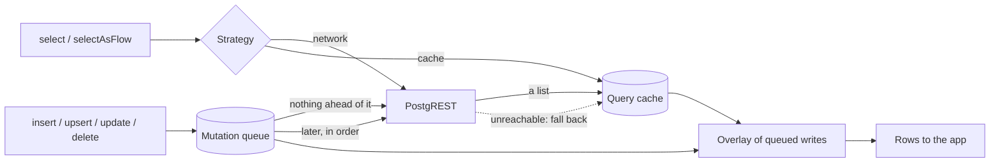

# How it works

The library keeps three things on the device: the answers to your list reads, the writes it has
not sent yet, and the files you downloaded. A read is answered by the server or from those
answers, with the unsent writes laid over it; a write is saved first and sent when nothing waits
ahead of it.

## The three local stores

| Store | What it holds | Bound |
| --- | --- | --- |
| The query cache | The rows the server answered to each list read, one entry per query | `cacheSizeBytes`, 100 MiB by default; the entries fetched longest ago go first |
| The mutation queue | Every write not yet accepted by the server, with the user who made it, in the order it was made; the writes the server refused, on the rejected list; and the writes held after a conflict, on the conflicted list | The queue: none, a queued write is never evicted. Each list: its newest 100 entries; older ones go, and their writes are lost |
| The file cache | Storage objects you downloaded | `fileCacheSizeBytes`, 256 MiB by default; the least recently used files go first |

The first two share one SQLite database, `supabase_offline.db`, and the files sit beside it
([On-device data](../reference/on-device-data.md)).

## What counts as offline

A failure is the network's when it is a timeout or an I/O failure, such as supabase-kt's
`HttpRequestException`, here or in a cause; an answer from the server, with any HTTP status, never
is. `Throwable.isNetworkOrConnectivityFailure()`
is the test, and the library uses it itself: a read falls back to the cache on a connectivity
failure only, so the cache never hides a refused request, and a write stays queued when it may not
have run or may pass when sent again (no connection, no answer, a `408`, `429`, `502`, `503`,
`504`, `520`, `522` or `524`, a token that could not be refreshed or that the server holds
expired). Any other answer is the server's decision, and is thrown. The
`NetworkDisabledException` of `disableNetwork()` counts as a connectivity failure too. The
platform's connectivity monitor is a hint, never a gate: every request you make is tried
([Replaying the queue](sync.md#the-connectivity-monitor-is-a-hint-never-a-gate)).

## What is cached

A list of rows, under its **cache key**: the table, its query parameters sorted by name, and its
range (`todos?done=eq.false&order=created_at.desc|range=0-49`). Another filter, order, column
list, page or schema is another entry, fetched and kept on its own, so **a query never read online
has nothing offline**, even when another cached list holds its rows: read offline with the query
you read online, and filter in memory. **Only lists are cached**: `single()`, a `count`, `head`,
`csv()`, `geojson()`, `stripNulls()` and `explain()` go to the server every time, so read one row
offline from the list, by its key.

## The overlay

A read returns the cached answer with the user's queued writes laid over it, oldest first, so the
app shows its own writes at once, online or not; a write sent at once is patched into the cached
lists instead ([Optimistic overlay](overlay.md)).

## Whose data it is

With supabase-kt's Auth plugin, the query cache and the file cache belong to one user at a time,
dropped when the session settles as someone else; the queue keeps each user's writes apart and
sends them only with that user's token. Without Auth there is one identity for the life of the
install ([Signing out and switching users](sign-out.md)).

## Glossary

| Term | Meaning |
| --- | --- |
| Cache key | The fingerprint a cached list is stored under: the table, its sorted query parameters and its range |
| Mutation | A write: an insert, upsert, update or delete |
| Pending, queued | A write in the mutation queue the server has not accepted yet |
| Pass | One run that sends the user's queued writes, in order, until the queue is empty or something stops it |
| Replayed | A queued write a pass sent and the server accepted. It stays in the overlay until each cached list has been fetched again after it |
| Rejected | A queued write the server refused for good on replay, kept on the rejected list for the app |
| Version column | A column a server-side trigger changes on every update of a row, which the app names so that replays are checked against it |
| Base | The version, and the written columns, of the row a queued update or delete targets, as the device saw it |
| Conflict | A queued update or delete whose row moved on the server since its base, settled by the app's resolver or held on the conflicted list ([Conflicts and merging](conflicts.md)) |
| Refresh | A reactive read asking the server again for the rows it shows |
| Settled session | A session that is signed in or signed out, not restoring and not failing to refresh |
| Stale | A cached list a write may have changed in a way the library could not follow; it is fetched again when it can be |
