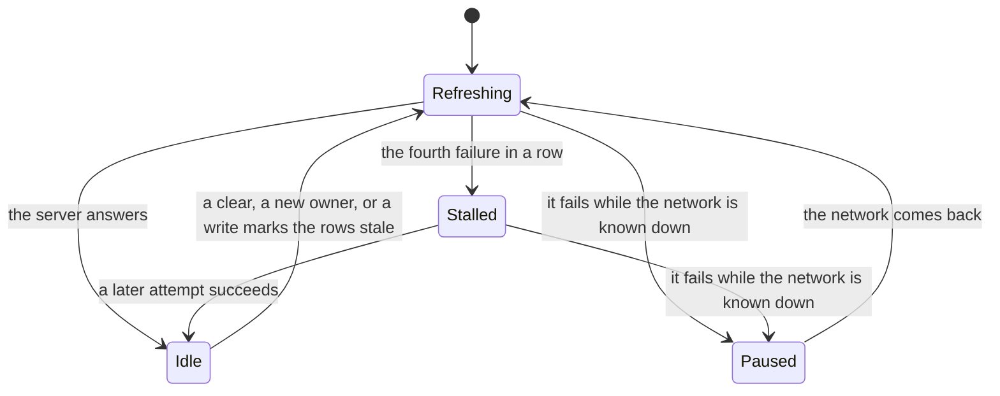

# Refresh lifecycle

A reactive read's refresh keeps trying until the server answers, for as long as the flow is
collected, and each emission says how it stands in `QuerySnapshot.refresh`. Waiting for the
network or for the session reads as waiting, never as a failure. The sample shows it on the Sync
tab:

From the samples: [LibraryMappings.kt](https://github.com/nesfeder/supabase-offline-kt/blob/main/samples/android/src/main/kotlin/io/github/nesfeder/offlinetasks/data/supabase/LibraryMappings.kt) · [SyncView.swift](https://github.com/nesfeder/supabase-offline-kt/blob/main/samples/ios/OfflineTasks/Sync/SyncView.swift)

=== "Android"

    ```kotlin
    --8<-- "data/supabase/LibraryMappings.kt:refresh-state"
    ```

=== "iOS"

    ```swift
    --8<-- "Sync/SyncView.swift:refresh-state"
    ```

## The four states

| State | Meaning | What to show |
| --- | --- | --- |
| `Idle` | No refresh is running or waiting: the last one succeeded, or the read does not refresh | Nothing |
| `Refreshing` | A refresh is running, is about to be tried again soon after a failure, or waits for a session that is still settling | A quiet progress mark, if anything |
| `Paused` | The refresh waits for the network, which the library knows to be unavailable. Nothing is failing | "Offline": the rows are the device's |
| `Stalled(cause)` | The refresh keeps failing while the network is believed to be up. It is still tried, at most a minute apart | "Can't reach the server": the rows are the device's |



`Stalled.cause` is the failure that stalled the refresh; a later, different failure does not
replace it. It is supabase-kt's own exception, whose message carries the request's URL and its
filter values: show your own words ([Security and privacy](../help/security.md#exceptions)).

## The retry schedule

A failed refresh is tried again after 300 ms, 900 ms and 2.4 s, then after 5 s, 15 s and every
60 s. It reads `Stalled` after the fourth failure in a row, about 3.6 s in, and `Paused` instead
while the network is known to be down. The wait is cut short, with an attempt at once, when the
network comes back (the connectivity monitor or your `networkAvailability` turns online, or
`enableNetwork()` is called) and when the session settles (a stored session finishes restoring,
or a user signs in).

A refresh turns supabase-kt's own retries of a failed `GET` (four attempts over about 7 s by
default) off for transport failures, so a dead network is noticed at once; a `503` or `520` is
still retried on supabase-kt's schedule.

## Cold start and session restore

Until supabase-kt's Auth plugin has restored the stored session, requests go out on the anon key,
which row-level security can answer with fewer rows, or none: nothing such a request returns is
written to the cache, and the refresh reads `Refreshing` until the session settles, with the
cached rows on screen ([Signing out and switching users](sign-out.md)).

Under `ResponseTrust.AuthenticatedSessionOnly`, a live read of an empty table made signed out
stays `Refreshing`, retried at most a minute apart, until the table has rows or a user signs in
(without Auth, only rows end it): under that rule an empty answer is written only for a signed-in
user.

## An old answer never replaces a newer write

Every request reads a tick from a monotonic clock before it goes out, and every write that changes
the cache moves its table's mark forward. An answer whose request left before the table's last
change is refused, since it cannot hold that change, and the refresh asks again. One that left
before `clearLocalData()` is refused and not asked again, since it may carry the cleared session's
token; one that left before the cache passed to a new owner is not written, and the refresh asks
again.

## Pinned by

The schedule and the states: `CacheFirstWithParallelRefreshTest.refresh_failure_does_not_terminate_flow`,
`CacheFirstWithParallelRefreshTest.exhausted_fast_retries_keep_the_flow_alive_and_report_stalled`,
`CacheFirstWithParallelRefreshTest.reports_in_flight_then_stalled_then_idle_on_late_success`,
`CacheFirstWithParallelRefreshTest.each_wake_up_triggers_one_immediate_retry`,
`CacheFirstWithParallelRefreshTest.a_wake_up_after_success_does_not_re_run_the_refresh`,
`ReactiveRefreshOfflineTest.offline_the_refresh_says_stalled_once_its_fast_retries_are_spent`,
`QuerySnapshotTest.a_refresh_that_cannot_reach_a_network_known_to_be_down_is_paused_not_stalled`.
Old answers: `StaleRefreshWatermarkTest.stale_non_empty_response_is_dropped_and_the_local_write_survives`,
`StaleRefreshWatermarkTest.a_response_that_left_before_sign_out_never_repopulates_the_cleared_cache`.
