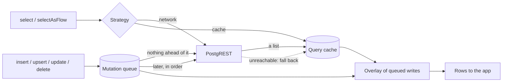

# How it works

The library keeps three things on the device: the answers to your list reads, the writes it has
not sent yet, and the files you downloaded. A read is answered by the server or from those
answers, as its strategy says, with the unsent writes laid over it; a write is saved first and
sent when nothing waits ahead of it.

The other Behaviours pages build on this one. Each opens with its rule, then shows it, then lists
the edge cases; the tables at their ends name the test that pins each fact.

## The three local stores

| Store | What it holds | Bound |
| --- | --- | --- |
| The query cache | The rows the server answered to each list read, one entry per query | `cacheSizeBytes`, 100 MiB by default; the entries fetched longest ago go first |
| The mutation queue | Every write not yet accepted by the server, with the user who made it, in the order it was made; and the writes the server refused, on the rejected list | None: a queued write is never evicted |
| The file cache | Storage objects you downloaded | `fileCacheSizeBytes`, 256 MiB by default; the least recently used files go first |

The first two live in one SQLite database, `supabase_offline.db`; the files beside it. See
[On-device data](../reference/on-device-data.md).

## What counts as offline

A failure is the network's when it is a timeout or an I/O failure, such as supabase-kt's
`HttpRequestException`, in the failure or one of its causes. An answer from the server, with any
HTTP status, never is. `Throwable.isNetworkOrConnectivityFailure()` is the test, and it is the one
the library itself uses:

- a read falls back to the cache on a connectivity failure only; a server's error is thrown, so
  the cache never hides a refused request;
- a write is kept in the queue when it may not have run: no connection, no answer, a `503` or
  `520`, an expired token that could not be refreshed. Any other answer is the server's decision
  and is thrown.

`disableNetwork()` turns the library's network access off, as airplane mode does, and the
`NetworkDisabledException` it causes counts as a connectivity failure too.

The platform's connectivity monitor is a hint, never a gate: the library tries every request you
make, whatever the monitor says, because a monitor can be wrong either way. See
[Replaying the queue](sync.md).

## What is cached

A read is cached when it returns a list of rows. Each list lives under its **cache key**: the
table, its query parameters sorted by name, and its range, such as
`todos?done=eq.false&order=created_at.desc|range=0-49`. So the same table read with another
filter, order, column list or page is another entry, fetched and kept on its own.

Two things follow:

- **A query never read online has nothing offline**, even when another cached list holds its
  rows. Read offline with the same query you read online, and filter in memory when you need a
  narrower view.
- **Only lists are cached.** `single()`, a `count`, `head`, `csv()`, `geojson()`, `stripNulls()`
  and `explain()` go to the server every time. To read one row offline, read the list with its
  key and take the first row.

A table in another schema is cached apart from a table of the same name in the default schema.

## The overlay

What a read returns is the cached answer with the user's queued writes laid over it, oldest
first, so the app shows its own writes at once, online or not. An INSERT appears in every list
whose filters it may match; an UPDATE patches the rows its filter provably matches; a DELETE
removes them. A write sent at once is patched into the cached lists instead. One a later pass
sends stays in the overlay until each cached list of its table has been fetched again after it,
so it never drops out of a list in between. See [Optimistic overlay](overlay.md).

## Read and write paths

A read asks the server or the cache, as its strategy says; a list the server returns is kept, and
every answer has the queued writes laid over it. A write is saved to the queue, sent at once when
nothing of the user waits ahead of it, and otherwise sent by a later pass, in order.

## Whose data it is

With supabase-kt's Auth plugin installed, the query cache and the file cache belong to one user at
a time: when the session settles as someone else, they are dropped, and nothing cached for one
user is ever served to the next. The mutation queue keeps every user's writes apart, and sends
each only with its own user's token. Without Auth, there is one identity for the life of the
install. See [Signing out and switching users](sign-out.md).

## Glossary

| Term | Meaning |
| --- | --- |
| Cache key | The fingerprint a cached list is stored under: the table, its sorted query parameters and its range |
| Mutation | A write: an insert, upsert, update or delete |
| Pending, queued | A write in the mutation queue the server has not accepted yet |
| Pass | One run that sends the user's queued writes, in order, until the queue is empty or something stops it |
| Replayed | A queued write a pass sent and the server accepted. It stays in the overlay until each cached list has been fetched again after it |
| Rejected | A queued write the server refused for good on replay, kept on the rejected list for the app |
| Refresh | A reactive read asking the server again for the rows it shows |
| Settled session | A session that is signed in or signed out, not restoring and not failing to refresh |
| Stale | A cached list a write may have changed in a way the library could not follow; it is fetched again when it can be |
