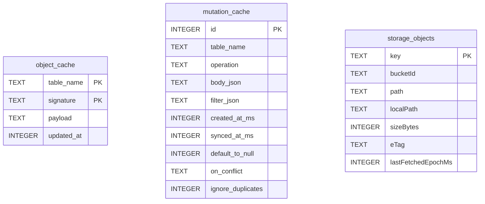

# Persistence

The SDK stores everything in a single AndroidX Room (KMP) database file named
`supabase_offline.db`. There are three tables. Schema is defined in
[OfflineEntities.kt](../shared/src/commonMain/kotlin/io/github/nesfeder/supabase/internal/db/OfflineEntities.kt)
and the database itself in
[OfflineDatabase.kt](../shared/src/commonMain/kotlin/io/github/nesfeder/supabase/internal/db/OfflineDatabase.kt).

## Contents

- [Schema overview](#schema-overview)
- [`object_cache`](#object_cache)
- [`mutation_cache`](#mutation_cache)
- [`storage_objects`](#storage_objects)
- [Database bootstrap](#database-bootstrap)
- [DB file locations](#db-file-locations)
- [Migration policy](#migration-policy)

## Schema overview



## `object_cache`

Caches SELECT results, keyed by the deterministic
[signature](./architecture.md#cache-key-the-select-signature) of the request.

```19:29:shared/src/commonMain/kotlin/io/github/nesfeder/supabase/internal/db/OfflineEntities.kt
@Entity(
    tableName = "object_cache",
    primaryKeys = ["table_name", "signature"]
)
internal data class ObjectRow(
    @ColumnInfo(name = "table_name") val table: String,
    @ColumnInfo(name = "signature") val signature: String,
    /** Full JSON payload from PostgREST (usually a JSON array string). */
    @ColumnInfo(name = "payload") val payload: String,
    @ColumnInfo(name = "updated_at") val updatedAt: Long
)
```

- **Primary key:** composite `(table_name, signature)`.
- **`payload`:** raw JSON string returned by PostgREST (typically a JSON array).
- **`updated_at`:** epoch ms when the row was last written. Used for TTL comparisons (TTL itself
  is supplied per request — see
  [`cacheDuration`](./architecture.md#cacheduration-is-ttl-at-read-not-ttl-at-write)).
- **DAO:** `ObjectDao` exposes `get`, `observe` (Flow), `upsert`, `delete`, `getAllForTable`,
  `observeAllForTable`, `deleteTable`, and the size-eviction helper
  `deleteOldestPayloadRows(limit)`.

## `mutation_cache`

Pending mutations awaiting sync, plus already-synced mutations kept around for read-time overlay
until the corresponding SELECT is refreshed.

```119:205:shared/src/commonMain/kotlin/io/github/nesfeder/supabase/internal/db/OfflineEntities.kt
@Entity(tableName = "mutation_cache")
internal data class MutationRow(
    @PrimaryKey(autoGenerate = true)
    val id: Long = 0L,

    @ColumnInfo(name = "table_name")
    val table: String,

    /** "INSERT", "UPSERT", "UPDATE", or "DELETE". */
    val operation: String,

    /**
     * Raw JSON body string. For INSERT/UPSERT usually a JSON array; for UPDATE a JSON object;
     * for DELETE usually "{}".
     */
    @ColumnInfo(name = "body_json")
    val bodyJson: String,

    /**
     * Optional JSON-encoded filter descriptor:
     *
     * {
     *   "mode": "AND" | "OR",
     *   "conditions": [
     *     { "column": "id", "operatorId": "eq", "value": "123" },
     *     ...
     *   ]
     * }
     *
     * Here "operatorId" is the FilterOperator.identifier (e.g. "eq", "lt", "ilike", ...).
     *
     * Only used for UPDATE / DELETE. INSERT / UPSERT typically don't carry filters.
     */
    @ColumnInfo(name = "filter_json")
    val filterJson: String?,

    /**
     * Client-side timestamp (epoch millis) when the mutation was enqueued.
     * Used to enforce FIFO ordering when syncing.
     */
    @ColumnInfo(name = "created_at_ms")
    val createdAtMs: Long,

    /**
     * Timestamp (epoch millis) when this mutation was successfully synced to the
     * server. A `null` value means the mutation is still *pending*.
     *
     * We keep synced mutations around so they can still participate in local
     * overlays when we have to fall back to cached SELECT data while offline.
     */
    @ColumnInfo(name = "synced_at_ms")
    val syncedAtMs: Long? = null,

    /**
     * Mirrors InsertRequestBuilder.defaultToNull / UpsertRequestBuilder.defaultToNull.
     *
     * - If true, missing fields default to `null`.
     * - If false, missing fields use the column's default value in Postgres.
     *
     * Only meaningful for INSERT / UPSERT; ignored for UPDATE / DELETE.
     * Nullable for backward compatibility and for non-INSERT/UPSERT rows.
     */
    @ColumnInfo(name = "default_to_null")
    val defaultToNull: Boolean? = null,

    /**
     * Mirrors UpsertRequestBuilder.onConflict.
     *
     * Comma-separated UNIQUE column(s) that define how duplicate rows are detected
     * during UPSERT.
     *
     * Only meaningful for UPSERT; ignored for other operations.
     */
    @ColumnInfo(name = "on_conflict")
    val onConflict: String? = null,

    /**
     * Mirrors UpsertRequestBuilder.ignoreDuplicates.
     *
     * - If true, duplicate rows are ignored on UPSERT.
     * - If false, duplicate rows are merged with existing rows.
     *
     * Only meaningful for UPSERT; ignored for other operations.
     */
    @ColumnInfo(name = "ignore_duplicates")
    val ignoreDuplicates: Boolean? = null
)
```

- **`operation`:** `"INSERT"`, `"UPSERT"`, `"UPDATE"`, or `"DELETE"` (constants in
  `MutationOperation`).
- **`bodyJson`:** the raw request body. INSERT/UPSERT use a JSON array string; UPDATE uses an
  object string; DELETE typically uses `"{}"`.
- **`filterJson`:** serialized `FilterDescriptor` (see
  [OfflineFilters.kt](../shared/src/commonMain/kotlin/io/github/nesfeder/supabase/internal/postgrest/OfflineFilters.kt))
  describing the WHERE clause for UPDATE / DELETE.
- **`syncedAtMs`:** `NULL` means **pending**. After a successful sync, the row is marked synced
  but not immediately deleted — it stays around to participate in mutation overlay until the
  affected SELECTs get a fresh response.
- **`defaultToNull` / `onConflict` / `ignoreDuplicates`:** mirror the supabase-kt
  `InsertRequestBuilder` / `UpsertRequestBuilder` options so replay preserves the original
  semantics.

`MutationDao` provides FIFO queries (`pendingAll`, `pendingForTable` — both `ORDER BY
created_at_ms ASC`), reactive count Flows (`countPendingFlow`, `countPendingForTableFlow`),
`markSynced`, `deleteById`, and `deleteSyncedForTable` (called after a fresh SELECT to prune).

## `storage_objects`

Tracks every file the storage download cache has on disk.

```75:87:shared/src/commonMain/kotlin/io/github/nesfeder/supabase/internal/db/OfflineEntities.kt
@Entity(
    tableName = "storage_objects",
    indices = [Index(value = ["bucketId", "path"], unique = true)]
)
internal data class StorageRow(
    @PrimaryKey val key: String,      // "$bucketId::$path"
    val bucketId: String,
    val path: String,
    val localPath: String,            // absolute file path
    val sizeBytes: Long?,
    val eTag: String?,                // optional (if you add revalidation later)
    val lastFetchedEpochMs: Long
)
```

- **`key`:** `"$bucketId::$path"` — the primary key.
- **`localPath`:** absolute path on the device.
- **`lastFetchedEpochMs`:** exposed publicly through
  [`StorageCacheMetadata`](../shared/src/commonMain/kotlin/io/github/nesfeder/supabase/StorageCacheMetadata.kt)
  for client-driven staleness checks. See [storage.md](./storage.md#client-driven-staleness).
- **`eTag`:** reserved for future HTTP revalidation; not used today.

## Database bootstrap

```12:41:shared/src/commonMain/kotlin/io/github/nesfeder/supabase/internal/db/OfflineDatabase.kt
@ConstructedBy(OfflineDatabaseConstructor::class)
@Database(
    entities = [ObjectRow::class, StorageRow::class, MutationRow::class],
    version = 1,
    exportSchema = false
)
internal abstract class OfflineDatabase : RoomDatabase() {

    abstract fun objectDao(): ObjectDao

    abstract fun storageDao(): StorageDao

    abstract fun mutationDao(): MutationDao
}

// The Room compiler generates the `actual` implementations.
internal expect object OfflineDatabaseConstructor : RoomDatabaseConstructor<OfflineDatabase> {
    override fun initialize(): OfflineDatabase
}

internal fun getRoomDatabase(
    builder: RoomDatabase.Builder<OfflineDatabase>
): OfflineDatabase {
    return builder
        .addMigrations()
        .fallbackToDestructiveMigrationOnDowngrade(true)
        .setDriver(BundledSQLiteDriver())
        .setQueryCoroutineContext(Dispatchers.IO)
        .build()
}
```

- **SQLite driver:** `BundledSQLiteDriver()` — a SQLite binary bundled with the SDK so both
  platforms use the same engine regardless of the OS-provided SQLite.
- **Coroutine context:** all DAO suspend calls run on `Dispatchers.IO`.
- **KMP plumbing:** `OfflineDatabaseConstructor` is the `expect object` that Room's compiler
  generates the `actual` implementation for, per target.

## DB file locations

The path resolver `expect interface DbPathProvider` (in
[OfflineCacheSettings.kt](../shared/src/commonMain/kotlin/io/github/nesfeder/supabase/internal/db/OfflineCacheSettings.kt))
has two platform implementations:

```11:20:shared/src/androidMain/kotlin/io/github/nesfeder/supabase/internal/db/DbPathProvider.android.kt
internal class AndroidDbPathProvider(
    private val context: Context,
) : DbPathProvider {

    override fun dbPath(): Path {
        val appContext = context.applicationContext
        val dbFile = appContext.getDatabasePath("supabase_offline.db")
        return dbFile.absolutePath.toPath()
    }
}
```

```14:28:shared/src/iosMain/kotlin/io/github/nesfeder/supabase/internal/db/DbPathProvider.ios.kt
internal class IosDbPathProvider : DbPathProvider {

    @OptIn(ExperimentalForeignApi::class)
    override fun dbPath(): Path {
        val url = NSFileManager.defaultManager.URLForDirectory(
            directory = NSDocumentDirectory,
            inDomain = NSUserDomainMask,
            appropriateForURL = null,
            create = false,
            error = null,
        )
        val basePath = requireNotNull(url?.path) { "Could not resolve Documents directory path" }
        return ("$basePath/supabase_offline.db").toPath()
    }
}
```

| Platform | Default location |
|----------|------------------|
| Android | App private databases dir (`Context.getDatabasePath("supabase_offline.db")`) |
| iOS | `Documents/supabase_offline.db` |

You can override the base directory (which contains both the DB and the storage file tree) by
setting [`SupabaseOfflineConfig.offlineStoragePath`](./configuration.md#offlinestoragepath).

## Migration policy

The schema is at **version 1** today.

The database is built with `.fallbackToDestructiveMigrationOnDowngrade(true)` — downgrades wipe
the database, but the SDK currently performs no explicit `addMigrations(...)`. When the schema
changes:

1. Bump `version` in `@Database` on `OfflineDatabase`.
2. Add a migration or, for cache-only schemas, accept destructive migration (the data is a
   recoverable cache).

The Room compiler is configured with `exportSchema = false` (see
[shared/build.gradle.kts](../shared/build.gradle.kts) `room { schemaDirectory(...) }`) — schemas
are not currently checked into the repo. If you start writing real migrations, flip
`exportSchema` to true so the JSON schemas can be diffed in PRs.
