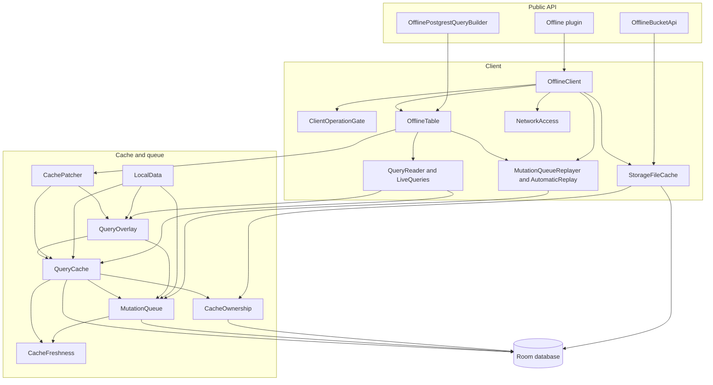
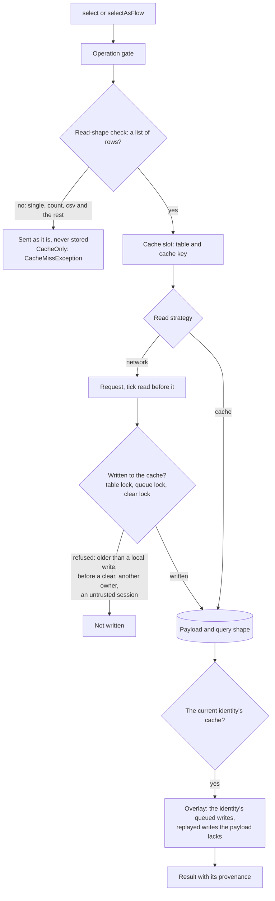
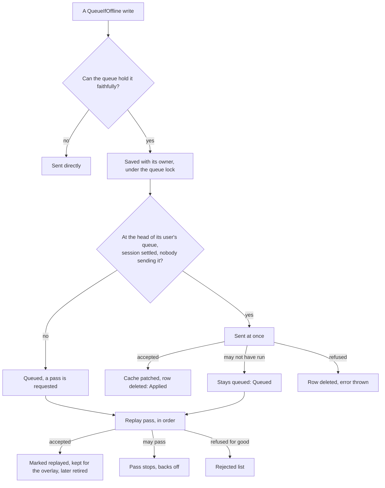

# Architecture

This page describes supabase-offline-kt as 0.1.0 ships it: the public API in full, how the engine
behind it works, the decisions that shaped both, and what the library promises. The
[Behaviours](../behaviours/index.md) pages hold the case-by-case tables; this page is the map.

## What it is

supabase-offline-kt is a plugin for [supabase-kt](https://github.com/supabase-community/supabase-kt),
for Kotlin Multiplatform apps on Android and iOS. An app installs it with `install(Offline) { … }`
beside PostgREST and reaches it as `supabase.offline`, and `supabase.offline.from("todos")` takes
supabase-kt's own verbs, overloads and request DSL. A read is answered from a cache on the device
or from the server, as its read strategy says, and the server's answers to list reads refresh the
cache. A write is saved to a mutation queue on the device first, sent at once when nothing of the
same user waits ahead of it, and otherwise sent, in the order it was made, by a later replay pass,
which the library starts by itself when the network comes back. Storage downloads are kept on disk
and served from there offline. A write returns a `MutationOutcome` rather than the server's result,
because a queued write has none yet: that is the one difference in what a call returns, and a few
call shapes need an edit (see [Moving a call from supabase-kt](#moving-a-call-from-supabase-kt)).
Each minor
release is built and tested against exactly one supabase-kt minor: today 3.8, which may still move
before 0.1.0 (see [Decisions](#decisions)).

```kotlin
val supabase = createSupabaseClient(url, key) {
    install(Auth)
    install(Postgrest)
    install(Storage)
    install(Offline) // settings go here
}

val todos = supabase.offline.from("todos").select { filter { eq("done", false) } }

when (val outcome = supabase.offline.from("todos").insert(todo)) {
    is MutationOutcome.Applied -> outcome.result
    is MutationOutcome.Queued -> outcome.pendingMutation
}
```

## The public API

Two artifacts ship from this repository:

| Artifact | Package | What it holds |
| --- | --- | --- |
| `io.github.nesfeder.supabase-offline:supabase-offline-kt` | `io.github.nesfeder.supabase.offline` | The plugin, and every type on this page outside its testing section |
| `io.github.nesfeder.supabase-offline:supabase-offline-kt-testing` | `io.github.nesfeder.supabase.offline.testing` | The in-memory client and the factories for tests |

Everything else lives under `io.github.nesfeder.supabase.offline.internal` and is not API. Four
rules hold across every table below and are not repeated in them:

- **The closed error.** Once the plugin is closed, `from` and every suspending call on it, or on a
  builder or bucket obtained from it, throws `IllegalStateException`, and a flow obtained from it
  fails with it when collected; a flow being collected at that moment completes instead. What does
  no work still answers: `syncStatus` (it holds its last value), the getters (`storage`, `config`,
  the builder's `postgrest`, `table` and `schema`), a bucket's `setHeader` and its URL builders
  (`publicUrl`, `authenticatedUrl` and the rest), and `close()` itself.
- **supabase-kt's failures pass through.** When the server refuses a request, or a request cannot
  be sent and the library does not answer it from the cache or the queue, the caller gets
  supabase-kt's own exception (`PostgrestRestException`, `RestException`, `HttpRequestException`)
  unchanged. The "Throws" columns list only what the library adds.
- **`@Throws(Throwable::class)`.** Every `suspend` function the library declares carries it, so a
  framework that exports the library to Swift hands a failure over as an error instead of ending
  the process. An override cannot declare its own: `close()`, which overrides supabase-kt's, has
  none, and neither have the `BucketApi` members an `OfflineBucketApi` inherits
  (`downloadAuthenticated`, `downloadPublic`, `upload`, `list` and the rest), which keep
  supabase-kt's declarations. Through such a framework, an offline bucket's download that throws
  (offline with nothing cached, or with network access off) ends the app unless the caller's own
  bridge catches around it.
- **Value types have internal constructors.** `QuerySnapshot`, `PendingMutation`,
  `RejectedMutation`, `ServerError`, `SyncReport`, `SyncStatus`, `CachedFile`, the two
  `MutationOutcome` cases, `RefreshState.Stalled` and the exceptions are built by the library, so
  it can add a field without breaking a caller. A test builds them with the
  [testing artifact](#the-testing-artifact)'s factories.

"The current user" means the identity the session speaks for: the signed-in user, or the
anonymous identity when nobody is signed in or the client has no Auth plugin (see
[Identity](#identity)).

### Installing and configuring

| Member | What it does | Rule | Throws |
| --- | --- | --- | --- |
| `interface Offline : SupabasePlugin<Offline.Config>` | The plugin: every member on this page that is not a type of its own. | Only the library implements it: `@SubclassOptInRequired(OfflineInternal::class)`. | — |
| `Offline.Companion` | The provider `install(Offline) { … }` takes, under the key `"offline"`. | `createConfig` checks the settings; `create` builds the plugin, which opens its database in supabase-kt's `init`, once every plugin exists. | `IllegalArgumentException` when a table's primary key names no column; through `createSupabaseClient`, `IllegalStateException` when another client holds the database or its directory, or, on Android, when the app removed androidx.startup's provider |
| `val SupabaseClient.offline: Offline` | The installed plugin, reached as `supabase.postgrest` is. | Import `io.github.nesfeder.supabase.offline.offline`. | `IllegalStateException` when the client has no `install(Offline)` |
| `Offline.CACHE_SIZE_UNLIMITED` | `-1L`, the size that turns eviction off, for either cache. | — | — |
| `class Offline.Config` | The settings, written in `install(Offline) { … }`. | **Read once**, when the client is created: changing `supabase.offline.config` afterwards has no effect. | — |

The settings:

| Setting | Default | What it sets |
| --- | --- | --- |
| `cacheSizeBytes: Long` | 100 MiB | The most the cached query results may hold, counted as the summed length of the cached responses, not the database file. Past it, the results fetched longest ago are evicted, never one of up to 500 queries a live reader shows. Any other value below 4 KiB counts as 4 KiB; `CACHE_SIZE_UNLIMITED` turns eviction off. |
| `fileCacheSizeBytes: Long` | 256 MiB | The most the Storage file cache may hold. Past it, the least recently used files are deleted, never one being read or used in the last 30 seconds. Any other value below zero counts as zero; `CACHE_SIZE_UNLIMITED` turns eviction off. |
| `dataDirectory: String?` | `null` | Where the database, `supabase_offline.db`, and the file cache live. `null` is the platform's place: the app's database directory and `<filesDir>/supabase_offline` on Android, `Documents` on iOS. When this directory has no database and the default place has one no client holds, the first client moves it here, unsent writes included; when it cannot, it opens the one it can without leaving queued writes behind, and logs a warning. |
| `networkAvailability: Flow<Boolean>?` | `null` | The app's own connectivity signal, `true` while online, in place of the platform's monitor. `null` uses the monitor. |
| `autoSync: Boolean` | `true` | Whether the library sends queued writes by itself when the session settles and when the network comes back. |
| `primaryKeys`, `primaryKey(table, vararg columns)` | `id` | Each default-schema table's key columns: how the cache recognises a row. `primaryKey` throws `IllegalArgumentException` for no column. |
| `responseTrust: ResponseTrust` | `SettledSession` | Which server responses may replace what the cache holds. |
| `logLevel: LogLevel?` | `null` | The least severe level the plugin logs at; `null` takes the client's `defaultLogLevel`. |

`ResponseTrust` is a sealed interface of two cases:

| Case | Rule |
| --- | --- |
| `SettledSession` (default) | A response replaces the cache when its request went out under a settled session (signed in, signed out, or a client without Auth) that had not changed when it answered. A session that is restoring, or whose refresh failed, never writes to the cache: supabase-kt then sends the anon key, and row-level security can answer with fewer rows, or none. |
| `AuthenticatedSessionOnly` | An empty response is written only when the same user was signed in before and after the request; a response with rows is written signed out too, under the same exclusions. For an app that reads public rows signed out and must never see an empty signed-out answer replace them. |

**Installing.** PostgREST is required: `from` throws `IllegalStateException` without it. Storage
is needed only for `storage`. Auth is optional. With it, the cache belongs to
one user at a time and the mutation queue keeps each user's writes apart; without it, or with the
app's own token provider, there is one identity for the life of the install, and an app whose own
provider serves several users must clear local data itself when the user changes. On Android the
plugin takes the application context from androidx.startup, so it needs no `Context`. Opening
claims the database and creates its directory on the thread that calls `createSupabaseClient`. A
second client over the same database or data directory throws `IllegalStateException` until the
first is closed, and a failure while opening fails `createSupabaseClient`. Install the plugin last:
when a plugin installed after it fails to set up, the client is never returned and the database
stays claimed until the process ends.

**Logging** goes through supabase-kt's own. The plugin logs to the logging processor the client
was built with (`defaultLoggingFactory`), tagged `Supabase-Offline`, at `logLevel` or the client's
`defaultLogLevel`; there is no second logging setup. Messages at `INFO` and above never carry rows,
filter values, tokens or object paths; `DEBUG` may.

### Reading

| Member | What it does | Rule | Throws |
| --- | --- | --- | --- |
| `from(table)`, `from(schema, table)`, `get(table)`, `get(schema, table)` | A table's `OfflinePostgrestQueryBuilder`; `offline["todos"]` is `offline.from("todos")`. | A table of another schema is cached apart from the default schema's table of the same name. | `IllegalStateException` without PostgREST |
| `class OfflinePostgrestQueryBuilder` | The offline counterpart of supabase-kt's `PostgrestQueryBuilder`, with its `postgrest`, `table` and `schema`. | Final, with an internal constructor. Each verb takes its offline choice as a named parameter with a default, before the trailing request lambda. | — |
| `select(columns, readStrategy = ReadStrategy.NetworkFirst(), request): PostgrestResult` | Reads rows once, from the server or the cache. | Only a list of rows is cached. `single()`, `maybeSingle()`, `head`, a count (with rows or without), `csv()`, `geojson()`, `stripNulls()` and `explain()` go to the server under every strategy but `CacheOnly`, are never stored, and fail offline as `NetworkOnly` does. | `CacheMissException` under `CacheOnly`; `NetworkDisabledException` while network access is off and the cache cannot answer |
| `selectAsFlow(columns, readStrategy = FlowReadStrategy.CacheFirstThenNetwork, request): Flow<QuerySnapshot>` | Reads rows as they change: emits again whenever a write, a refresh or a server record changes them. | A failing refresh is reported in the snapshot, not thrown. A failure the read cannot recover from ends the flow after the values before it. A shape the cache never holds emits the server's answer once and completes. Needs no Realtime channel. | Through the flow: `CacheMissException` under `CacheOnly` for a shape the cache never holds; `NetworkDisabledException` while network access is off, for such a shape or for `NetworkFirstThenCache` with nothing cached |

A verb may run its `request` lambda more than once: a read once to learn its shape and once per
request sent, a queueable write up to three times. The lambda must build the same request every
time: no side effects, and no clock or counter read.

`ReadStrategy`, for `select`:

| Case | What it does | Rule |
| --- | --- | --- |
| `NetworkOnly` | Asks the server, and fails as supabase-kt does when it cannot be reached. | Its answer is written to the cache. |
| `NetworkFirst(maxAge: Duration? = null)` | Asks the server, and serves the cached rows when it cannot be reached. | Only a connectivity failure falls back: an expired token that cannot be refreshed, or a server answering `503` until the retries run out, is thrown even with the query cached. With the query cached, a transport failure falls back at once (supabase-kt's retries of it are skipped; a `503` or `520` is still retried). Rows older than `maxAge` count as none, and the transport failure is thrown. |
| `CacheFirst(maxAge: Duration? = null)` | Serves the cached rows, and asks the server when there are none. | Rows a write marked stale are fetched again, and served after all when the server cannot be reached. |
| `CacheOnly(maxAge: Duration? = null)` | Serves the cached rows and never sends a request. | With nothing it may serve, it throws `CacheMissException`. |

`FlowReadStrategy`, for `selectAsFlow`:

| Case | What it does | Rule |
| --- | --- | --- |
| `CacheFirstThenNetwork` | Emits the cached rows at once and refreshes them from the server in parallel. | A failing refresh leaves the rows on screen and is retried for as long as the flow is collected, at most a minute apart, and at once when the session settles or the network comes back. |
| `NetworkFirstThenCache` | Asks the server first, then emits the cached rows as they change. | Offline with the query cached, it emits the cached rows at once, `Stalled` (`Paused` when the network is known down), and keeps asking until the server answers. With nothing cached, or on a server error, the flow fails. |
| `CacheOnly` | Emits the cached rows and never sends a request. | A shape the cache never holds fails with `CacheMissException`. |

`QuerySnapshot` is one emission:

| Field | Meaning |
| --- | --- |
| `result: PostgrestResult?` | The rows, with the user's queued writes applied; `null` while nothing is known for the query; a body of `[]` when the server returned no rows. |
| `isFromCache: Boolean` | Whether the rows are the device's copy rather than an answer this read had from the server: `true` until the read's refresh succeeds, always under `CacheOnly`, and again once the cache marks them stale. |
| `fetchedAt: Instant?` | When the rows were fetched from the server, by the device's clock; never the time of a later local change applied to them. For rows the library built from written rows alone, when it built them. |
| `hasPendingMutations: Boolean` | Whether a queued write added, changed or removed a row shown. |
| `refresh: RefreshState` | How the refresh behind the read stands. |

Each field is true of its own emission, so a change to any of them emits.

`RefreshState` is a closed set:

| Case | Meaning |
| --- | --- |
| `Idle` | No refresh is running or waiting: the last one succeeded, or the read does not refresh. |
| `Refreshing` | A refresh is running, or is about to be tried again soon after a failure. |
| `Paused` | The refresh waits for the network, which the library knows to be unavailable. Nothing is failing. |
| `Stalled(cause)` | The refresh keeps failing; `cause` is the failure that stalled it, and a later, different failure does not replace it. It is still tried, at most a minute apart. |

A one-shot read carries the same provenance as three extension properties on `PostgrestResult`:
`isFromCache`, `fetchedAt: Instant?` and `hasPendingMutations`. The library stamps them in
response headers PostgREST never sends (`X-Supabase-Offline-…`); a result from supabase-kt itself
reads `false`, `null` and `false`.

`CacheMissException`: a read that may use only the cache found nothing there it may serve, or
asked for a shape the cache never holds. No request was sent.

### Writing

| Member | What it does | Rule | Throws |
| --- | --- | --- | --- |
| `insert(body: JsonArray, mutationStrategy, request)`; reified `insert(value: T, …)`, `insert(values: List<T>, …)` | Inserts rows. | A typed value is encoded by `postgrest.serializer`, as supabase-kt encodes it. | `MutationNotQueueableException` |
| `upsert(body: JsonArray, …)`; reified `upsert(value: T, …)`, `upsert(values: List<T>, …)` | Inserts rows, or merges them into the rows they conflict with. | Shown merged by `onConflict`'s columns, or by the table's key. | `MutationNotQueueableException` |
| `update(update: PostgrestUpdate.() -> Unit, …)`, `update(body: JsonElement, …)`; reified `update(value: T, …)` | Sets columns on the rows `request` filters. | A queued update replays exactly the values it sets. Queueing needs a filter the queue can record exactly. | `MutationNotQueueableException` |
| `delete(mutationStrategy, request)` | Deletes the rows `request` filters. | Queueing needs a filter the queue can record exactly. | `MutationNotQueueableException` |

Each returns a `MutationOutcome`, and `mutationStrategy` defaults to `QueueIfOffline`. An
`OnlineOnly` write made while network access is off throws `NetworkDisabledException`.

`MutationStrategy`:

| Case | What it does | Rule |
| --- | --- | --- |
| `QueueIfOffline` (default) | Saves the write to the mutation queue, sends it at once when nothing of the user waits ahead of it, and otherwise leaves it for a later pass. | It keeps its place among the user's writes in every table, and cached reads show it at once. |
| `OnlineOnly` | Sends the write now, and throws when it cannot. | Never queued and never patched into the cache; it can reach the server before writes still queued, to the same rows or to a parent row. |

`MutationOutcome` is a closed set of two:

| Member | Meaning |
| --- | --- |
| `Applied(result: PostgrestResult)` | The server applied the write; `result` is its response. |
| `Queued(pendingMutation: PendingMutation)` | The write waits in the mutation queue; `pendingMutation.id` identifies it from now on. |
| `isQueued` | Whether it is `Queued`. |
| `resultOrNull()` | The `Applied` result, or `null` when `Queued`. |

What a `QueueIfOffline` write returns:

| When it is made | Outcome |
| --- | --- |
| Nothing of the user waits ahead of it, the session is settled, and the server accepts it | `Applied`, and the cache is patched with the rows the server returned, or with the rows sent when it returned none |
| Something of the user waits ahead of it, in any table, or the session is still restoring | `Queued`, and a pass is requested |
| Network access is off | `Queued`: nothing is sent and no pass is requested; a later trigger sends it |
| Sent at once, and it may not have run: no connection or no answer, a `503` or `520`, an expired token that could not be refreshed, or PostgREST's schema cache not knowing the table or a column yet (`PGRST204`, `PGRST205`) before its tenth such refusal, counted at least 30 seconds apart | `Queued`, with no pass requested; a later trigger sends it |
| Sent at once, and the server answered with any other status: a refusal, a `408` or `429`, another `5xx`, or the tenth schema-cache refusal | The server's exception is thrown, and the write leaves the queue |
| Local data was cleared while it was on the wire | `Applied` without a cache patch, or its failure |
| The queue cannot hold it faithfully (below) | Sent directly: `Applied`, or its failure; for want of a connection, `MutationNotQueueableException` |
| The caller is cancelled while it is on the wire | It stays queued, since the server may have it, and a pass sends it |

**The immediate refusal.** A write sent at once that the server refuses throws supabase-kt's
exception to its caller, as `supabase.from(…)` would. It is deleted from the queue, never reaches
the rejected list, and leaves the cached reads that showed it. Writes made behind it are then sent
by a pass. Only a refusal found on replay goes to the rejected list.

**Writes the queue cannot hold faithfully** are sent directly, as an `OnlineOnly` write is, except
that a success updates the cache: patched in, or, where it cannot be (a write to another schema, a
filter the queue cannot record), the queries it may reach marked stale. A rolled-back dry run, and a
write that answered after local data was cleared, leave the cache as it was. These writes are:

- a `dryRun()` write, or one whose request could not be inspected to tell whether it is one;
- an UPDATE or DELETE whose filter the queue cannot record exactly or would not replay in full:
  such as a logical group, an embedded table's column, a negated or unknown operator, a `limit`,
  `order` or `offset`, or no filter at all;
- a write whose user cannot be read from the stored session;
- a write to a schema other than the client's default, since the queue replays to the default
  schema only;
- a write that was on its way into the queue while local data was cleared.

`MutationNotQueueableException`: such a write could not be sent for want of a connection. Nothing
was queued; the message says which kind of write it was, and `cause` is the connectivity failure,
so `isNetworkOrConnectivityFailure()` is `true` for it.

`MutationOperation` is the closed enum `INSERT`, `UPSERT`, `UPDATE` and `DELETE`.

### The mutation queue

| Member | What it does | Rule | Throws |
| --- | --- | --- | --- |
| `pendingMutations(table: String? = null): Flow<List<PendingMutation>>` | The current user's queued writes, of one table or all, in the order they will be sent, as the queue changes. | Empty while the stored session cannot be read. | — |
| `pendingMutationCount(table: String? = null): Int` | How many there are. | The same writes as `pendingMutations`. | — |
| `pendingMutationCountFlow(table: String? = null): Flow<Int>` | The count, as it changes. | Emits only a value that differs from the last. | — |
| `discardPendingMutation(id: Long)` | Removes one queued write without sending it: destructive. Its rows show again as the server last sent them, and what waited behind it is sent. | When the write is on the wire, waits for that send to end, then discards it if it is still queued. Does nothing for an id that is not one of the current user's queued writes. | — |
| `rejectedMutations(): Flow<List<RejectedMutation>>` | The current user's writes the server refused for good on replay, and those the library could no longer replay exactly, oldest first, as the list changes. | Kept on the device across restarts until each entry is dismissed or retried. | — |
| `dismissRejectedMutation(id: Long)` | Removes an entry for good. | Does nothing for an id that is not one of the current user's entries. | — |
| `retryRejectedMutation(id: Long)` | Queues the write again, at the end of the user's queue under a new id, and asks for a pass; the entry leaves the list. | For when the cause has been fixed, such as a missing parent row or a policy. Does nothing for an id that is not the current user's. | `IllegalArgumentException` when the entry `isRetryable` is `false` |

`PendingMutation`: `id: Long`, `table`, `operation: MutationOperation`, `createdAt: Instant`,
`rowKeys: List<JsonObject>` (the key values of the rows it touches, from body rows that carry the
whole key or from the key's equality conditions in the filter; empty when unknown) and
`body: JsonElement?` (`null` for a DELETE, or a stored body that no longer parses).

`RejectedMutation`: the same six fields, then `serverError: ServerError?` (`null` when the library
refused the write itself, because it could no longer be replayed exactly as it was made),
`message`, `rejectedAt: Instant` and `isRetryable`. `ServerError` is PostgREST's error kept as data
so it survives a restart: `status`, `code` (the SQLSTATE or PostgREST code), `message`, `details`
and `hint`.

**Whose writes these are.** Each queued write records its owner, the user at the time it was made.
The current user's writes are the ones made under that user's session, and those queued with no
owner that the user may take over (see [Identity](#identity)). Another user's writes are never
listed, counted, discarded, dismissed or retried: their ids are inert.

**Ids.** A write's id is its row's autoincrement id in the queue. It survives a restart, it is the
id `MutationOutcome.Queued` carried, and a write the server later refuses keeps it on the rejected
list. Writes are sent in id order, not `createdAt` order.

**The rejected list's bounds.** It holds the newest 100 entries of every user together, within
512 K characters. A body longer than 16 K characters is not kept (its length is), so that entry has
`isRetryable = false`; the server's message, details and hint are kept to 4 K characters each.
When the list is full the oldest entries go, and their writes are lost.

### Sync

| Member | What it does | Rule | Throws |
| --- | --- | --- | --- |
| `syncPendingMutations(table: String? = null): SyncReport` | Sends the current user's queued writes now, of one table or all, in the order they were made, and says what happened. | Returns promptly offline, and sends nothing while network access is off. A failure that may pass stops it and is not thrown. | `IllegalStateException` without PostgREST |

`SyncReport`: `syncedCount` (the writes this call sent and the server accepted), `rejected` (the
`RejectedMutation`s refused during this call, by the server or by the library itself), `remainingCount` (the writes still queued
when it returned) and `alreadyOnServerCount` (of `syncedCount`, the inserts whose rows the server
already held because an earlier send whose answer was lost had reached it).

`SyncFailedException`, with `httpStatus: Int?` and `code: String?`: why a pass stopped with writes
still queued, as `SyncStatus.lastSyncError` reports it. It keeps the status and the PostgREST or
Postgres code and nothing of the original failure's message, which may carry a row, a filter value
or a token.

**What a pass does.** It waits, for at most 10 seconds, for the session to settle (signed in or
signed out), except when the network is known down. It then sends the user's writes one at a time,
in order, across tables. A failure that may pass (no connection, a `401`, `408`, `429`, any
`5xx`, a schema-cache refusal before the tenth, or a local failure) stops the pass with every
remaining write queued, so no write overtakes an earlier one;
`SyncStatus.lastSyncError` says why. A write the server refuses for good (another `4xx`) moves to
the rejected list and the pass goes on. For one table, a `403` or `409` on a write with an earlier
write of the user pending in another table is held rather than rejected: the earlier write may be
the parent row it needs.

**When a background pass holds the head.** If the library is already sending the same writes, by
itself or for another call, `syncPendingMutations` waits for it to let go and runs again, so it
returns only once nothing more can be sent now. Its `syncedCount` and `rejected` are its own
passes'; `remainingCount` is what is still queued after both.

**Automatic replay.** The library starts passes by itself, coalesced, so at most one runs and one
waits however many requests arrive:

| Trigger | Stopped by `autoSync = false` |
| --- | --- |
| The session settles into a user with writes queued | Yes |
| The network comes back: the monitor or the app's `networkAvailability` turns `true`, or `enableNetwork()` is called, and then the network is reachable and the session settled into a user with writes queued | Yes |
| A write is queued behind an earlier one; a write sent, refused or discarded leaves writes queued behind it; a rejected write is retried | No |

The last row always runs. With write-ahead, an online write returns `Queued` whenever anything of
its user waits ahead of it, and only these passes send it; without them it would wait for the app
with nothing to show for it. After an automatic pass that stopped on a failure that may pass, the
next automatic pass waits 1 s, doubling up to 60 s, and at least as long as a `Retry-After` the
server sent, up to an hour. A pass the app asks for goes at once and moves no wait.

### Status and the network switch

| Member | What it does | Rule | Throws |
| --- | --- | --- | --- |
| `syncStatus: StateFlow<SyncStatus>` | One value to draw a sync banner from. | The same flow whether or not the client is open, and it never throws. At `close()` it takes a last value with `isSyncing` `false`, and changes no more. A client nobody reads it from runs no collectors for it. | — |
| `disableNetwork()` | Turns the library's network access off, as an airplane-mode switch does. | Not kept: a new client starts with access on. Calling it again changes nothing. | — |
| `enableNetwork()` | Turns it back on: a waiting refresh runs, and with `autoSync`, queued writes are sent once the network is reachable and the session settled. | Calling it while access is on changes nothing. | — |

`SyncStatus`:

| Field | Meaning |
| --- | --- |
| `network: NetworkStatus` | Whether the library believes it can reach the network. Current as soon as `disableNetwork()` or `enableNetwork()` returns. |
| `pendingMutationCount`, `rejectedMutationCount` | The current user's queued writes and rejected entries. They follow each change to the queue shortly after it, read together, so a write moving between the queue and the rejected list is counted in exactly one. |
| `isSyncing` | Whether a pass is sending, started by the app or by the library; `false` while a pass waits for the session to settle. |
| `lastSyncedAt: Instant?` | When a pass, or a write sent at once, last left the current user's queue empty, a pass over an already empty queue included. In memory only. |
| `lastSyncError: Throwable?` | A `SyncFailedException` saying why the last pass stopped with writes queued. Cleared when a later pass runs to the end, when sending empties the queue, and when local data is cleared. |

`NetworkStatus` is the closed enum `UNKNOWN` (nothing has said yet; treated as online), `ONLINE`,
`OFFLINE` and `DISABLED` (after `disableNetwork()`).

**What the switch covers.** While access is off nothing is sent. Reads are answered from the cache
as offline, reactive reads report `Paused`, writes that may queue are queued, passes send nothing,
and a Storage download is answered from the file cache, or throws `NetworkDisabledException` when
nothing is cached. A request that must reach the server throws
`NetworkDisabledException`: a `NetworkOnly` read, an `OnlineOnly` write, an `rpc`, and every
Storage call other than a download. A write the queue cannot hold fails with
`MutationNotQueueableException`, whose cause is that exception. A request already on the wire still
answers. `NetworkDisabledException` counts as a connectivity failure, so code that handles being
offline handles it too.

**The monitor.** By default the library watches the platform: on Android `ConnectivityManager`,
counting a network with internet that Android has validated (the library's manifest declares
`ACCESS_NETWORK_STATE`, which appears in every app's merged manifest); on iOS, Network's path
monitor. `networkAvailability` replaces it with the app's own signal. Either is a hint, never a
gate: a request the app makes is always tried, because a monitor can be wrong either way. It decides
only when the library tries by itself, what a waiting refresh reports, whether a sync returns at
once rather than wait for an unsettled session, and what `syncStatus.network` says.

### Storage

| Member | What it does | Rule | Throws |
| --- | --- | --- | --- |
| `storage: OfflineStorage` | Storage buckets, with downloads kept on the device. | Bucket management (creating, listing, emptying buckets) stays on `supabase.storage`. | — |
| `OfflineStorage.from(bucketId)`, `get(bucketId)` | One bucket, as `OfflineBucketApi`. | — | `IllegalStateException` without Storage |
| `interface OfflineBucketApi : BucketApi` | Every `BucketApi` operation, plus the file cache. | Only the library implements it. `setHeader` returns an offline bucket that still caches. | — |
| `cachedFile(path): CachedFile?` | The cached copy, or `null`; never touches the network. | Only an untransformed download or `ensureCachedFile` caches the copy it returns. | — |
| `ensureCachedFile(path, isPublic = false): CachedFile` | The cached copy, downloading it into the cache first when there is none. | A cached copy is returned however old: compare `fetchedAt` with your own rule. | `IllegalArgumentException` for a path that cannot be cached; `IllegalStateException` when local data was cleared during the download; `IOException` when the file cache could not store the download, or the file left the cache before it could be returned; `NetworkDisabledException` while network access is off and nothing is cached |
| Android `BucketApi.ensureLocalFile`, `ensureLocalUri`; iOS `BucketApi.ensureLocalPath` | The cached copy as a `File`, a `file:` `Uri` or a path, downloading it first when none is cached. | `null` when the bucket did not come from the offline client. | As `ensureCachedFile` |
| Android `BucketApi.localUriIfCached`; iOS `BucketApi.localPathIfCached` | The cached copy as a `file:` `Uri` or a path, when one is cached; never touches the network. | `null` when nothing is cached, the path cannot be cached, or the bucket did not come from the offline client. | — |

`CachedFile(path, fetchedAt, sizeBytes)` is the cache's own copy, at an absolute path. Read it, open
it, hand it to an image loader, but do not move or write it. The cache may delete it when the
object is uploaded, updated, deleted, moved or copied over through the offline bucket, when the
server reports it gone, when the cache passes its bound and the file has not been used for 30
seconds, when the cache is dropped for a new owner, and when local data is cleared.

**What is cached, and what is not.** Downloads (`downloadAuthenticated` and `downloadPublic`, to
bytes or to a channel) go to the network first. A success is written to the cache; a "not found" from the server drops the
copy and is rethrown; any other failure is answered from the cached copy when there is one. A download with an image transform is cached per transform, apart from the original, and
a channel download streams through a file on disk instead of being held in memory. Writes (uploads,
updates, deletes, moves and copies) are online-only and never queued: offline they fail with
supabase-kt's error, and one that reaches the server drops the cached copies it made stale. A
resumable upload drops them once it finishes, unless it finishes after `close()`, which leaves the
stale copy. An upload does not put its bytes in the cache, so the
next read downloads them. Signed URLs, listings, `info`, `exists` and the public status always ask
the server. An object path that cannot be mapped safely onto a file (a leading `/`, an empty, `.` or
`..` segment, a `\`, a control character) still downloads and writes, uncached.

### Local data and lifecycle

| Member | What it does | Rule | Throws |
| --- | --- | --- | --- |
| `clearLocalData()` | Deletes everything the library keeps on the device: cached results, downloaded files, and every queued write, which is never sent, with the rejected list. | A pass in flight is cancelled first, and nothing queued is sent once it has begun. The database is rewritten without the deleted rows and its write-ahead log emptied, unless open reads hold the log's checkpoint off for about a second: then the old pages stay in the log until its next checkpoint, and a warning is logged. The client stays usable. | — |
| `applyServerRecord(table, record: JsonObject, primaryKeys = null, schema = null)`; reified `applyServerRecord(table, record: T, …)` | Applies a row the server reports, such as a Realtime INSERT or UPDATE record, to every cached query of the table. | The cached row with the same key is replaced, and a query that admits the row gains it. A record without its whole key is logged and dropped. `primaryKeys = null` is the table's configured key, and `id` for a table of another schema. | The reified form: `IllegalArgumentException` when `record` does not encode to a JSON object |
| `applyServerDelete(table, oldRecord, primaryKeys = null, schema = null)` | Removes a row the server reports deleted from every cached query of the table. | As `applyServerRecord`. | — |
| `rpc(function, request)`, `rpc(function, parameters: JsonObject, request)`; reified `rpc(function, parameters: T, request)` | Calls a database function, as `supabase.postgrest.rpc` does. | Network only: never cached, never queued, since a function may change data. | `NetworkDisabledException` while access is off; `IllegalStateException` without PostgREST; the reified form, `IllegalArgumentException` when `parameters` does not encode to a JSON object |
| `close()` | Closes the plugin and frees its database for another client. Nothing is deleted. | The close contract, below. | — |

Realtime does not replay what happened while the device was disconnected, so
`applyServerRecord` keeps the cache current between refreshes and never replaces them: read again
after a reconnect.

**The close contract.** `supabase.close()` closes the plugin once supabase-kt has begun closing its
HTTP client. `supabase.offline.close()` closes the plugin alone, and called first lets the calls
not yet sent go out.

| | What happens |
| --- | --- |
| At once | Every new call fails with the closed error, on the plugin and on any builder, bucket or flow obtained from it; `syncStatus` can still be read. Every flow being collected completes, a channel held through `produceIn` included, failing no scope; a flow collected afterwards fails with the closed error. The library's own work stops (refreshes, passes), and so do the syncs and every Storage call in progress but `cachedFile` and a resumable upload, their callers getting the closed error, never a cancellation. |
| Left to finish | A PostgREST write, a clear, a one-shot `select` that goes to the network, an `rpc`, a read of the cache, and the start or continuation of a resumable upload. A clear that has begun completes, and a write whose answer arrives is applied and never sent again. A pass with a queued write on the wire finishes that request and records its answer first. A stopped Storage write may have been applied, so the cached copies it touched are dropped. |
| May still be sent | Through `supabase.close()`, a call made while supabase-kt closes its HTTP client, or one whose request had not gone out, is either still sent (Ktor can send while its client finishes closing) or ends as it would offline: a read the cache can answer is answered from it, a write the queue holds returns `Queued`, and anything else fails with the closed error. Never with a cancellation. |
| The bound | Every `close()` returns once the database is released, or after 10 seconds of real time at most, even under a test's virtual clock. Past that, the database is released when the last call finishes; until then a new client on it fails with an error saying it is still closing. Safe to call more than once, and from inside a collector of one of the plugin's flows. |

### Errors

| Member | What it is |
| --- | --- |
| `abstract class OfflineException : Exception` | A failure the library itself reports. The hierarchy is open: a release may add a subclass, so match the ones you handle and keep a branch for the rest. No public constructor. |
| `CacheMissException` | A cache-only read found nothing it may serve. |
| `MutationNotQueueableException` | A write the queue cannot hold could not be sent for want of a connection. |
| `NetworkDisabledException` | A request that must reach the server was made while network access was off. |
| `SyncFailedException` | Why a pass stopped with writes queued; `httpStatus` and `code`. |
| `Throwable.isNetworkOrConnectivityFailure()` | Whether a failure is the network's rather than the server's: a timeout or an I/O failure, here or in a cause; never a cancellation, and never anything carrying an HTTP status. It is the test the library itself uses to fall back to the cache and to queue. |
| `Throwable.httpStatusOrNull()` | The HTTP status the server answered with, read from supabase-kt's `RestException` (PostgREST's and Storage's errors), Ktor's `ResponseException` or a `SyncFailedException`, here or in a cause. |

### The markers

| Marker | Level | What it marks |
| --- | --- | --- |
| `@OfflineExperimental` | Error | API whose shape may still change in a minor release. Using it needs `@OptIn(OfflineExperimental::class)`, and it is left out of the API records and the compatibility checks, so it may change without a changelog line. Nothing in 0.1.0 carries it. |
| `@OfflineInternal` | Error | What the library keeps for itself: implementing `Offline` or `OfflineBucketApi`, and the hooks the testing artifact calls. It is not part of the supported API and may change in any release. |

### The testing artifact

`supabase-offline-kt-testing` builds a client the way an app builds one:

```kotlin
val supabase = createSupabaseClient(url, key) {
    httpEngine = MockEngine { request -> … }
    install(Postgrest)
    install(Offline) { inMemory(clock = testClock) }
}
```

| Member | What it does | Rule |
| --- | --- | --- |
| `Offline.Config.inMemory(clock: Clock = Clock.System)` | Keeps the cache, the mutation queue and the Storage file cache in the client's memory; nothing is written to disk. `clock` is the time the client sees: fetch, queue and rejection times, and so how old a cached read is against a `maxAge`. | Every other setting applies as in an app but `dataDirectory`, which has no effect, and each client starts empty. It watches no monitor: `syncStatus.network` stays `UNKNOWN`, which counts as online, until the test sets `networkAvailability` or calls `disableNetwork()`, the way to take it offline. The client's work runs in the library's scope, so a background failure is logged, never thrown into the test. supabase-kt's own plugins keep their own state: give Storage a `MemoryResumableCache` and Auth a session manager that keeps the session in memory. |
| `appliedOutcome`, `queuedOutcome`, `pendingMutation`, `rejectedMutation`, `serverError`, `querySnapshot`, `stalledRefresh`, `syncReport`, `syncStatus`, `cachedFile` | Build the value types, for an app's own test doubles. | Every field is a parameter; the ones a test rarely sets have defaults. |
| `cacheMissException`, `mutationNotQueueableException`, `networkDisabledException`, `syncFailedException` | Build the exceptions. | `syncFailedException(isConnectivityFailure = true)` is one `isNetworkOrConnectivityFailure()` accepts. |

**The version rule.** Use the testing artifact at exactly the library's version. It depends on the
core at its own version, and calls hooks marked `@OfflineInternal`, which change between releases.

### Moving a call from supabase-kt

**The drop-in rule.** A call written against `supabase.from(table)` or
`supabase.storage.from(bucket)` compiles against `supabase.offline.from(table)` or
`supabase.offline.storage.from(bucket)` with only the receiver changed and the accessor imported.
The builder has supabase-kt's verbs and overloads under their names, with its request DSL and its
serializer, and the offline choices are named parameters with defaults placed before the trailing
lambda, so supabase-kt's call shapes resolve unchanged. These need an edit:

| Call | Why | The edit |
| --- | --- | --- |
| A write whose result is read: `insert(row) { select() }.decodeSingle<Row>()` | A write returns `MutationOutcome`, and a queued one has no response yet. | `.resultOrNull()?.decodeSingle<Row>()`, and decide what to show for a queued write: what was sent, or a later read. |
| A suspending call or an early `return` inside a request lambda | supabase-kt's verbs are `inline`; these are not, because the library keeps the lambda and runs it again. | Make the call, or return, before the verb, and use its result inside the lambda. |
| A request lambda inside the parentheses: `insert(row, { select() })` | The parameter in that place is `mutationStrategy`: the second of `insert`, `upsert` and `update`, the first of `delete`. | Name it, `request = { … }`, or move it after the parentheses. |
| Realtime's `selectAsFlow(…)` on a table | The builder's own `selectAsFlow` is the offline one. | Keep realtime calls on `supabase.from(table)`. |
| The typed `rpc(function, parameters)` | It is this library's extension on `Offline`. | Import `io.github.nesfeder.supabase.offline.rpc` in place of `io.github.jan.supabase.postgrest.rpc`. |
| Any call through the plugin | The accessor is an extension of its own. | Import `io.github.nesfeder.supabase.offline.offline`. |

## How it works

### The components

The plugin forwards every call to one internal `OfflineClient`, which wires the parts below and
owns their lifecycle. Each layer depends only on the layers under it.



The client's parts:

| Part | What it does |
| --- | --- |
| `ClientOperationGate` | Counts every public call and every flow while it is collected, whoever's coroutine runs it, so `close()` never closes the database under one. |
| `OfflineTable` | One table behind the builder: reads through `QueryReader`, writes through the mutation queue or sent directly, and the cache patched with what the server applied. |
| `QueryReader` | Answers reads from the network, the cache or both, as the strategy says; `LiveQueries` shares one upstream and one refresh loop among the collectors of one `CacheFirstThenNetwork` query. |
| `MutationQueueReplayer` | Sends the queue: the immediate send of a write at the head, and replay passes. `AutomaticReplay` starts passes, coalesced and backed off. |
| `NetworkAccess` | The connectivity signal and the app's switch. |
| `StorageFileCache` | The Storage files, shared by every bucket the client hands out (`CachingBucketApi`). |

The cache and the queue are seven components over the Room database, each owning one job and its
own locks.

| Component | Owns | Lock |
| --- | --- | --- |
| `CacheFreshness` | The watermarks that say whether a response or a cache write is still current: each table's last local write, and when local data was last cleared or the cache dropped. | The clear lock |
| `CacheOwnership` | Whose the query cache and the file cache are, and whether the current identity may read or write them; asked on every cache read and write. | The owner record's, always last |
| `MutationQueue` | The queue's rows and the records beside them: enqueue, the head checks, a send's outcome, rejection, retry, discard, the counts and lists the app is shown, the send record, the sync sequence, the rejected list, and retiring replayed writes. | The queue lock, and a read lock per table that its readers share |
| `QueryCache` | The cached queries: writing a response behind its guards, reading, observing and deleting payloads, size eviction, and each query's shape record. | The per-table write locks, the eviction lock, and the query-shape records' own |
| `QueryOverlay` | Every read served with the writes its payload does not hold laid over it, and the key indexes that find rows other queries hold. | None |
| `CachePatcher` | Patching an online write into its table's cached queries, and marking stale the queries a write may have changed but cannot be patched into. | None of its own |
| `LocalData` | Clearing local data, and dropping the cache for a new owner, in one transaction each. | None of its own |

### The lock order

Outermost first: the replayer's send lock, then the file cache's lock, then a table's write lock,
then the queue lock, then the clear lock, then the owner record's and the query-shape records' own
locks. Every commit, eviction, move and invalidation of a file takes the file cache's lock too, but
only a clear or a drop holds it while taking the store's locks; its other users take none of them
under it. A clear or a drop takes no table lock: a write that holds
one checks the watermarks under the clear lock instead. The eviction lock and the queue's per-table
read locks are taken with none of these held. No lock is held across a request: the send lock
covers choosing a write and recording its outcome, and the queue lock short sections of database
calls.

### The read path



**The read-shape check.** Before a read touches the cache, the engine builds its SELECT through a
second PostgREST instance configured as the app's but with a fixed token, and a request-pipeline
phase placed ahead of every plugin reads the method and the `Accept` and `Prefer` headers and
stops it. Building the check asks no token provider and sends nothing. It fails closed: a read whose
request cannot be built fails as sending it would. Anything but a JSON array of rows goes to the
network as it is.

**The cache key.** A cached query lives under `(table, cache key)`. The key is the table, its query
parameters sorted by name and its range, such as
`assets?deleted=eq.false&order=updatedAt.desc|range=0-49`, and a table of another schema is named
`schema.table`. The key is a fingerprint and is never parsed back. What the query admits is captured
from its request instead, when it is read: its select list, its conditions on plain columns and
what it asks of the tables it embeds, recorded as a query shape beside the payload.

**The overlay of pending writes.** What a read serves is the stored payload with the writes it does
not hold laid on top, oldest first: the current identity's queued writes, and replayed writes newer
than the payload. The engine evaluates `eq`, `neq`, `in` and `is` with Postgres's rules for nulls;
any other condition, and any comparison whose answer depends on the column's type, is unknown.
Unknown admits a row into a list and never lets a queued UPDATE or DELETE touch it. An INSERT places
the rows the query admits; an UPSERT merges by its conflict columns or the key; an UPDATE patches
the rows its filter provably matches and moves a row out of, or into, a list as its membership
changes, borrowing a row only from a query read with the same select list and embedded options; a
DELETE removes provable matches. A queued row is appended past a list's order and limit. A write
that fails part-way is undone from a journal and reported once, and the rest still show.

**Freshness ticks.** Every request reads a tick from a monotonic clock before it goes out. Every
write that changes the cache itself (an online write's patch, a replayed write, an emptied table)
advances its table's watermark, and a clear or a drop moves its own. A queued write moves none: the
overlay lays it over whatever response lands. A response whose request started before its table's
watermark is refused, since it cannot describe that write, and the reader asks again. One
whose request started before a clear is refused and not asked again, since it may carry the cleared
session's token. One that started before the cache was dropped for a new owner is not written: a
reactive read's refresh asks again, and a one-shot read asks again only when the session was
restoring or moved during the request, and otherwise returns the server's rows uncached.

**Stale after a write.** A payload's `updated_at` is the time of the response it holds, and a patch
keeps it. A write the cache cannot patch exactly (an UPDATE or DELETE filtered by something the
engine cannot evaluate, an upsert without keys, a write to another schema) marks stale the cached
queries it may reach, by negating that time, and their live readers fetch again. Stale means
"refresh when you can": `CacheFirst` fetches a stale payload again online and serves it offline
within its `maxAge`, and `NetworkFirst` and `CacheOnly` serve it within theirs.

**Eviction.** After a response of 4 K characters or more, and after every 32nd response, the engine
sums the payloads' length. Over the bound, it deletes the payloads fetched longest ago, ten at a
time, down to 50 MB below the bound (or to the bound when it is 50 MB or less), never one of up to
500 queries with a live reader. The engine's own records are never counted or evicted.

**Retries and refreshes.** A `NetworkFirst` read with a warm cache, a `CacheFirst` read fetching a
stale payload again, a `NetworkFirstThenCache` read's first request with a warm cache, and every
reactive refresh send their SELECT with supabase-kt's transport retries off, so a transport failure falls back at once; a
`503` or `520` is still retried on supabase-kt's schedule. A `CacheFirstThenNetwork` refresh retries
after 300, 900 and 2,400 ms, then after 5 s, 15 s and every 60 s, for as long as the flow is
collected: `Stalled` after the fourth failure (about 3.6 s), `Paused` instead when the network is
known down. A session settling or the network coming back cuts the wait short. A slow collector is
handed the latest snapshot, never holding back the query's other collectors.

### The write path



**Write-ahead.** A `QueueIfOffline` write to the default schema goes through these steps:

1. The identity is read as the write is made: the signed-in user, the stored session's user while
   it restores or refreshes, or the anonymous identity.
2. The engine works out how the write would be queued. An INSERT or UPSERT always can be; an UPDATE
   or DELETE needs a filter the strict capture records exactly and that replays in full.
3. It tells a dry run from a write. supabase-kt records `dryRun()` only in the `Prefer` header, which
   the queue does not keep, so the engine builds the write once more, on the token-free PostgREST
   instance, under a probe that a pipeline phase ahead of every plugin reads and stops. No app plugin
   sees the stopped request.
4. It saves the write: one row in `mutation_cache` with its owner, inserted under the queue lock,
   refused when local data was cleared since the write began. The table's readers are told, and the
   overlay shows the write from now on.
5. It sends the write at once when the network switch is on, nothing earlier of the same identity is
   pending in any table, nobody else is sending it, and the session is still that identity and
   settled. Otherwise the write returns `Queued`: with a pass requested when something waits ahead
   of it or the session is unsettled, and with none while network access is off, when a later
   trigger (the network coming back, the session settling, the app's own sync) sends it.

**The queue records.** A row of `mutation_cache` is everything a replay needs: the table, the
operation, the body, the encoded filter, the insert and upsert options, the owner, when it was
made and when it was replayed (`created_at_ms`, `synced_at_ms`), and three more pieces of
bookkeeping. `send_unconfirmed` says a send may have reached the server; `sync_sequence` orders
replayed writes against cached payloads; `schema_cache_misses` counts PostgREST's schema-cache
refusals. The order is the row's autoincrement id.

**The head send.** Before a keyed INSERT (one whose rows all carry the table's primary key) goes
out, its send is recorded as possibly delivered. The request runs carrying its owner, which the
replay-token check below reads. Accepted, the response is patched into the cache, then the row, its
send record and any stale rejected entry are deleted, and the caller gets `Applied`; if the patch or
the delete fails, the caller still gets `Applied`, since the server has the write, and the failure
is logged. A failure that may not have run keeps the row. The send record is cleared only on proof
that the write did not run: every attempt the HTTP engine made failed before connecting (each retry
an app plugin made, and each attempt an engine carried as a suppressed exception, must prove it
too), PostgREST answered `503` with `PGRST000` or `PGRST002`, the token could not be refreshed, the
schema cache did not know the table or a column, or network access was off. Anything else that answers deletes
the row and throws: the immediate refusal.

**Dry runs.** A dry run is never queued. Whether the server rolled it back is read from its
`Preference-Applied` answer, and only a rolled-back write is left out of the cache.

**The cache patch of an online write.** The rows the server accepted, or returned when the write
asked for rows back, are laid into every cached query of the table that admits them, matched by
key and merged with the columns the write sent. A live query with no payload yet gets one made of
the written rows it admits, marked stale. A query the patch may leave wrong is marked stale and its
live readers fetch again. The patch writes under the table's write lock, each payload under the
clear lock, and nothing patches a write whose request started before a clear. An `OnlineOnly` write
is not patched.

**Replay in order.** A pass reads the identity's queue once, then claims each write in turn under
the send lock: still pending, no earlier write in flight whoever owns it, network access still on,
and no clear since the pass began. It reads the identity again before every request and stops if it changed. A cancelled pass
stops between writes: a request already on the wire runs to its answer, which is recorded, because a
write the server applied but the queue kept would be sent again.

- **An INSERT that may already be on the server**, a keyed INSERT with its send record set, replays
  as an upsert on the primary key that ignores duplicates, with `Prefer: count=exact`. The returned
  count tells an inserted row from one the earlier send had written (`alreadyOnServerCount`). When
  the table has no unique key to match (`42P10`) it is sent again as the plain INSERT.
- **Every other INSERT** replays as it was sent, so a genuine duplicate id is refused with `23505`
  and reaches the rejected list with the server's own error, unless a one-table sync holds it
  behind an earlier write of the user pending in another table (a `23505` is a `409`).
- **An UPSERT, an UPDATE and a DELETE** replay as sent; they are idempotent, and a replay after a lost
  response overwrites a change another writer made in between. A stored filter that can no longer be
  read, or would not replay in full, is never sent: the write is rejected by the library itself.
- **Accepted**, a write's table watermark advances, then, in one transaction, the write is marked
  replayed with the next sync sequence, its send record cleared and any stale rejected entry
  removed.
- **A schema-cache refusal** (`PGRST204`, `PGRST205`) keeps the write queued and stops the pass. The
  tenth such refusal, each counted at least 30 seconds after the last by the process's monotonic
  clock (the first after a start counts at once), rejects it: at least four and a half minutes of a
  missing table or column while the app keeps running, where the reload a migration triggers takes
  seconds. The spacing is kept per process, so an app restarted often reaches the tenth sooner.

**One owner per mutation.** A set of in-flight ids, changed under the send lock, means one write has
exactly one sender at a time: a pass never sends a write the head send has on the wire, never
overtakes it, and two passes never send one write. A pass releases a write's in-flight mark together
with its recorded outcome, and on every other way out.

**The replay-token rule.** A queued write is sent with its owner's token or not at all. A
request-pipeline phase placed just before the send, after supabase-kt has set the `Authorization`
header, reads the owner the request carries. With Auth installed, it stops a PostgREST request whose
token does not speak for that owner: a user's JWT must name the owner as `sub`, and an anonymous
write must carry no user's token. It also stops a request whose pass was cancelled before it went
out. The write then stays queued for its owner's next session, and the send record this attempt made
is cleared, since nothing left the device. A token that does not name its own session's user holds
that user's queue, and is reported once at `WARNING`. A PostgREST configured with its own `jwtToken`
sends that token whoever is signed in, so it is not checked.

**The rejected list.** It is one bounded value in a reserved row of `object_cache`, read once and
written whole under the queue lock. Moving a write onto it, deleting its row and clearing its send
record are one transaction. An unreadable list is kept aside under a new name, logged at `ERROR`, and
started afresh.

**Retirement.** A replayed write stays, marked with its sync sequence, for the queries fetched
before it replayed. Each payload written from a response records the sync sequence it has seen
(`synced_through`), and the overlay applies a replayed write only to payloads that have not. Once
every cached query of its table has seen it, and no live query of the table is still waiting for its
first payload, the write is retired; beyond the newest 1,000 replayed writes of a table, the oldest
go regardless. A table nothing caches keeps none. Every pass sweeps, and no clock is read, so a
device clock set back or forward neither keeps nor retires one.

### The network

`NetworkAccess` combines the connectivity signal, the platform monitor or the app's flow, with the
app's switch. It counts reconnections, and each wakes waiting refreshes and, with `autoSync`, starts
a pass when the settled identity has writes queued.

**The automatic replay switch** has two conditions, written into the engine where the triggers live:

1. `autoSync = false` turns off the session-settle trigger and the reconnection trigger.
2. It never turns off the passes the write path asks for: a write queued behind an earlier one, what
   a sent, refused or discarded write leaves queued, a retried rejection. With write-ahead, those
   passes are what sends an online write that returned `Queued`.

**The `disableNetwork()` interception.** The switch is checked where requests start, never by
cancelling them. Each PostgREST verb of a table handle throws `NetworkDisabledException` before
supabase-kt is called; the head send leaves its write queued; a pass sends nothing; a refresh waits,
`Paused`; the bucket answers a download from the file cache and throws for any other call; `rpc`
throws. The exception proves the request was never sent: a write it stops stays queued as never
sent, and a read falls back to the cache as it would offline.

### Lifecycle

**The plugin's `init`.** supabase-kt creates every plugin before calling `init` on each, so the
plugin opens nothing in `create`. In `init` it opens its local data, then compares the supabase-kt
version the app resolved with the tested one: it reads the version supabase-kt reports in its own
`X-Client-Info` header, and logs one warning when the major or minor differs.

**The database claim.** Opening registers the database file and the data directory, with every
symbolic link resolved, in a process-wide registry, and fails when another open client holds
either. With `dataDirectory` set, a database at the default place moves there when that directory
has none and nothing holds the default one. Room then opens the database on the bundled SQLite, and
the client is built over it: every setting of `Offline.Config` reaches the engine in that one
function, read once (the opener also reads `dataDirectory`, and the version check `logLevel`). The client installs its
request-pipeline phases once (the dry-run check, the read-shape check, the transport-failure capture
and the replay-token check) and starts its watchers: connectivity, the session-settle trigger when
`autoSync` is on, and the cache owner.

**The operation gate.** Every public call and every flow passes the client's gate, which counts the
calls in flight whoever's coroutine runs them. A flow is checked when it is collected and counted for
as long as it is; its upstream runs in a child job of the collection, so closing can stop it however
the collector behaves. Everything the client starts itself (refreshes, passes, watchers) runs in the
client's own scope, a child of the engine's scope, whose exception handler logs a background failure
by type instead of crashing the process.

**`close()` through `supabase.close()`.** supabase-kt closes its HTTP client, then each plugin. In
between, a request that fails with the closed client's cancellation while its caller still runs
becomes an internal `TransportClosedException`, an `IOException`, so the engine handles it as offline:
the cache answers a read, the queue keeps a write. The gate turns any such failure, or a cancellation
the closing caused, that reaches a call's edge into the closed error. The plugin's own `close()` then
runs, in order:

1. The gate shuts: every new call fails with the closed error, and every collection completes.
2. The client's scope is cancelled, which stops its own work, the syncs and every Storage call, and
   `syncStatus` takes its last value.
3. It waits, at most 10 seconds of real time on `Dispatchers.Default`, for that scope to end and for
   no call to be left in the gate.
4. The database is closed and the claim released, once, by whichever waiting call gets there first.
   A close that gave up marks the database as still closing, and the release runs when the last call
   ends.

### Identity

**Who a request speaks for.** With Auth, a signed-in session is its user, and a signed-out one the
anonymous identity. A session that is restoring, or whose refresh failed, is the stored session's
user for queueing and for the overlay, but is not settled: nothing is sent under it and no response
it brings is trusted, since its requests carry the anon key. Without Auth, or with the app's own
token provider, every request is the anonymous identity: the engine cannot tell those users apart.

**Ownerless mutations.** Every write the plugin queues records its owner. The queue also accepts a
write with no owner recorded, which the plugin itself does not make; a pass adopts such writes for a
signed-in user when Auth is installed, and for the anonymous identity without it. Lists and counts
show the current identity's writes and the ownerless ones it may adopt, and nothing while the
identity cannot be told; the overlay shows every identity's writes then, so a write is never hidden
from its maker.

**The cache owner record.** One reserved row, `cache_owner`, records the identity the query cache
and the file cache belong to. With Auth, a read is served only from the current identity's cache and
a write goes only into it. A cache no identity owns is adopted by a user, and by the anonymous
identity only while it holds nothing, since rows an earlier session left may be a user's.

**`dropCacheFor`.** When the session settles into another identity, or a read or a write finds the
cache another identity's, the client drops it under the send lock (no pass is stopped, since none of the
queue goes) and the file cache's lock: the cached queries, their shapes and the file rows go in one
transaction that records the new owner, the database is rewritten, the files are deleted, and live
queries fetch again. The drop watermark moves, so a response or a patch that started before it
cannot land afterwards; a download that started before it is kept out by the file cache's own
generation. The mutation queue is kept: queued writes stay with their owners.

**`clearLocalData`.** The replayer bumps its clear generation, cancels the passes in flight and takes
the send lock; the file cache takes its lock; one transaction deletes every mutation, every file row
and every cached payload, the engine's own records included, and records the owner, the anonymous
identity when nobody is signed in with Auth, and nobody otherwise, so a user's first use claims it.
The queue's in-memory records are set to known-empty, so no later read writes an old one back. Then
`VACUUM` rewrites the database and a `TRUNCATE` checkpoint empties its write-ahead log, tried for
about a second while open reads hold it off and logged when they still do; the cache directories go
last. Without
Auth there is one identity and its cache is never dropped; only this call empties it.

### Logging

The engine logs through one logger that builds a message only when its level passes, and hands it
to supabase-kt's `createLogger("Supabase-Offline", logLevel)`, so it reaches the app's own logging
processor. Messages at `INFO` and above carry no rows, filter values, tokens or object paths; a
background failure is logged by its type, never its message, which can carry row data. The library
writes nothing to the console on any platform, which a check in CI enforces.

### The schema

The database is Room schema version 1, the one 0.1.0 ships, identity hash
`d82a2435c50b4595368573f8728a370b`. Three tables:

| Table | Key | Columns |
| --- | --- | --- |
| `object_cache` | `(table_name, signature)` | `table_name`, `signature` (the cache key), `payload`, `updated_at` (the fetch time, negated when stale), `synced_through` (the sync sequence the payload has seen) |
| `mutation_cache` | `id`, autoincrement | `table_name`, `operation`, `body_json`, `filter_json`, `created_at_ms`, `synced_at_ms`, `default_to_null`, `on_conflict`, `ignore_duplicates`, `owner`, `sync_sequence`, `schema_cache_misses`, `send_unconfirmed`; indexed on `(owner, synced_at_ms)` and `table_name` |
| `storage_objects` | `key`, `"<bucket>::<path>"` | `bucketId`, `path`, `localPath`, `sizeBytes`, `eTag`, `lastFetchedEpochMs`; unique on `(bucketId, path)` |

**What is `TEXT`, and why.** `payload` is the JSON array PostgREST answered, kept as text because a
cached read is served back as a `PostgrestResult` of the same shape, and the overlay parses it once
per change. `body_json` and `filter_json` are the JSON a replay sends and the filter it rebuilds,
kept as written so a replay sends exactly what the caller made. `operation` is the stored word
(`INSERT`, `UPSERT`, `UPDATE`, `DELETE`), a format pinned by tests. The engine's own records (the
rejected list, the cache owner, each query's shape) are JSON text in reserved rows of
`object_cache`, under a table name 94 bytes long: Postgres truncates identifiers at 63 bytes, so no
table can be named that, and `from()` refuses it. A reserved row is never evicted, counted, read as
a query or overlaid. `localPath` records where a file was written, but a file's place is always
derived from its bucket and path; the recorded one is read only to clean up a file an older mapping
left. A schema change after 0.1.0 is a new version with a migration that keeps `mutation_cache`'s
rows.

## Decisions

The decisions that shaped the API and the engine, with the date each was settled and its reason.

| Date | Decision | Why |
| --- | --- | --- |
| 2026-09-28 | A supabase-kt plugin with a builder that mirrors supabase-kt's: `supabase.from` becomes `supabase.offline.from`. | supabase-kt's builder is final, its verbs are inline and its request executor cannot be replaced, so nothing can make the existing call sites offline-aware; a new receiver is the drop-in that stays on public API. |
| 2026-09-28 | Writes return `MutationOutcome`. | A queued write has no server response, and pretending otherwise hid failures. |
| 2026-09-28 | Every `QueueIfOffline` write is saved to the queue first, then sent if it is at the head. | It closes two ordering defects at once (an online write overtaking a queued one it depends on, and an older write that timed out replaying over a newer one) and keeps `Applied` with the server's row when nothing waits. |
| 2026-09-28 | The queue is per identity, with an owner recorded for each write. | One account's writes must never be sent under another's session, and a single owner for the whole queue made signed-out writes unsendable. |
| 2026-09-28 | A failure that may pass, a server error included, stops the whole pass. | Skipping a failing write would send the writes behind it out of order; discarding it is the app's decision. |
| 2026-09-28 | The immediate refusal throws: a write sent at once that the server refuses throws supabase-kt's error and is not kept. | An online caller keeps the synchronous error it always had from supabase-kt. |
| 2026-09-28 | PostgREST's `503` and `520` keep the write queued. | A `503` means the database could not be reached, so the write never ran; the send record decides how it replays if it did. |
| 2026-09-28 | A replayed INSERT ignores duplicates only when an earlier send may have reached the server. | Ignoring duplicates on every replay swallowed a genuine duplicate id and lost the user's row. |
| 2026-09-28 | A dry run is never queued. | The queue does not keep the header that makes a write a dry run, so a queued one would replay as a real write. |
| 2026-09-28 | Automatic replay is on by default. | The offline libraries an app's developer is likely to know all send by themselves. |
| 2026-09-28 | Rejected writes are a persisted list, not an event stream. | An event is lost whenever nothing listens, which is when rejections happen. |
| 2026-09-28 | A built-in connectivity monitor, with the app's own flow as an override; a hint, never a gate (2026-10-02). | Without one, the Kotlin library and the Swift package would behave differently out of the box; as a gate, a wrong monitor strands writes, while as a hint it costs one failed attempt. |
| 2026-09-28 | A second client on an open database throws. | Two clients on one database can send the same write twice. |
| 2026-09-28 | The Kotlin artifact runs on the bundled SQLite for 0.1.0. | Every install then runs one SQLite version; the Swift package, whose users have no database to migrate, is to use the system one. |
| 2026-09-28 | Clearing local data rewrites the database and empties its write-ahead log, so the deleted rows cannot be read from the files. | After a clear, the previous user's rows could still be read from the write-ahead log. |
| 2026-09-28 | Nothing internal is visible to a consumer. | Only what is documented is API: internal code lives in internal packages, and a check in CI enforces it. |
| 2026-09-28 | One tested supabase-kt minor per release, with a weekly canary (2026-09-30) and a warning at install (2026-10-02). | The artifact compiles supabase-kt's inline functions into itself, implements its `BucketApi` by delegation and matches its filter operators exhaustively, so a range of minors cannot be promised. Open before 0.1.0: supabase-kt 3.7.0 and 3.8.0 carry a Realtime crash and a protocol V2 leave bug, and the pin moves to the first release that fixes both, so the tested minor may move past 3.8. |
| 2026-09-28 | Before 1.0, a patch changes nothing in the contract; a supabase-kt minor or a schema version is a minor release. | No change should alter what a version promises without anyone noticing. |
| 2026-09-29 | The cache belongs to one identity at a time. | A signed-out empty answer was served to the next user to sign in, and one user's cached rows and files could be read by the next. |
| 2026-09-29 | A read the cache answers never touches the network. | Built through the app's own plugin, each cached read offline with an expired token asked for a token refresh. |
| 2026-09-29 | Stale means "refresh when you can". | A stale cached list that threw offline was worse than serving it. |
| 2026-09-29 | A write to another schema is sent directly, never queued. | The queue replays to the default schema only, and refusing such a write even online was harsher than needed. |
| 2026-09-30 | One Room schema: 0.1.0 ships version 1 only. | No published build wrote an earlier shape, and keeping one frozen was pushing the queue's records into reserved rows. |
| 2026-09-30 | `NumericDeltaColumn` removed. A queued write replays exactly what was sent, and a value several devices change concurrently is computed on the server. | A lost response after an applied replay doubles a delta, which the client cannot prevent; an update body cannot say whether a number is absolute or relative; and its serial form made a public class a stored format. |
| 2026-10-01 | No deprecated public API at launch. | Deprecated names in a first release confuse every first reader; each old name is deleted where it is replaced. |
| 2026-10-01 | Experimental API is marked at error level and kept out of the API records. | An opt-in that cannot be ignored, for API that may change in a minor release without a changelog line. |
| 2026-10-01 | Logging through supabase-kt. | One logging configuration, the client's, not a second system beside it. |
| 2026-10-01 | The close window: through `supabase.close()`, a call may still be sent, or ends as offline or with the closed error, never with a cancellation. | supabase-kt closes its HTTP client before its plugins; closing that window would need a request plugin installed for it alone. |
| 2026-10-02 | Live collections complete at close; a flow collected after it fails. | A screen torn down with the client sees its flow end, not an error. |
| 2026-10-02 | `autoSync` is read once, when the client opens. | The two triggers it governs must follow one value; one read live and one read at open disagreed. |
| 2026-10-02 | The network switch is not kept across restarts. | It follows the rule of the offline libraries an app's developer is likely to know: a new client starts with access on. |
| 2026-10-02 | The exceptions, like every value type, have no public constructor; tests build them with the testing artifact's factories. | The library can then change them without breaking a caller. |

### What it deliberately does not do

| Settled | Not done | Why |
| --- | --- | --- |
| 2026-09-28 | Retry the queue on a timer. | A pass runs only when something asks for one; each makes one attempt at the head. |
| 2026-09-30 | Join rows across queries. | A row joins a cached list only when it starts matching and another list read with the same select list holds it; a row a list held before is outside its window, not missing. An embedded table's rows come only from the server. |
| 2026-09-30 | Evaluate conditions beyond `eq`, `neq`, `in` and `is`. | Each needs Postgres's collation and type rules to be right; unknown is always safe. |
| 2026-09-30 | Cache `single()`, counts and the other shapes. | Stored over the list with the same filters, they were served in its place. |
| 2026-09-30 | Resolve conflicts. | The last write wins; a value several writers change belongs in a server-side computation. |

The cache also does not follow the server's cascades and triggers. A write patches only its own
table's cached queries, so a cascade or a trigger that changes another table shows when that
table's queries are fetched again; a write that asks for its rows back brings the server's values
for those rows.

## Guarantees and limits

What the library promises, each with the tests that pin it:

| Promise | Pinned by |
| --- | --- |
| A user's queued writes are sent in the order they were made, across tables, and none overtakes an earlier one of the same user. The one exception is `syncPendingMutations(table)`, which sends that table's writes ahead of earlier ones in other tables, holding back only a `403` or `409` there. `OnlineOnly` writes, writes the queue cannot hold, `rpc` and Storage writes are never queued, so they go around the queue. | `WriteAheadOrderTest`, `MutationQueueReplayOrderTest`, `OnlineWriteJoinsQueueTest`, `HeadSendTest` |
| With Auth installed, a queued write is sent with its owner's token or not at all. A PostgREST configured with its own `jwtToken` is not checked. | `ReplayTokenBindingTest`, `ReplayOwnerCheckTest`, `PerIdentityQueueTest` |
| No write leaves the queue silently. It leaves when the server accepts it; when the server refuses it for good on replay, or its schema-cache refusals reach the bound (it goes to the rejected list); when the library can no longer replay it exactly as it was made (the rejected list too); when, sent at once, it fails with any status but `503` or `520` (the error is thrown to its caller); or when the app discards it or clears local data. A failure that may pass leaves it queued. | `MutationQueueTransientFailureTest`, `SchemaCacheMissTest`, `HeadSendTest`, `DiscardPendingMutationTest`, `RejectedMutationListTest` |
| On a table whose configured key matches a unique key on the server, a keyed INSERT whose send may have reached the server is never inserted twice. | `MutationQueueIdempotentReplayTest`, `UnconfirmedSendProofTest`, `UndeliveredRequestsAndroidTest`, `UndeliveredRequestsIosTest` |
| Answering a read from the cache sends no request. | `CachedReadsSendNothingTest` |
| A response whose request started before a write changed the cache, before a clear, or before a change of owner never lands in the cache. | `OfflineStoreStaleRefreshWatermarkTest`, `OfflineStoreCacheOwnerTest`, `ClearLocalDataDuringWritesTest`, `StorageClearDuringDownloadTest` |
| With Auth, one user's cached rows and files are never served to another. | `CacheBelongsToOneIdentityTest`, `OfflineStoreCacheOwnerTest` |
| After `clearLocalData()`, the deleted rows cannot be read back from the database's files once its write-ahead log is checkpointed: at once when no open read holds the checkpoint off, and otherwise at the next checkpoint, with a warning logged. | `ClearLocalDataAndroidTest`, `ClearLocalDataIosTest` |
| Within one process, one database is open in one client at a time. | `OfflinePluginAndroidTest`, `OfflinePluginIosTest`, `IosClientLifecycleTest` |
| `close()` returns within 10 seconds of real time, a clear that has begun completes, and a write whose answer arrives during it is applied and never sent again. | `SupabaseOfflineClientCloseTest`, `PluginCloseRaceAndroidTest`, `PluginCloseRaceIosTest`, `ClientCloseRaceAndroidTest`, `ClientCloseRaceIosTest`, `MutationQueueAcrossCloseTest` |
| A failure in the library's background work never crashes the process. | `BackgroundFailureContainmentTest` |
| The library writes nothing to the console itself; its messages go only where supabase-kt's logging sends them. | `scripts/check-no-console.py`, in CI |
| Logs at `INFO` and above carry no rows, filter values, server messages or object paths. | `LogPrivacyTest`, `OfflineMutationQueueDecisionTest`, `OfflineBucketApiDownloadTest` |

What it does not do yet, or does only so far:

| Limit | Planned |
| --- | --- |
| After one failed read of the queue, the session-settle trigger stops starting passes for the rest of that client's life; the other triggers and `syncPendingMutations()` still work. | Fixed before 0.1.0 |
| Rejected entries dropped from a full list are not reported anywhere public. | An additive count; its release is not fixed |
| Nothing fires when the app comes to the foreground: a resume starts a pass only when Auth refreshes the session on it, and a reconnect starts one through the network trigger. | Open: whether to add a trigger is to be decided before 0.1.0 |
| An upload does not seed the file cache, so a file uploaded just before going offline is not available offline: the bytes are the caller's, and caching them needs a size and ownership policy. | 0.2.0 |
| An INSERT whose key the server makes is inserted twice when its response is lost and it replays. Give rows their ids on the device. | No change planned |
| A replayed UPSERT, UPDATE or DELETE overwrites a change another writer made between the lost response and the replay. | No change planned |
| A queued UPDATE or DELETE whose filter the engine cannot evaluate changes nothing on screen until it is sent and the list fetched again. | No change planned |
| A queued row is appended past a list's order and limit, on every page it matches. | 0.2.0 |
| A JSON `null` reads as SQL `NULL` for `is`, which is wrong for a `jsonb` column holding the JSON value `null`. | No change planned |
| A list that also asks for a count is never cached, so a paginated screen with a total has no offline data. | No change planned |
| Once a table has 1,000 newer replayed writes, a list cached before them and never fetched again stops showing the oldest, and a replayed DELETE's row reappears in it until the list is fetched. | No change planned |
| Offline with a signed-in session whose token has expired, a `NetworkFirst` read throws `TokenExpiredException` instead of serving the cache. | Open: a decision, then 0.2.0 |
| A `NetworkFirst` read against a server that answers `503` for good waits out supabase-kt's retries and throws, with no fallback to the cache, since a `503` is not a connectivity failure. | Open: a decision |
| On iOS, a request that fails as the network path drops can read as never sent, and its replay may be refused as a duplicate of itself: a false rejection, never a loss. | No change planned |
| On Android, Auto Backup includes the database and the file cache unless the app excludes them; `Offline`'s documentation gives the rules. | 0.2.0 moves the data out of backup scope, with a migration |

## What the compatibility checks pin

Each artifact commits three records of its public surface under `api/`: the Android target's JVM
signatures (`api/android/<module>.api`), both iOS targets' Kotlin signatures with the klib's name
and which types are sealed (`api/<module>.klib.api`), and every public function and constructor with
its parameter names in order (`api/<module>.signatures`), since a Kotlin caller passes arguments by
name and neither ABI record shows them. `check` fails on a stale ABI record, and a script fails on a
stale signatures record and on a public `suspend` function that overrides nothing and lacks
`@Throws(Throwable::class)`.
Declarations under `@OfflineInternal` or `@OfflineExperimental` stay out of all three, and a check
ties that list of markers to the sources, so nothing else can be hidden from the records.

A classifier rates every pull request from committed files alone: none, patch, additive or breaking,
flagged `format` for stored data and `dependency` for an upstream pin or a toolchain floor. A removed
or changed record line is breaking; a new member of `Offline` or `OfflineBucketApi` is additive,
because only the library implements them; a new case of `ReadStrategy`, `FlowReadStrategy`,
`MutationStrategy` or `ResponseTrust` is additive, because the policy lists them as types a caller
passes in (though `Offline.Config.responseTrust` can be read back), and a new case of any other
sealed or enum type is breaking. A new supabase-kt minor or major, a new minor or major of Ktor,
okio, kotlinx.coroutines or kotlinx.serialization (held with supabase-kt, and reaching an app at
the versions this build names), a new Kotlin tooling release, and a raised minimum Android version
or compile SDK are flagged as dependencies. A record change
it cannot read rates breaking; a catalog entry it watches that is renamed or removed rates nothing,
so a reviewer checks those. A pull request needs a changelog line under the
heading its rating needs (before the first tag, any new line under `Unreleased` does), and the release workflow refuses a version number too small for everything
since the last tag. See [Compatibility](compatibility.md).

The stored data is pinned apart from the records. Once a version is tagged, editing an exported
Room schema is an error that nothing can override; before that it rates `format`, as a new schema
version does. The schema's identity hash,
`d82a2435c50b4595368573f8728a370b`, is pinned by a continuity test and by a fixture of the database a
0.1.0 install holds. Sixteen pinned files (thirteen test classes and three fixtures) hold the persisted names and reserved rows, the stored
mutation formats and their replay on each SQLite driver, the object-name encoding and file layout of
the file cache, and where the database and the files live on both platforms; a change to any of them
rates `format`. What no record shows (a changed default, documented behaviour, the body of an inline
function, a new opt-in requirement) is a reviewer's to catch.
