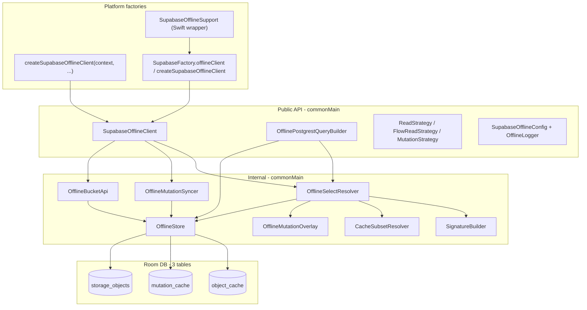
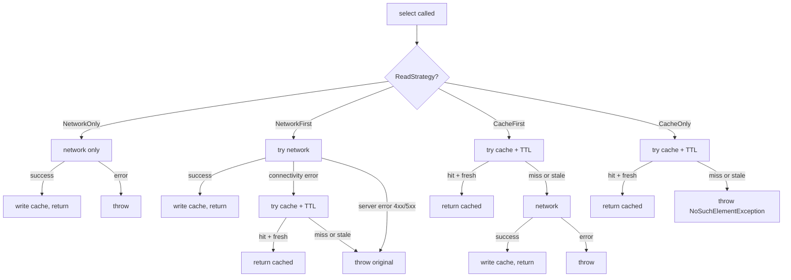

# SDK Architecture

--8<-- "docs/.snippets/legacy-notice.md"

This document explains how the Supabase Offline SDK (Kotlin Multiplatform) is structured internally — how
caching, mutation queueing, sync, and error classification are implemented across the Kotlin
Multiplatform module.

If you are looking for the **how to use it** surface (strategies, exception tables, etc.), see
[api-reference.md](../reference/supported-features.md). For the persistence layer details, see
[persistence.md](../reference/on-device-data.md).

## Contents

- [Module map](#module-map)
- [Read path (caching deep-dive)](#read-path-caching-deep-dive)
    - [Cache key: the SELECT signature](#cache-key-the-select-signature)
    - [`cacheDuration` is TTL-at-read, not TTL-at-write](#cacheduration-is-ttl-at-read-not-ttl-at-write)
    - [Subset derivation](#subset-derivation)
    - [Mutation overlay during reads](#mutation-overlay-during-reads)
    - [Read strategy state machines](#read-strategy-state-machines)
- [Write path (mutation queueing)](#write-path-mutation-queueing)
- [Sync orchestration](#sync-orchestration)
- [Network vs. server error classification](#network-vs-server-error-classification)
- [Storage cache](#storage-cache)
- [Cache eviction](#cache-eviction)

## Module map

The SDK lives entirely under `shared/src/commonMain/kotlin/io/github/nesfeder/supabase/`. Public types
sit at the package root; everything under `internal/` is implementation detail.



### Key files

| Layer | File |
|-------|------|
| Public client interface | [shared/src/commonMain/kotlin/io/github/nesfeder/supabase/SupabaseOfflineClient.kt](https://github.com/nesfeder/supabase-offline-kt/blob/9b014a795453590d7aecd704b01ca36ade8f67cb/shared/src/commonMain/kotlin/io/github/nesfeder/supabase/SupabaseOfflineClient.kt) |
| Public query builder | [shared/src/commonMain/kotlin/io/github/nesfeder/supabase/OfflinePostgrestQueryBuilder.kt](https://github.com/nesfeder/supabase-offline-kt/blob/9b014a795453590d7aecd704b01ca36ade8f67cb/shared/src/commonMain/kotlin/io/github/nesfeder/supabase/OfflinePostgrestQueryBuilder.kt) |
| Read/mutation/flow strategies | [shared/src/commonMain/kotlin/io/github/nesfeder/supabase/OperationOfflineStrategy.kt](https://github.com/nesfeder/supabase-offline-kt/blob/9b014a795453590d7aecd704b01ca36ade8f67cb/shared/src/commonMain/kotlin/io/github/nesfeder/supabase/OperationOfflineStrategy.kt) |
| Read resolver | [shared/src/commonMain/kotlin/io/github/nesfeder/supabase/internal/postgrest/OfflineSelectResolver.kt](https://github.com/nesfeder/supabase-offline-kt/blob/9b014a795453590d7aecd704b01ca36ade8f67cb/shared/src/commonMain/kotlin/io/github/nesfeder/supabase/internal/postgrest/OfflineSelectResolver.kt) |
| Signature builder | [shared/src/commonMain/kotlin/io/github/nesfeder/supabase/internal/postgrest/SignatureBuilder.kt](https://github.com/nesfeder/supabase-offline-kt/blob/9b014a795453590d7aecd704b01ca36ade8f67cb/shared/src/commonMain/kotlin/io/github/nesfeder/supabase/internal/postgrest/SignatureBuilder.kt) |
| Subset resolver | [shared/src/commonMain/kotlin/io/github/nesfeder/supabase/internal/postgrest/CacheSubsetResolver.kt](https://github.com/nesfeder/supabase-offline-kt/blob/9b014a795453590d7aecd704b01ca36ade8f67cb/shared/src/commonMain/kotlin/io/github/nesfeder/supabase/internal/postgrest/CacheSubsetResolver.kt) |
| Filter engine (overlay + replay) | [shared/src/commonMain/kotlin/io/github/nesfeder/supabase/internal/postgrest/OfflineFilters.kt](https://github.com/nesfeder/supabase-offline-kt/blob/9b014a795453590d7aecd704b01ca36ade8f67cb/shared/src/commonMain/kotlin/io/github/nesfeder/supabase/internal/postgrest/OfflineFilters.kt) |
| Central Room store | [shared/src/commonMain/kotlin/io/github/nesfeder/supabase/internal/db/OfflineStore.kt](https://github.com/nesfeder/supabase-offline-kt/blob/9b014a795453590d7aecd704b01ca36ade8f67cb/shared/src/commonMain/kotlin/io/github/nesfeder/supabase/internal/db/OfflineStore.kt) |
| Mutation overlay | [shared/src/commonMain/kotlin/io/github/nesfeder/supabase/internal/db/OfflineMutationOverlay.kt](https://github.com/nesfeder/supabase-offline-kt/blob/9b014a795453590d7aecd704b01ca36ade8f67cb/shared/src/commonMain/kotlin/io/github/nesfeder/supabase/internal/db/OfflineMutationOverlay.kt) |
| Mutation sync | [shared/src/commonMain/kotlin/io/github/nesfeder/supabase/internal/db/OfflineMutationSyncer.kt](https://github.com/nesfeder/supabase-offline-kt/blob/9b014a795453590d7aecd704b01ca36ade8f67cb/shared/src/commonMain/kotlin/io/github/nesfeder/supabase/internal/db/OfflineMutationSyncer.kt) |
| Storage bucket wrapper | [shared/src/commonMain/kotlin/io/github/nesfeder/supabase/internal/storage/OfflineBucketApi.kt](https://github.com/nesfeder/supabase-offline-kt/blob/9b014a795453590d7aecd704b01ca36ade8f67cb/shared/src/commonMain/kotlin/io/github/nesfeder/supabase/internal/storage/OfflineBucketApi.kt) |
| Error classification | [shared/src/commonMain/kotlin/io/github/nesfeder/supabase/internal/util/ThrowableExtensions.kt](https://github.com/nesfeder/supabase-offline-kt/blob/9b014a795453590d7aecd704b01ca36ade8f67cb/shared/src/commonMain/kotlin/io/github/nesfeder/supabase/internal/util/ThrowableExtensions.kt) |

## Read path (caching deep-dive)

Every cached SELECT result is stored as a row in the Room `object_cache` table, keyed by
`(table_name, signature)` and carrying the raw JSON payload plus an `updated_at` timestamp. The
relevant entity definition is in [OfflineEntities.kt](https://github.com/nesfeder/supabase-offline-kt/blob/9b014a795453590d7aecd704b01ca36ade8f67cb/shared/src/commonMain/kotlin/io/github/nesfeder/supabase/internal/db/OfflineEntities.kt):

```kotlin title="shared/src/commonMain/kotlin/io/github/nesfeder/supabase/internal/db/OfflineEntities.kt" linenums="19"
@Entity(
    tableName = "object_cache",
    primaryKeys = ["table_name", "signature"]
)
internal data class ObjectRow(
    @ColumnInfo(name = "table_name") val table: String,
    @ColumnInfo(name = "signature") val signature: String,
    /** Full JSON payload from PostgREST (usually a JSON array string). */
    @ColumnInfo(name = "payload") val payload: String,
    @ColumnInfo(name = "updated_at") val updatedAt: Long
)
```

### Cache key: the SELECT signature

The cache key for a SELECT is **not** SQL — it is a deterministic, canonicalized string built
from the PostgREST request itself. This guarantees that two semantically identical SELECTs hit
the same cache row regardless of how the call site spelled them.

`SignatureBuilder.build` accumulates the params PostgREST would have sent over the wire (filters,
order, select column list, logical groups), sorts the keys, and appends the canonicalized Range
header:

```kotlin title="shared/src/commonMain/kotlin/io/github/nesfeder/supabase/internal/postgrest/SignatureBuilder.kt" linenums="22"
internal object SignatureBuilder {

    fun build(
        table: String,
        columns: Columns = ALL,
        builderFactory: () -> SelectRequestBuilder,
        request: SelectRequestBuilder.() -> Unit
    ): String {
        val tmp = builderFactory().apply(request)
        val params: MutableMap<String, List<String>> = tmp.params.toMutableMap()
        val headers: Headers = tmp.headers.build()

        if (columns.value != ALL.value) {
            params["select"] = listOf(columns.value)
        }

        // Canonicalize params: sort keys; preserve insertion-order of values
        val query = params.keys.sorted().joinToString("&") { key ->
            val values = params[key].orEmpty()
            if (values.isEmpty()) key
            else values.joinToString("&") { v -> "$key=$v" }
        }

        // Canonicalize Range (as |range=start-end)
        val rangePart = headers["Range"]?.let { r ->
            val canon = r.removePrefix("items=")
            "|range=$canon"
        } ?: ""

        return buildString {
            append(table)
            if (query.isNotEmpty()) {
                append('?'); append(query)
            }
            append(rangePart)
        }
    }
}
```

A concrete example, from the file's KDoc:

```
assets?deleted=eq.false&name=ilike.%pump%&order=updatedAt.desc|range=0-49
```

This means: two SELECTs that differ only in the order their filters were declared still resolve
to the same cache row. Conversely, a select that adds `range(0..49)` is a **different** cache
row from one without — the cache models the wire-level request, not the table.

### `cacheDuration` is TTL-at-read, not TTL-at-write

Each `object_cache` row stores the time it was written (`updated_at`) — it does **not** store
an expiration. TTL is supplied per request by the strategy:

- `ReadStrategy.NetworkFirst(cacheDuration = 3.minutes)` — only fall back to cache rows newer
  than 3 minutes.
- `ReadStrategy.CacheFirst(cacheDuration = null)` — never expire (the default for the constructor
  without an argument).
- `ReadStrategy.CacheOnly(cacheDuration = 1.hour)` — treat anything older than 1 hour as a miss.

Because TTL lives on the **read**, not the row, two callers can disagree about whether the same
cache entry is fresh. A request with no `cacheDuration` will happily reuse a row that another
caller's stricter `cacheDuration` would consider expired.

**Stale = missing.** A stale row is treated identically to "no row" — `CacheFirst` falls back
to network, `CacheOnly` throws `NoSuchElementException`, etc.

### Subset derivation

Sometimes a narrower SELECT can be answered from a broader cached payload that already lives in
`object_cache`. Example: the list screen cached `SELECT * FROM assets ORDER BY updated_at DESC
LIMIT 50`, and now the detail screen asks for `SELECT * FROM assets WHERE id = '…'`. We have the
row in memory — we should not need the network just to filter the cached list.

This is handled by [CacheSubsetResolver.kt](https://github.com/nesfeder/supabase-offline-kt/blob/9b014a795453590d7aecd704b01ca36ade8f67cb/shared/src/commonMain/kotlin/io/github/nesfeder/supabase/internal/postgrest/CacheSubsetResolver.kt),
which (a) parses the signature back into a structured `SelectQueryMetadata` via
[SelectQueryMetadataParser.kt](https://github.com/nesfeder/supabase-offline-kt/blob/9b014a795453590d7aecd704b01ca36ade8f67cb/shared/src/commonMain/kotlin/io/github/nesfeder/supabase/internal/postgrest/parser/SelectQueryMetadataParser.kt),
(b) decides via `canProvideSubsetFor` whether a candidate cached payload could satisfy the new
request, and (c) `deriveSubsetPayload` applies the requested filters/order in memory.

Subset derivation only kicks in when the candidate payload's metadata says it's safe (no truncating
`range`, compatible select columns, etc.). When it isn't safe, the SDK falls through to the
normal network/cache miss path.

### Mutation overlay during reads

When a SELECT is served from cache while there are pending mutations for the same table, those
pending mutations are applied to the JSON payload **before it is returned to the caller**. This
preserves the optimistic-UI illusion across reads: insert a row offline, navigate to a list, and
the new row shows up.

The overlay is implemented in [OfflineMutationOverlay.kt](https://github.com/nesfeder/supabase-offline-kt/blob/9b014a795453590d7aecd704b01ca36ade8f67cb/shared/src/commonMain/kotlin/io/github/nesfeder/supabase/internal/db/OfflineMutationOverlay.kt)
(`applyPendingMutations`), driven by the filter engine in
[OfflineFilters.kt](https://github.com/nesfeder/supabase-offline-kt/blob/9b014a795453590d7aecd704b01ca36ade8f67cb/shared/src/commonMain/kotlin/io/github/nesfeder/supabase/internal/postgrest/OfflineFilters.kt):

- INSERT → row appended to the payload
- UPSERT → row appended or replaced based on `onConflict`
- UPDATE → matching rows in the payload have their fields patched
- DELETE → matching rows in the payload are removed

Matching uses `FilterEngine.matchesRow`, which re-runs the same logical operators (`eq`, `neq`,
`ilike`, etc.) that PostgREST would apply server-side.

### Read strategy state machines

All four `ReadStrategy` variants are dispatched from
[OfflineSelectResolver.select](https://github.com/nesfeder/supabase-offline-kt/blob/9b014a795453590d7aecd704b01ca36ade8f67cb/shared/src/commonMain/kotlin/io/github/nesfeder/supabase/internal/postgrest/OfflineSelectResolver.kt):

```kotlin title="shared/src/commonMain/kotlin/io/github/nesfeder/supabase/internal/postgrest/OfflineSelectResolver.kt" linenums="51"
    suspend fun select(
        columns: Columns,
        readStrategy: ReadStrategy,
        request: SelectRequestBuilder.() -> Unit
    ): PostgrestResult {
        val table = delegate.table
        sdkLogger.debug { "SELECT $table via ${readStrategy::class.simpleName}" }
        return when (readStrategy) {
            is ReadStrategy.NetworkFirst -> {
                try {
                    performNetworkSelect(table, columns, request)
                } catch (exception: Exception) {
                    if (!exception.isNetworkOrConnectivityFailure()) throw exception
                    val cached = performCacheSelect(table, columns, request, readStrategy.cacheDuration)
                    if (cached != null) {
                        sdkLogger.warning { "SELECT $table network failed, falling back to cache" }
                        cached
                    } else {
                        sdkLogger.error { "SELECT $table network failed and no cache available" }
                        throw exception
                    }
                }
            }
            ReadStrategy.NetworkOnly -> {
                performNetworkSelect(table, columns, request)
            }
            is ReadStrategy.CacheFirst -> {
                val cached = performCacheSelect(table, columns, request, readStrategy.cacheDuration)
                if (cached != null) {
                    sdkLogger.info { "SELECT $table served from cache" }
                    cached
                } else {
                    performNetworkSelect(table, columns, request)
                }
            }
            is ReadStrategy.CacheOnly -> {
                val cached = performCacheSelect(table, columns, request, readStrategy.cacheDuration)
                if (cached != null) {
                    sdkLogger.info { "SELECT $table served from cache" }
                    cached
                } else {
                    sdkLogger.error { "SELECT $table no cached data available" }
                    throw NoSuchElementException("No valid cached data found for this query")
                }
            }
        }
    }
```

Each branch in plain English:



The `FlowReadStrategy` variants (`CacheFirstThenNetwork`, `NetworkFirstThenCache`, `CacheOnly`)
are implemented just below in the same file via `cacheOnlyFlow`, `cacheFirstThenNetworkFlow`,
and `networkFirstThenCacheFlow`. They observe `object_cache` rows reactively via
`ObjectDao.observe(...)` and re-apply the mutation overlay on every emission.

## Write path (mutation queueing)

Mutations are processed by the `OfflinePostgrestQueryBuilderImpl` in
[OfflinePostgrestQueryBuilder.kt](https://github.com/nesfeder/supabase-offline-kt/blob/9b014a795453590d7aecd704b01ca36ade8f67cb/shared/src/commonMain/kotlin/io/github/nesfeder/supabase/OfflinePostgrestQueryBuilder.kt).
The rule is symmetric across `insert`, `upsert`, `update`, `delete`:

1. Try the network call against PostgREST.
2. If it **succeeds**, return the server's `PostgrestResult` as-is.
3. If it fails with a **network/connectivity error** (see classification below) AND the strategy
   is `MutationStrategy.QueueIfOffline`, persist a `MutationRow` to the `mutation_cache` table
   and return an empty synthetic result.
4. If it fails with a **server error** (4xx/5xx), the mutation is **never** queued — it's
   immediately rethrown so the caller knows it was the application's fault.

`MutationStrategy.OnlineOnly` skips step 3 entirely and rethrows network errors.

Queued mutations carry enough state to be replayed faithfully later — the raw JSON body, the
serialized filter descriptor for the WHERE clause (UPDATE/DELETE), and any insert/upsert options
(`defaultToNull`, `onConflict`, `ignoreDuplicates`). See
[OfflineEntities.kt](https://github.com/nesfeder/supabase-offline-kt/blob/9b014a795453590d7aecd704b01ca36ade8f67cb/shared/src/commonMain/kotlin/io/github/nesfeder/supabase/internal/db/OfflineEntities.kt)
for the `MutationRow` entity.

Once queued, the mutation also participates in [overlay during reads](#mutation-overlay-during-reads)
until it is synced and the original row gets refreshed.

## Sync orchestration

The SDK **never syncs in the background by itself**. Sync happens only when the application
calls one of the sync APIs on `SupabaseOfflineClient`. Both routes lead to
[OfflineMutationSyncer.kt](https://github.com/nesfeder/supabase-offline-kt/blob/9b014a795453590d7aecd704b01ca36ade8f67cb/shared/src/commonMain/kotlin/io/github/nesfeder/supabase/internal/db/OfflineMutationSyncer.kt):

- `syncAllPendingMutations()` → `OfflineMutationSyncer.syncAllTables()` — iterates every table
  with pending mutations, syncing each table independently. Errors in one table don't block
  another.
- `syncPendingMutations(table)` → `OfflineMutationSyncer.syncTable(table)` — replays mutations
  for a single table in FIFO order by `created_at_ms`.

Per-table behavior:

| Outcome of replay | Effect |
|-------------------|--------|
| Success | Mutation marked synced (`synced_at_ms` populated); count incremented |
| Network failure | Stop syncing **this table**; remaining mutations stay queued for retry |
| Permanent failure (4xx except 408/429) | Mutation dropped from queue; continue with the next |
| Unknown error in `syncPendingMutations(table)` | Rethrown to caller; mutation kept in queue |
| Unknown error in `syncAllPendingMutations()` | Swallowed per-table; other tables continue |

"Permanent failure" is decided by `Throwable.isPermanentMutationFailure()` in
[ThrowableExtensions.kt](https://github.com/nesfeder/supabase-offline-kt/blob/9b014a795453590d7aecd704b01ca36ade8f67cb/shared/src/commonMain/kotlin/io/github/nesfeder/supabase/internal/util/ThrowableExtensions.kt),
which inspects the HTTP status of `PostgrestRestException` / `ResponseException`.

Typical app pattern (from the test apps): subscribe to platform connectivity and call
`syncAllPendingMutations()` whenever the device transitions to online. See
[test-apps.md](../samples/index.md) for concrete snippets.

## Network vs. server error classification

Almost every fallback decision in the SDK gates on a single helper —
`Throwable.isNetworkOrConnectivityFailure()`:

```kotlin title="shared/src/commonMain/kotlin/io/github/nesfeder/supabase/internal/util/ThrowableExtensions.kt" linenums="79"
internal fun Throwable.isNetworkOrConnectivityFailure(): Boolean {
    // Cancellation is never treated as a network error.
    if (this is CancellationException) return false

    // Any error that already has an HTTP status is assumed to be a server
    // response (4xx/5xx etc.), not a transport/connectivity failure.
    if (httpStatusOrNull() != null) return false

    var current: Throwable? = this
    while (current != null) {
        when (current) {
            is CancellationException -> return false
            is HttpRequestTimeoutException -> return true
            is ConnectTimeoutException -> return true
            is SocketTimeoutException -> return true
            is IOException -> return true
        }

        current = current.cause
    }

    return false
}
```

The important behavioral consequence: a `PostgrestRestException` carrying a 4xx/5xx status is
**not** a network error. It will:

- Not trigger SELECT cache fallback under `NetworkFirst`.
- Not get queued under `QueueIfOffline`.
- Propagate to the caller unchanged.

This keeps the offline cache from masking real application bugs (RLS denials, schema mismatches,
constraint violations).

## Storage cache

Storage downloads (`bucket.downloadAuthenticated` / `downloadPublic`) get the same treatment as
SELECT. The wrapper is [OfflineBucketApi.kt](https://github.com/nesfeder/supabase-offline-kt/blob/9b014a795453590d7aecd704b01ca36ade8f67cb/shared/src/commonMain/kotlin/io/github/nesfeder/supabase/internal/storage/OfflineBucketApi.kt):

- Successful downloads are written to disk at `<offlineStoragePath>/storage/<bucket>/<path>`.
- The location is tracked in the Room `storage_objects` table as a `StorageRow` keyed
  `"$bucketId::$path"`.
- A subsequent download failure falls back to the disk copy if it exists; otherwise the original
  error is rethrown.
- `delete(paths)` removes both the remote object and the local cache row + file.
- `move(from, to)` keeps the local cache pointing at the new path.

See [storage.md](../behaviours/storage.md) for the user-facing API around `ensureLocalPath`,
`storageCacheMetadata`, and client-driven staleness.

## Cache eviction

`SupabaseOfflineConfig.cacheSizeBytes` (default 100 MB) caps the size of the Room database file.
Eviction is implemented in `OfflineStore.enforceDbSizeLimitIfNeeded()` and uses the settings in
[OfflineCacheSettings.kt](https://github.com/nesfeder/supabase-offline-kt/blob/9b014a795453590d7aecd704b01ca36ade8f67cb/shared/src/commonMain/kotlin/io/github/nesfeder/supabase/internal/db/OfflineCacheSettings.kt):

- `maxDbSizeBytes` — hard cap. `null` (when `cacheSizeBytes == CACHE_SIZE_UNLIMITED`) disables
  eviction entirely.
- `evictionBatchSize = 10` — number of oldest rows deleted per pass via
  `ObjectDao.deleteOldestPayloadRows`.
- `minRetainedBytes = 50 MB` — soft floor that keeps the eviction loop from wiping cached data
  under normal circumstances.

Only `object_cache` rows are evicted by size — the mutation queue and storage metadata are
considered durable user state and never thrown away by the eviction loop.
