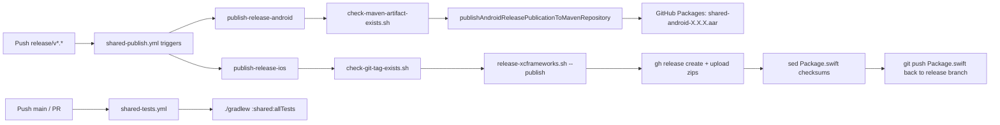

# Release Runbook

--8<-- "docs/.snippets/legacy-notice.md"

How to ship a new version of the SDK to Android (GitHub Packages) and iOS (Swift Package
Manager, backed by binary XCFrameworks attached to **GitHub Releases**).

The XCFrameworks are no longer committed to the repo. Each release uploads them to the
matching GitHub Release as `.zip` assets and `Package.swift` resolves via
`.binaryTarget(url:checksum:)`.

## Contents

- [TL;DR](#tldr)
- [CI overview](#ci-overview)
- [Prerequisites](#prerequisites)
    - [Local PAT setup (`github.properties`)](#local-pat-setup-githubproperties)
    - [Required GitHub Actions secrets](#required-github-actions-secrets)
- [Android release](#android-release)
- [iOS release](#ios-release)
- [Manual XCFramework rebuild (fallback)](#manual-release-fallback)
- [Consumer integration](#consumer-integration)
- [Notes and caveats](#notes-and-caveats)

## TL;DR

```
1. Cut release/vX.X.X off main
2. Bump `version` in shared/build.gradle.kts
3. git commit -m "Release vX.X.X" && git push -u origin release/vX.X.X
4. CI:
     - publishes the Android AAR to GH Packages
     - builds + zips both iOS XCFrameworks, creates the GitHub Release with the zips
       attached, and pushes back the updated Package.swift checksums
5. Open a PR release/vX.X.X -> main, merge
6. git tag -a X.X.X -m "vX.X.X" && git push origin --tags
```

The CI flow creates the release before the tag; the tag is added in step 6 once the PR is
merged to main.

## CI overview



Files involved:

- Publish workflow: [.github/workflows/shared-publish.yml](https://github.com/nesfeder/supabase-offline-kt/blob/9b014a795453590d7aecd704b01ca36ade8f67cb/.github/workflows/shared-publish.yml)
- Test workflow: [.github/workflows/shared-tests.yml](https://github.com/nesfeder/supabase-offline-kt/blob/9b014a795453590d7aecd704b01ca36ade8f67cb/.github/workflows/shared-tests.yml)
- Composite setup action: [.github/actions/setup-project/action.yml](https://github.com/nesfeder/supabase-offline-kt/blob/9b014a795453590d7aecd704b01ca36ade8f67cb/.github/actions/setup-project/action.yml)
- Gradle config: [shared/build.gradle.kts](https://github.com/nesfeder/supabase-offline-kt/blob/9b014a795453590d7aecd704b01ca36ade8f67cb/shared/build.gradle.kts)
- SPM manifest: [Package.swift](https://github.com/nesfeder/supabase-offline-kt/blob/9b014a795453590d7aecd704b01ca36ade8f67cb/Package.swift)
- Scripts: [scripts/](https://github.com/nesfeder/supabase-offline-kt/tree/9b014a795453590d7aecd704b01ca36ade8f67cb/scripts)

## Prerequisites

- JDK 17 (CI uses Temurin 17)
- macOS for iOS releases (the publish workflow runs `macos-26` for iOS, `macos-latest` for
  Android)
- Xcode 15+
- A GitHub Personal Access Token (PAT) with `read:packages` and `write:packages` scopes for local
  publishing experiments

### Local PAT setup (`github.properties`)

For local Gradle publishes to GitHub Packages (and for the maven existence check script), create
a `github.properties` file at the repo root:

```
username=yourGhUsername
token=ghp_yourPATValue
```

This file is gitignored. The publishing block in
[shared/build.gradle.kts](https://github.com/nesfeder/supabase-offline-kt/blob/9b014a795453590d7aecd704b01ca36ade8f67cb/shared/build.gradle.kts) only configures the GH Packages repo when
this file is present:

```kotlin title="shared/build.gradle.kts" linenums="146"
val githubProps = runCatching {
    Properties().apply {
        load(rootProject.file("github.properties").inputStream())
    }
}.onFailure {
    println("Warning: Could not load github.properties for publishing: ${it.message}. " +
            "Make sure to place the file in the root project directory with 'username' and 'token' properties.")
}.getOrNull()

if (githubProps != null) {
    publishing {
        repositories {
            maven {
                url = uri("https://maven.pkg.github.com/nesfeder/supabase-offline-kt")
                credentials {
                    username = githubProps.getProperty("username")
                    password = githubProps.getProperty("token")
                }
            }
        }
    }
}
```

### Required GitHub Actions secrets

| Secret | Used by | Purpose |
|--------|---------|---------|
| `PUBLISHING_PROPERTIES_BASE64` | `setup-project` action | Base64-encoded `github.properties`. The composite action decodes it into the repo root before Gradle runs. |

## Android release

1. **Cut a release branch** off `main`. The name must match `release/v*.*`:

    ```
    git checkout main && git pull
    git checkout -b release/v1.0.0
    ```

2. **Bump the version** in [shared/build.gradle.kts](https://github.com/nesfeder/supabase-offline-kt/blob/9b014a795453590d7aecd704b01ca36ade8f67cb/shared/build.gradle.kts) (the field on
    line 144):

    ```kotlin
    group = "io.github.nesfeder.supabase-offline-kt"
    version = "1.0.0"
    ```

3. **Commit and push:**

    ```
    git commit -am "Release v1.0.0"
    git push -u origin release/v1.0.0
    ```

4. **Wait for CI.** The `publish-release-android` job runs
    `./scripts/check-maven-artifact-exists.sh` first; if `shared-android-1.0.0.pom` already exists
    in GH Packages, the job short-circuits with `exit 78` (see
    [Notes and caveats](#notes-and-caveats)). Otherwise it runs:

    ```
    ./gradlew assembleRelease publishAndroidReleasePublicationToMavenRepository --stacktrace
    ```

5. **Verify** the artifact at
    `https://github.com/nesfeder/supabase-offline-kt/packages` —
    `io.github.nesfeder.supabase-offline-kt:shared-android:1.0.0` should appear.

## iOS release

The Android job above runs in parallel on the same release branch.

1. The `publish-release-ios` job runs `./scripts/check-git-tag-exists.sh`, then:

    ```
    ./scripts/release-xcframeworks.sh --publish
    ```

    That single script:

    - builds the KMP framework via `./gradlew :shared:assembleSupabaseOfflineReleaseXCFramework`
      (finalized by `buildSupportXCFramework` — see [shared/build.gradle.kts](https://github.com/nesfeder/supabase-offline-kt/blob/9b014a795453590d7aecd704b01ca36ade8f67cb/shared/build.gradle.kts)
      lines 129–141 — which runs [scripts/build-support-xcframework.sh](https://github.com/nesfeder/supabase-offline-kt/blob/9b014a795453590d7aecd704b01ca36ade8f67cb/scripts/build-support-xcframework.sh)
      to produce `SupabaseOfflineSupport.xcframework` from the Swift wrapper Xcode project),
    - copies both XCFrameworks into `ios/distribution/` (gitignored),
    - zips each one as `SupabaseOffline.xcframework.zip` /
      `SupabaseOfflineSupport.xcframework.zip`,
    - computes the SwiftPM-format SHA-256 checksum via `swift package compute-checksum`,
    - rewrites the `version` / `kmpChecksum` / `supportChecksum` constants at the top of
      [Package.swift](https://github.com/nesfeder/supabase-offline-kt/blob/9b014a795453590d7aecd704b01ca36ade8f67cb/Package.swift) in place,
    - calls `gh release create $VERSION --generate-notes <zips>` to create the GitHub Release
      and attach both zips (uses the workflow's `GITHUB_TOKEN`).

2. A follow-up step commits the patched `Package.swift` back to the release branch as the
    CI bot.

3. Once CI is green, **open a PR** from `release/v1.0.0` to `main`. The diff is only the
    `Package.swift` checksum bump + the Android version bump.

4. After merging, **tag the merge commit** on `main`:

    ```
    git checkout main && git pull
    git tag -a 1.0.0 -m "v1.0.0"
    git push origin --tags
    ```

SwiftPM consumers resolve `Package.swift` at the tagged commit, which contains the right URL +
checksum for the just-published GitHub Release assets.

## Manual release (fallback)

If CI is broken or you need to ship a hotfix locally, run the same script that CI uses with
the GitHub CLI authenticated against the repo (`gh auth login`):

```
git checkout release/v1.0.0
./scripts/release-xcframeworks.sh --publish    # builds, zips, publishes GH release, patches Package.swift
git add Package.swift
git commit -m "CHORE: Manual - Update Package.swift checksums for 1.0.0"
git push origin release/v1.0.0
```

To just produce the artifacts (no upload, no Package.swift edit), call the lower-level helper:

```
./scripts/build-xcframeworks-to-distribution.sh
```

That populates `ios/distribution/SupabaseOffline.xcframework` and
`SupabaseOfflineSupport.xcframework` (both gitignored) so the iOS demo's `Package.swift`
can resolve **only** if you also temporarily switch the binary targets back to `path:` mode.

## Consumer integration

### Android (Gradle)

Add the GitHub Packages Maven repo and the dependency:

```kotlin
// settings.gradle.kts
dependencyResolutionManagement {
    repositories {
        maven {
            url = uri("https://maven.pkg.github.com/nesfeder/supabase-offline-kt")
            credentials {
                username = providers.gradleProperty("gpr.user").get()
                password = providers.gradleProperty("gpr.key").get()
            }
        }
    }
}

// app/build.gradle.kts
dependencies {
    implementation("io.github.nesfeder.supabase-offline-kt:shared-android:1.0.0")
}
```

### iOS (Swift Package Manager)

Depend on the repo's root [Package.swift](https://github.com/nesfeder/supabase-offline-kt/blob/9b014a795453590d7aecd704b01ca36ade8f67cb/Package.swift). It declares two
`.binaryTarget(url:checksum:)` artifacts that resolve from the matching GitHub Release.

Consumers depend on the package URL and pin to a tag:

```swift
.package(
    url: "https://github.com/nesfeder/supabase-offline-kt.git",
    from: "1.0.0"
)
```

Then in your app target:

```swift
.product(name: "SupabaseOffline", package: "supabase-offline-kt"),
.product(name: "SupabaseOfflineSupport", package: "supabase-offline-kt"),
```

## Notes and caveats

- **`exit 78` shows as a red CI run.** Both guard scripts —
  [check-maven-artifact-exists.sh](https://github.com/nesfeder/supabase-offline-kt/blob/9b014a795453590d7aecd704b01ca36ade8f67cb/scripts/check-maven-artifact-exists.sh) and
  [check-git-tag-exists.sh](https://github.com/nesfeder/supabase-offline-kt/blob/9b014a795453590d7aecd704b01ca36ade8f67cb/scripts/check-git-tag-exists.sh) — exit with code 78 to mean
  "already published, skipping." GitHub Actions treats any non-zero exit as a step failure, so
  re-running publish on an already-published version produces a red workflow even though nothing
  actually failed. Read the step log to confirm the skip before treating it as a problem.
- **Branch name is just a trigger.** `shared-publish.yml` triggers on `release/v*.*`, but the
  actual version published comes from `shared/build.gradle.kts`. If you forget to bump it, the
  guard script will skip and nothing ships.
- **CI commits to your release branch.** The iOS job's final step pushes the patched
  `Package.swift` to `$GITHUB_REF_NAME`. Pull before further commits to the branch.
- **Stale `main` will fail `swift build`.** Between releases, `main`'s `Package.swift` still
  references the previous release's URL and checksum — that's normal. SwiftPM consumers always
  pin to a tag, never `branch: "main"`, so this only affects you when running `swift build`
  locally on the package itself.
- **Test workflow runs on `main` and PRs.** [.github/workflows/shared-tests.yml](https://github.com/nesfeder/supabase-offline-kt/blob/9b014a795453590d7aecd704b01ca36ade8f67cb/.github/workflows/shared-tests.yml)
  runs `./gradlew :shared:allTests` on every push to `main` and on every pull request. Coverage
  reporting is not wired up in this repo today — use `./gradlew :shared:koverHtmlReport`
  locally if you want a coverage report.
