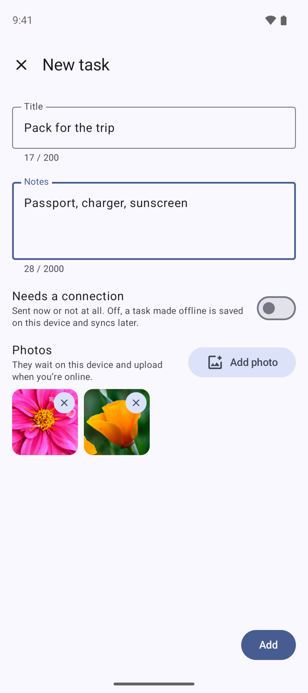
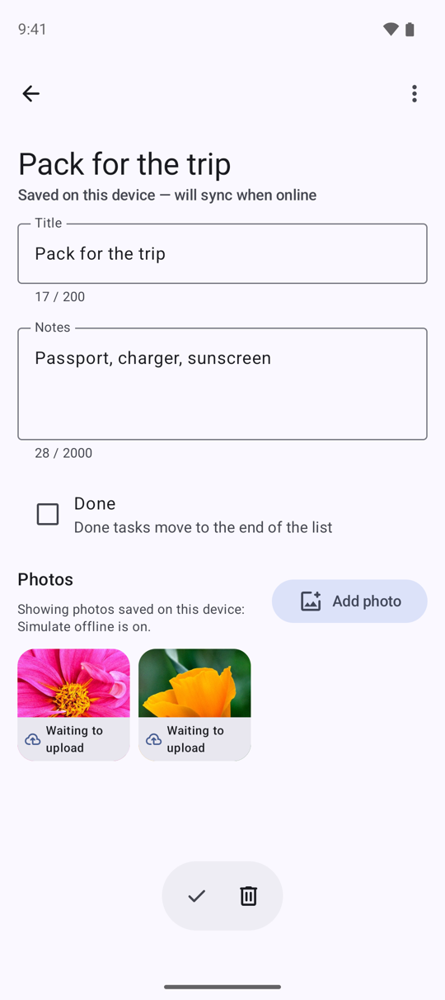
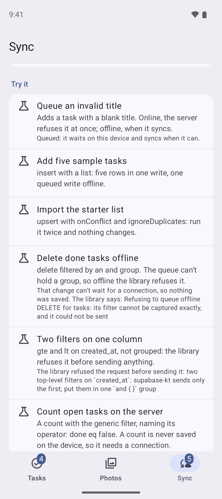

# Run the Android sample

Building and running Offline Tasks on Android, and what to try once it runs.

The app runs on the library against your own Supabase project. Its lists are live queries on the
device's cache, every change goes through the library's queue, and photos go through the offline
Storage bucket, so what you do offline reaches your project when the network comes back.

## Prerequisites

- JDK 17.
- The Android SDK with platform 37 (Android 17). Android Studio installs it.
- A device or emulator on Android 7.0 (API 24) or later. Dynamic color needs Android 12.
- A Supabase project with the samples' schema, both migration files applied: [Set up
  Supabase](supabase-setup.md). The second adds the two database functions, the Storage policy that
  lets a photo be replaced or moved, and the tables' Realtime publication.

## Add your keys

Put the project URL and its publishable key in `local.properties` at the repository root, beside
`sdk.dir` (see `local.properties.example`):

```properties
sdk.dir=/path/to/your/Android/sdk
SUPABASE_URL=https://<ref>.supabase.co
SUPABASE_PUBLISHABLE_KEY=sb_publishable_…
```

Git ignores `local.properties`, so the keys never reach a commit. The build copies them into the
app's `BuildConfig`. Without them the app still builds, and opens on a screen that names the two
keys to add.

## Build and run

From the repository root, with a device connected or an emulator running:

```bash
./gradlew :samples:android:installDebug
```

Or open the repository in Android Studio and run the app module in `samples/android`.

The sample takes the library from Maven Central, as your app does:
`io.github.nesfeder.supabase-offline:supabase-offline-kt`, with `supabase-offline-kt-testing` for its
tests, at the release `supabase-offline` names in `gradle/libs.versions.toml`. Each release moves it
to the version just published. On `main`, and at a release's tag until the pull request that follows
the release moves the pin, the sample's code can use API newer than the release it pins: if the
default build does not compile, [build on this checkout](#build-on-this-checkout) instead.

The first launch signs in anonymously and opens on an empty list: add a task with **New task**.
Every row and photo belongs to that anonymous user, and the session is kept on the device, so the
next launch is the same user, offline too.

If the device is offline on the very first launch, there is no user yet. The list says it is not
signed in, and **New task** and the Sync tab's **Queue an invalid title** are switched off: every
row needs its user, and only the server can create one. The app signs in as soon as it reaches
the internet.

{ width="270" loading=lazy }

## Build on this checkout

To run the sample against the library in this checkout instead, pass `-PsupabaseOffline.local=true`.
It builds the sample on the repository's own two modules in place of the published artifacts, which
is how CI builds and tests it:

```bash
./gradlew :samples:android:installDebug -PsupabaseOffline.local=true
```

In Android Studio, add `supabaseOffline.local=true` to `gradle.properties` in your Gradle user home
(`~/.gradle`), and sync.

## Things to try

### Go offline and keep working

On the Sync tab, switch on **Simulate offline**. It cuts this app off from the server, as airplane
mode would, until you switch it back or the app restarts; the rest of the device stays online.

Now add a task, clear another's notes, tick one done and delete one. Each change shows at once.
A cloud mark on a row means its change has not reached the server yet; the banner and the Sync
tab's badge count the changes waiting. Pull to refresh, and the caption under the title says the
list is from this device, and how old it is. A task you have never opened still opens offline: it
is read from the list the device already holds.

{ width="270" loading=lazy }

### Come back and watch it send

The Sync tab counts the changes waiting per table and lists each one, with **Discard** to throw it
away unsent. **Sync now** needs the network, so offline it is switched off.

Switch **Simulate offline** off. The changes are sent in the order you made them, and the count
drops to **Nothing waiting**. To see the server's copy, use **Clear local cache** under **Local
data**: it deletes what the device holds, then reads both lists again from your project.

Closing the app while offline loses nothing either: the queue is kept on the device and sent on
the next launch that has the network.

{ width="270" loading=lazy }

### Queue an invalid title

The schema refuses a blank title. Under **Try it**, **Queue an invalid title** adds a task with
one.

Online, the server refuses it as soon as it is sent: the app says why in a message, and nothing is
kept. Offline, it waits in the queue like any other change. When it is sent the server refuses it
(HTTP 400, Postgres code 23514), and it moves to **Refused changes** with the server's answer.
**Retry** sends it again; **Dismiss** removes it.

{ width="270" loading=lazy }

### Conflicting changes

The client names `updated_at` as the version column of both tables and sets a resolver that holds
a title both sides changed. Such a change waits under **Conflicting changes**, between Refused
changes and Server, with the title on the server beside this device's, when it was made and held,
**Keep mine** (send it over the server's row as it is now; off when the task is gone or the change
was too long to keep) and **Keep theirs** (drop it). The Sync badge counts it with the refused ones,
and the last report's line says how many conflicts were settled, kept the server's or held. **Make
a conflict**, under Try it, gives the two-writers recipe: the app ships no stand-in server, so
the second writer is your project's Table Editor
([Try a conflict](tour.md#try-a-conflict)).

### Attach a photo

Open a task and tap **Add photo**, or add photos as you create a task with **New task**'s **Add
photo**, several at once. A photo shows at once, from the device, marked while it waits or
uploads, with the upload's progress. Once it is uploaded the library's file cache keeps it, so it
still shows offline: the Photos tab marks it available offline.

{ width="270" loading=lazy }
{ width="270" loading=lazy }

The library never queues a Storage write, so the app keeps its own queue: a photo added offline
(Simulate offline on, say) waits on the device, marked "Waiting to upload", and uploads when the
network comes back, its row written only once Storage has the file. One that fails says why, with
**Retry**, and **Remove** to give it up. Until it is uploaded, the viewer offers Share and Remove
for it but not Details, Share link, Replace, Move or Duplicate. Those, and Delete for an uploaded
photo, need the network: offline they are switched off.

{ width="270" loading=lazy }

### Search, filter and refresh

The search field and the All / Open / Done / Recent chips are filters the server applies, and each
one is saved on the device on its own once it has been asked online. Offline, a search or a chip
you never used online has nothing saved, and the list says so. On the Sync tab, **Prefer fresh
data** makes the list ask the server first rather than show the device's copy first.

### Live updates

With **Live updates** on, the default, a change made elsewhere (in the Table Editor, say) shows in
the list as it happens: the app names its two tables in the plugin's configuration, and the plugin
keeps their cached lists current through Realtime. The Sync tab says where the channel stands
(waiting for a user or the network, connecting, connected, or failed and trying again); Simulate
offline and a lost network pause it, and it connects again, reading both lists afresh, when the
network is back. The switch is the plugin's own `disableRealtime()` and `enableRealtime()`.

### Photos, beyond the upload

Open a photo. **Details** shows what Storage holds for it and the copy on this device. **Share**
sends the photo, **Share link** a link to a 512-pixel copy (a project without image
transformations answers that link with an error), and the menu replaces the photo, moves it to
another task or adds a copy to one. The Sync tab's **Storage** section lists your folders in the
bucket, and **Upload through a signed URL** copies your newest photo through one.

### The server's side

The Tasks menu's **Mark all done** and the Sync tab's **Server** section call the samples' two
database functions; Server also counts your tasks. Functions and counts always ask the server:
offline, the app says why they cannot run.

### Try it

Besides **Queue an invalid title**, the Sync tab's **Try it** adds five sample tasks in one write,
imports a starter list that a second import leaves as it is, makes a grouped delete offline that
the library refuses, makes a read with two filters on one column that it refuses too, and counts
the open tasks on the server. Each says which call it made and what happened.

{ width="270" loading=lazy }

### Start over

**Start over**, under **Local data**, holds photo uploads (waiting for one in progress), clears the
device, deletes this user's photos, photo rows and tasks from your project, with any file a waiting
photo already stored, deletes the photos waiting to upload, and signs in as a new anonymous user
with an empty list. It needs the network: an anonymous user cannot sign back in to reach what it
left behind, so offline it refuses and deletes nothing.
**Clear local cache** deletes what the device holds, the queue and the photos waiting to upload
included, then reads both lists again from your project.

## Troubleshooting

- **The app says there is no Supabase project yet.** `local.properties` has no `SUPABASE_URL` or
  `SUPABASE_PUBLISHABLE_KEY`. Add them and build again.
- **It cannot sign in.** Check that anonymous sign-ins are on (Authentication, Sign In /
  Providers) and that the project is not paused: a free project pauses after a week without
  activity ([If the project pauses](supabase-setup.md#if-the-project-pauses)). The app tries
  again each time the network comes back; until then the list says it is not signed in yet.
- **A photo will not upload.** Check that the `task-photos` bucket exists, private, as
  [Set up Supabase](supabase-setup.md) creates it. The photo is marked "Upload failed" with the
  app's sentence for Storage's answer. A missing bucket reads as "This photo's file is missing" and
  is tried again once the bucket exists, on **Retry** or when the network next comes back. A photo
  Storage's policies refused stays failed with Retry switched off: remove it, fix the policy, and
  add it again.
- **Mark all done or the Server section fails, or Replace and Move photo are refused.** The second
  migration file is not applied: run it as [Set up Supabase](supabase-setup.md#apply-the-schema)
  says.
- **Live updates says it couldn't connect, or changes from elsewhere never show.** Check that the
  second migration file added `tasks` and `task_photos` to the `supabase_realtime` publication
  (Database, Publications, in the dashboard). Without it, Realtime refuses the subscription, or
  sends nothing, and the plugin keeps trying to join again.
- **The build asks for platform 37.** Install Android SDK Platform 37 in Android Studio's SDK
  Manager.
