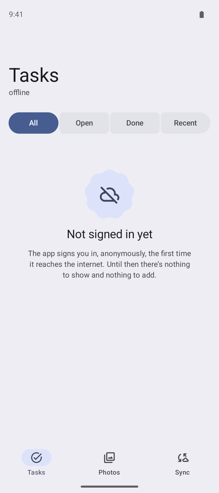
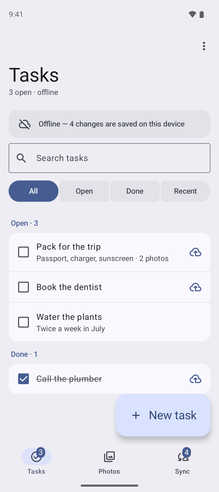
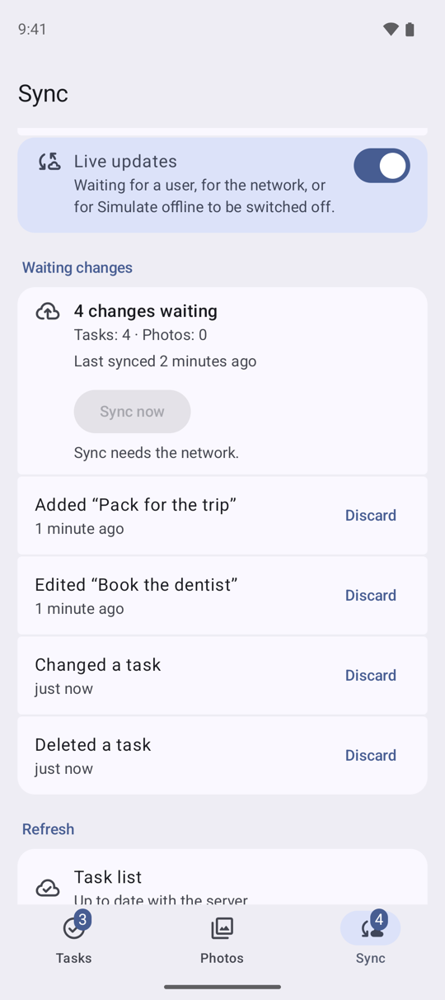
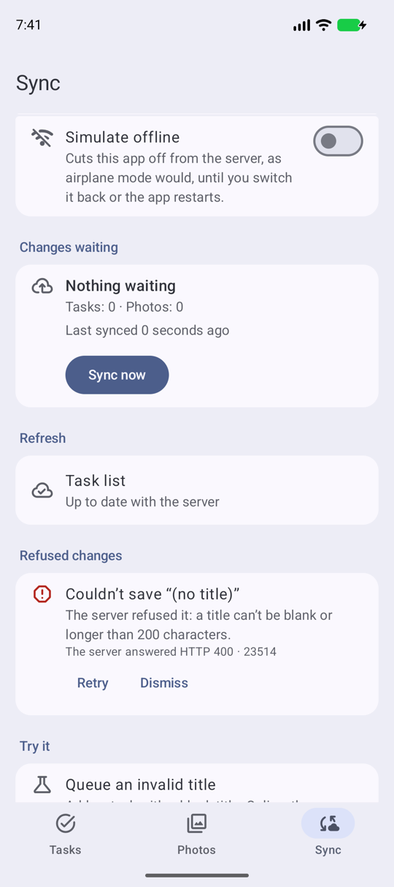
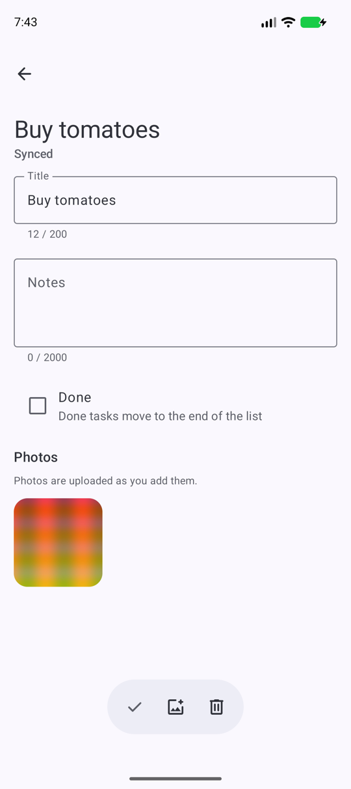

# Run the Android sample

Building and running Offline Tasks on Android, and what to try once it runs.

The app runs on the library against your own Supabase project. Its lists are live queries on the
device's cache, every change goes through the library's queue, and photos go through the offline
Storage bucket, so what you do offline reaches your project when the network comes back.

## Prerequisites

- JDK 17.
- The Android SDK with platform 37 (Android 17). Android Studio installs it.
- A device or emulator on Android 7.0 (API 24) or later. Dynamic color needs Android 12.
- A Supabase project with the samples' schema, both migration files applied: [Set up
  Supabase](supabase-setup.md). The second adds the two database functions, the Storage policy that
  lets a photo be replaced or moved, and the tables' Realtime publication.

## Add your keys

Put the project URL and its publishable key in `local.properties` at the repository root, beside
`sdk.dir` (see `local.properties.example`):

```properties
sdk.dir=/path/to/your/Android/sdk
SUPABASE_URL=https://<ref>.supabase.co
SUPABASE_PUBLISHABLE_KEY=sb_publishable_…
```

Git ignores `local.properties`, so the keys never reach a commit. The build copies them into the
app's `BuildConfig`. Without them the app still builds, and opens on a screen that names the two
keys to add.

## Build and run

From the repository root, with a device connected or an emulator running:

```bash
./gradlew :samples:android:installDebug
```

Or open the repository in Android Studio and run the app module in `samples/android`.

The first launch signs in anonymously and opens on an empty list: add a task with **New task**.
Every row and photo belongs to that anonymous user, and the session is kept on the device, so the
next launch is the same user, offline too.

If the device is offline on the very first launch, there is no user yet. The list says it is not
signed in, and **New task** and the Sync tab's **Queue an invalid title** are switched off: every
row needs its user, and only the server can create one. The app signs in as soon as it reaches
the internet.

{ width="270" loading=lazy }

## Things to try

### Go offline and keep working

On the Sync tab, switch on **Simulate offline**. It cuts this app off from the server, as airplane
mode would, until you switch it back or the app restarts; the rest of the device stays online.

Now add a task, clear another's notes, tick one done and delete one. Each change shows at once.
A cloud mark on a row means its change has not reached the server yet; the banner and the Sync
tab's badge count the changes waiting. Pull to refresh, and the caption under the title says the
list is from this device, and how old it is. A task you have never opened still opens offline: it is read from the list
the device already holds.

{ width="270" loading=lazy }

### Come back and watch it send

The Sync tab counts the changes waiting per table and lists each one, with **Discard** to throw it
away unsent. **Sync now** needs the network, so offline it is switched off.

Switch **Simulate offline** off. The changes are sent in the order you made them, and the count
drops to **Nothing waiting**. To see the server's copy, use **Clear local cache** under **Local
data**: it deletes what the device holds, then reads both lists again from your project.

Closing the app while offline loses nothing either: the queue is kept on the device and sent on
the next launch that has the network.

{ width="270" loading=lazy }

### Queue an invalid title

The schema refuses a blank title. Under **Try it**, **Queue an invalid title** adds a task with
one.

Online, the server refuses it as soon as it is sent: the app says why in a message, and nothing is
kept. Offline, it waits in the queue like any other change. When it is sent the server refuses it
(HTTP 400, Postgres code 23514), and it moves to **Refused changes** with the server's answer.
**Retry** sends it again; **Dismiss** removes it.

{ width="270" loading=lazy }

### Attach a photo

Online, open a task and tap **Add photo**. The upload shows its progress, and the photo joins the
task once its row is saved. Once a photo has been shown it stays on the device: the Photos tab
marks it available offline.

Storage changes are never queued. Offline, **Add photo** and **Delete photo** are switched off,
and the photos already on the device still show.

{ width="270" loading=lazy }

### Search, filter and refresh

The search field and the All / Open / Done / Recent chips are filters the server applies, and each
one is saved on the device on its own once it has been asked online. Offline, a search or a chip
you never used online has nothing saved, and the list says so. On the Sync tab, **Prefer fresh
data** makes the list ask the server first rather than show the device's copy first.

### Live updates

With **Live updates** on, the default, a change made elsewhere (in the Table Editor, say) shows in
the list as it happens. The Sync tab says whether the Realtime channel is connected; Simulate
offline pauses it.

### Photos, beyond the upload

Open a photo. **Details** shows what Storage holds for it and the copy on this device. **Share**
sends the photo, **Share link** a link to a 512-pixel copy (a project without image
transformations answers that link with an error), and the menu replaces the photo, moves it to
another task or adds a copy to one. The Sync tab's **Storage** section lists your folders in the
bucket, and **Upload through a signed URL** copies your newest photo through one.

### The server's side

The Tasks menu's **Mark all done** and the Sync tab's **Server** section call the samples' two
database functions; Server also counts your tasks. Functions and counts always ask the server:
offline, the app says why they cannot run.

### Try it

Besides **Queue an invalid title**, the Sync tab's **Try it** adds five sample tasks in one write,
imports a starter list that a second import leaves as it is, makes a grouped delete offline that
the library refuses, makes a read with two filters on one column that it refuses too, and counts
the open tasks on the server. Each says which call it made and what happened.

### Start over

**Start over**, under **Local data**, deletes this user's photos, photo rows and tasks from your
project, clears the device, and signs in as a new anonymous user with an empty list. It needs the
network: an anonymous user cannot sign back in to reach what it left behind, so offline it
refuses and deletes nothing.

## Troubleshooting

- **The app says there is no Supabase project yet.** `local.properties` has no `SUPABASE_URL` or
  `SUPABASE_PUBLISHABLE_KEY`. Add them and build again.
- **It cannot sign in.** Check that anonymous sign-ins are on (Authentication, Sign In /
  Providers) and that the project is not paused: a free project pauses after a week without
  activity ([If the project pauses](supabase-setup.md#if-the-project-pauses)). The app tries
  again each time the network comes back; until then the list says it is not signed in yet.
- **A photo will not upload.** Check that the `task-photos` bucket exists, private, as
  [Set up Supabase](supabase-setup.md) creates it. The app shows Storage's own answer.
- **Mark all done or the Server section fails, or Replace and Move photo are refused.** The second
  migration file is not applied: run it as [Set up Supabase](supabase-setup.md#apply-the-schema)
  says.
- **Live updates stays at "Connecting to Realtime…", or changes from elsewhere never show.** Check
  that the second migration file added `tasks` and `task_photos` to the `supabase_realtime`
  publication (Database, Publications, in the dashboard). Without it, Realtime refuses the
  subscription and the app keeps trying to join again.
- **The build asks for platform 37.** Install Android SDK Platform 37 in Android Studio's SDK
  Manager.
