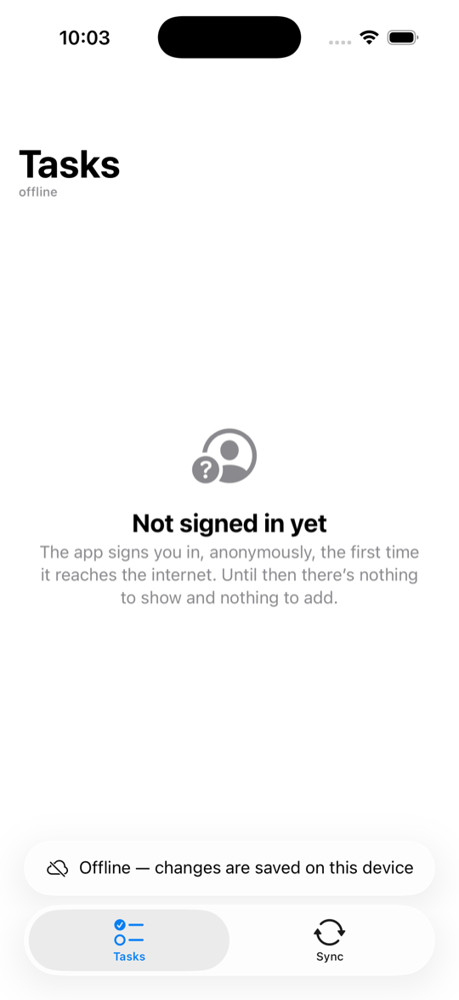
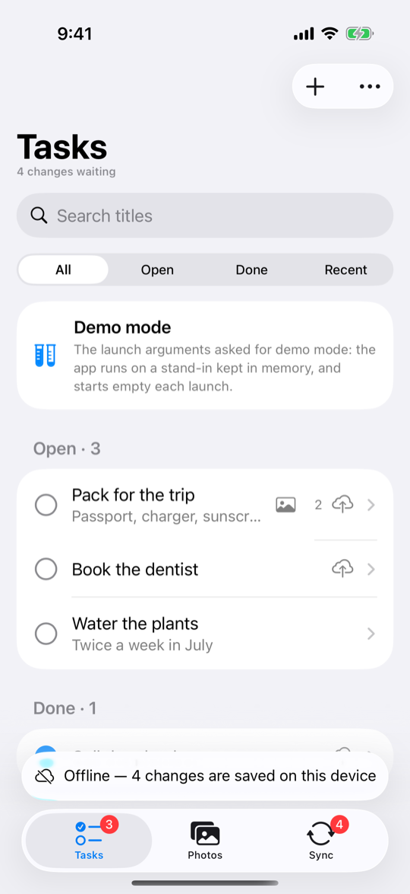
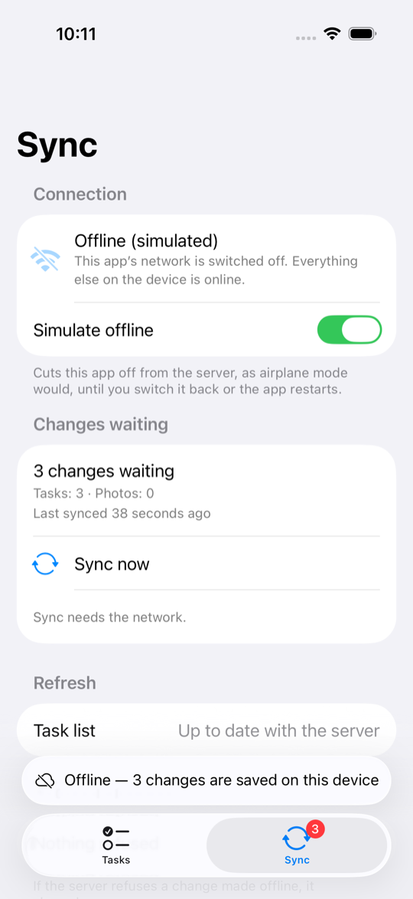
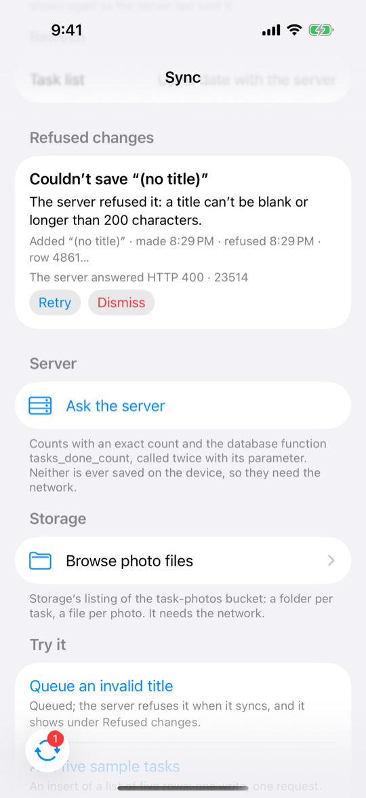
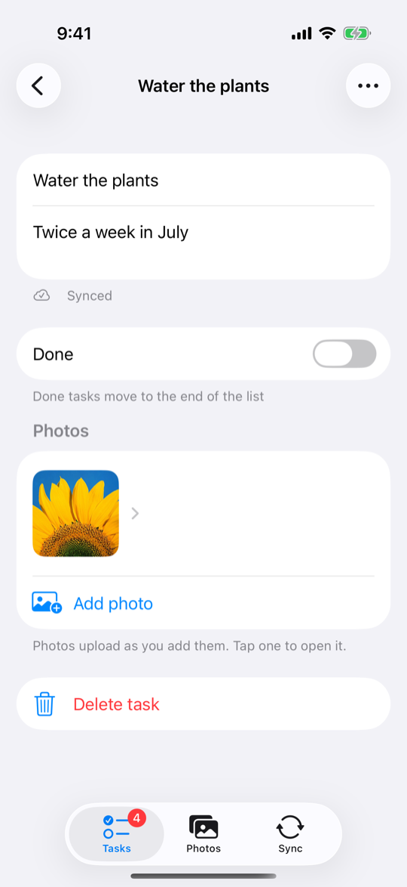

# Run the iOS sample

Building and running Offline Tasks on iOS, and what to try once it runs.

The app is SwiftUI on the Swift package, against your own Supabase project. Its lists are live
queries on the device's cache, every change goes through the package's queue, and photos go through
the offline Storage bucket, so what you do offline reaches your project when the network comes back.
It is the same app as [the Android sample](android.md), with the same screens and words, in iOS's
own idiom.

## Prerequisites

- A Mac with Apple silicon, and Xcode 26 or later.
- An iOS 26 simulator, or a device on iOS 26. Simulators run arm64 only: the project builds for
  Apple silicon simulators and leaves out Intel ones.
- JDK 17, to build the package's prebuilt library from this checkout (see below).
- A Supabase project with the samples' schema: [Set up Supabase](supabase-setup.md). Without one,
  the app runs in [demo mode](#demo-mode).

## Add your keys

Copy `samples/ios/Configuration/Secrets.xcconfig.example` to `Secrets.xcconfig` beside it, and put
in the project URL and its publishable key:

```text
SUPABASE_URL = <ref>.supabase.co
SUPABASE_PUBLISHABLE_KEY = sb_publishable_…
```

The URL has no `https://`, because `//` starts a comment in an xcconfig file; the app adds it. Git
ignores `Secrets.xcconfig`, so the keys never reach a commit. The build puts them in the app's
`Info.plist`. Without them the app still builds, and opens in demo mode.

## Build the package from this checkout

The app depends on the Swift package in `swift/` by its path, so it always builds against the code
beside it. The package wraps a prebuilt library that the release ships; from a checkout you build it
yourself, once, and again after a change outside `swift/`. From the repository root:

```bash
scripts/prepare-local-swift-package.sh
```

It builds the library with Gradle (JDK 17; the first build downloads its toolchain, which takes a
few minutes) and copies it into `swift/LocalCore`, which git ignores. In a checkout the package
always takes the library from there, so run the script before you build.

## Build and run

Open `samples/ios/OfflineTasks.xcodeproj` in Xcode, choose the **OfflineTasks** scheme and an iOS 26
simulator, and run.

From the command line:

```bash
cd samples/ios
xcodebuild build -project OfflineTasks.xcodeproj -scheme OfflineTasks \
    -destination 'platform=iOS Simulator,name=iPhone 17'
```

The tests, model tests on the testing product's in-memory client and one UI test, run in demo mode
and reach no project:

```bash
scripts/test-ios-sample.sh --simulator <simulator UDID> --derived-data <a scratch folder>
```

To run on a device, add your team and a bundle identifier of your own to `Secrets.xcconfig`
(`DEVELOPMENT_TEAM` and `OFFLINE_TASKS_BUNDLE_IDENTIFIER`; the example file shows both).

The first launch signs in anonymously and opens on an empty list: add a task with the **+** button.
Every row and photo belongs to that anonymous user, and supabase-swift keeps the session in the
Keychain, so the next launch is the same user, offline too.

If the device is offline on the very first launch, there is no user yet. The list says it is not
signed in, the **+** button is hidden, and the Sync tab's **Queue an invalid title** is switched
off: every row needs its user, and only the server can create one. The app signs in as soon as it reaches the
internet.

{ width="270" loading=lazy }

## Demo mode

Without keys, the app runs on the package's testing product: the in-memory client, talking to a
stand-in for the samples' project that the app carries (`Demo/DemoServer.swift`). The stand-in keeps
the schema's rules (each user reaches only their own rows and files, a blank title is refused, a
photo is one JPEG at its owner's path), so everything below works, but nothing is kept between
launches. The Tasks list and the Sync tab say when the app is in demo mode. The UI test and Xcode's
previews use the same stand-in; the launch argument `-demo-mode` opens it whatever the keys say.

## Things to try

### Go offline and keep working

On the Sync tab, switch on **Simulate offline**. It cuts this app off from the server, as airplane
mode would, until you switch it back or the app restarts; the rest of the device stays online.

Now add a task, clear another's notes, tick one done and swipe one away. Each change shows at once.
A cloud mark on a row means its change has not reached the server yet; the status above the tab bar
and the Sync tab's badge count the changes waiting. Pull to refresh, and the app says it is showing
what is saved on the device. A task you have never opened still opens offline: it is read from the
list the device already holds.

{ width="270" loading=lazy }

### Come back and watch it send

The Sync tab lists the changes waiting, per table. **Sync now** needs the network, so offline it
is switched off.

Switch **Simulate offline** off. The changes are sent in the order you made them, and the count
drops to **Nothing waiting**. To see the server's copy, use **Clear local cache** under **Local
data**: it deletes what the device holds, then reads the list again from your project.

Closing the app while offline loses nothing either: the queue is kept on the device and sent on
the next launch that has the network. Simulate offline does not outlive the app, and a simulator
has no airplane mode, so to launch with no network at all, turn off the Mac's Wi-Fi (the simulator
shares it), or use airplane mode on a device.

{ width="270" loading=lazy }

### Queue an invalid title

The schema refuses a blank title. Under **Try it**, **Queue an invalid title** adds a task with
one.

Online, the server refuses it as soon as it is sent: the app says why in an alert, and nothing is
kept. Offline, it waits in the queue like any other change. When it is sent the server refuses it
(HTTP 400, Postgres code 23514), and it moves to **Refused changes** with the server's answer; an
alert says so, and its **View** opens them. **Retry** sends it again; **Dismiss** removes it.

{ width="270" loading=lazy }

### Attach a photo

Online, open a task and tap **Add photo** in the bottom toolbar. The app turns the picked image into
one JPEG under 5 MB and uploads it, and the photo joins the task once its row is saved. Once a photo
has been shown it stays on the device.

Storage changes are never queued. Offline, **Add photo** is switched off and the Photos section
says why; **Delete photo**, on a long press, is switched off too. The photos already on the device
still show.

{ width="270" loading=lazy }

### Start over

**Start over**, under **Local data**, starts again as a new anonymous user with an empty list. In
this order, it discards the changes not synced yet, deletes this user's photos, photo rows and
tasks from your project, turns the client's network off, signs out, clears the device, signs in as
the new user, and turns the network back on. It needs the network: an anonymous user cannot sign
back in to reach what it left behind, so offline, Simulate offline included, it refuses and changes
nothing.

The network is off from before the sign-out until the new user is signed in, so the Sync tab shows
**Offline (simulated)** for that moment. A list still open on screen fetches its rows again as soon
as the device is cleared, with whatever token the app hands the client then; with the old user's,
their rows would be back on the device for the next user to read. With the network off nothing is
fetched until the new user's token is the one handed over.

## How the app uses the package

- **One client, made at launch** (`App/AppModel.swift`) and shared by every screen. Every call the
  app makes to it is in `Data/TaskRepository.swift`: `selectAsSequence` for the live lists,
  `insert` / `update` / `delete` through the queue, `pendingMutations` for the per-row marks,
  `syncStatus`, `syncPendingMutations`, `rejectedMutations`, `disableNetwork` / `enableNetwork`,
  `clearLocalData`, and the offline bucket's `upload`, `remove`, `cachedFile` and
  `ensureCachedFile`.
- **The user comes from the token alone.** supabase-swift's Auth signs in anonymously
  (`Data/AnonymousSession.swift`), and the client receives its access token through
  `Config.accessToken`. The client cannot tell one user's cached rows and queued writes from
  another's, so Start over turns the network off, signs out, clears local data, signs in the new
  user, and only then turns the network back on, as the Swift guide's "When the user changes" does.
  Model tests pin that nothing of the first user is sent or shown afterward, with a list left open
  throughout.
- **Ids are made on the device, in lower case** (`uuidString.lowercased()`): Postgres writes a UUID in
  lower case, and the schema compares photo paths as text. Object names hold no `%`, `?` or `#`.
- **A private photo is downloaded only once a user is signed in.** Without the user's token Storage
  answers "not found", which would drop a copy kept on the device.

## Troubleshooting

- **The app says it is in demo mode.** `Secrets.xcconfig` is missing, is not beside the example
  file, or lacks one of the two keys. Add them and build again.
- **Xcode cannot resolve the SupabaseOffline package**: a local binary target under
  `swift/LocalCore` "does not contain a binary artifact". The library is not built yet: run
  `scripts/prepare-local-swift-package.sh`. If Xcode already has the project open, choose **File >
  Packages > Resolve Package Versions**, or close the project and open it again.
- **A build for an Intel simulator fails.** The package's library has arm64 simulator code only:
  build on Apple silicon, for a simulator or with `ARCHS=arm64`.
- **It cannot sign in.** Check that anonymous sign-ins are on (Authentication, Sign In /
  Providers) and that the project is not paused ([If the project pauses](supabase-setup.md#if-the-project-pauses)).
  The app tries again each time the network comes back; until then the list says it is not signed
  in yet.
- **A photo will not upload.** Check that the `task-photos` bucket exists, private, as
  [Set up Supabase](supabase-setup.md) creates it. The app shows Storage's own answer.
- **A device build fails to sign.** Add `DEVELOPMENT_TEAM` and a bundle identifier of your own to
  `Secrets.xcconfig`.
